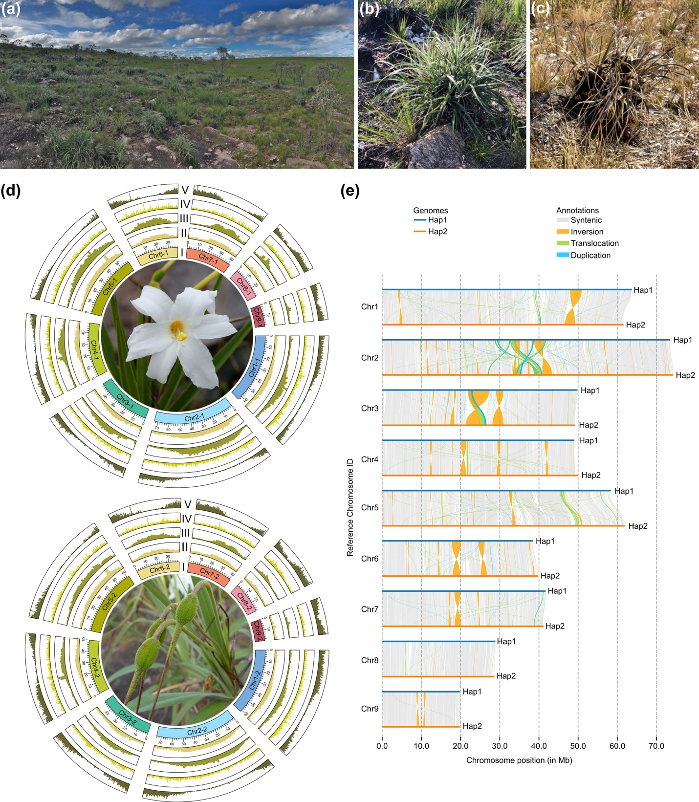
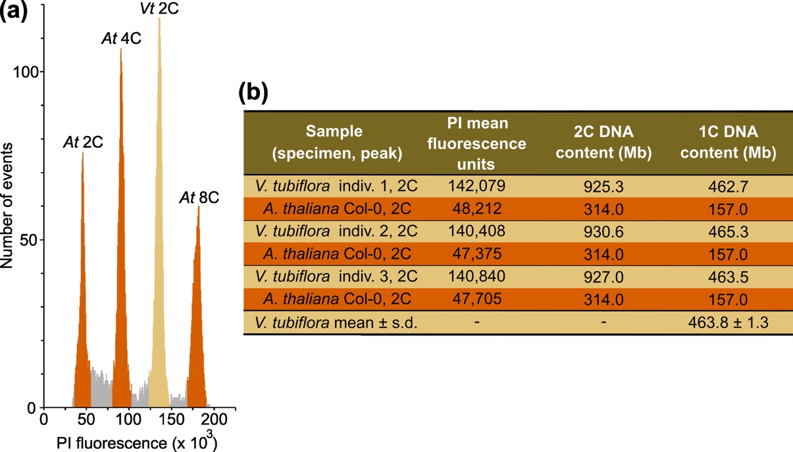
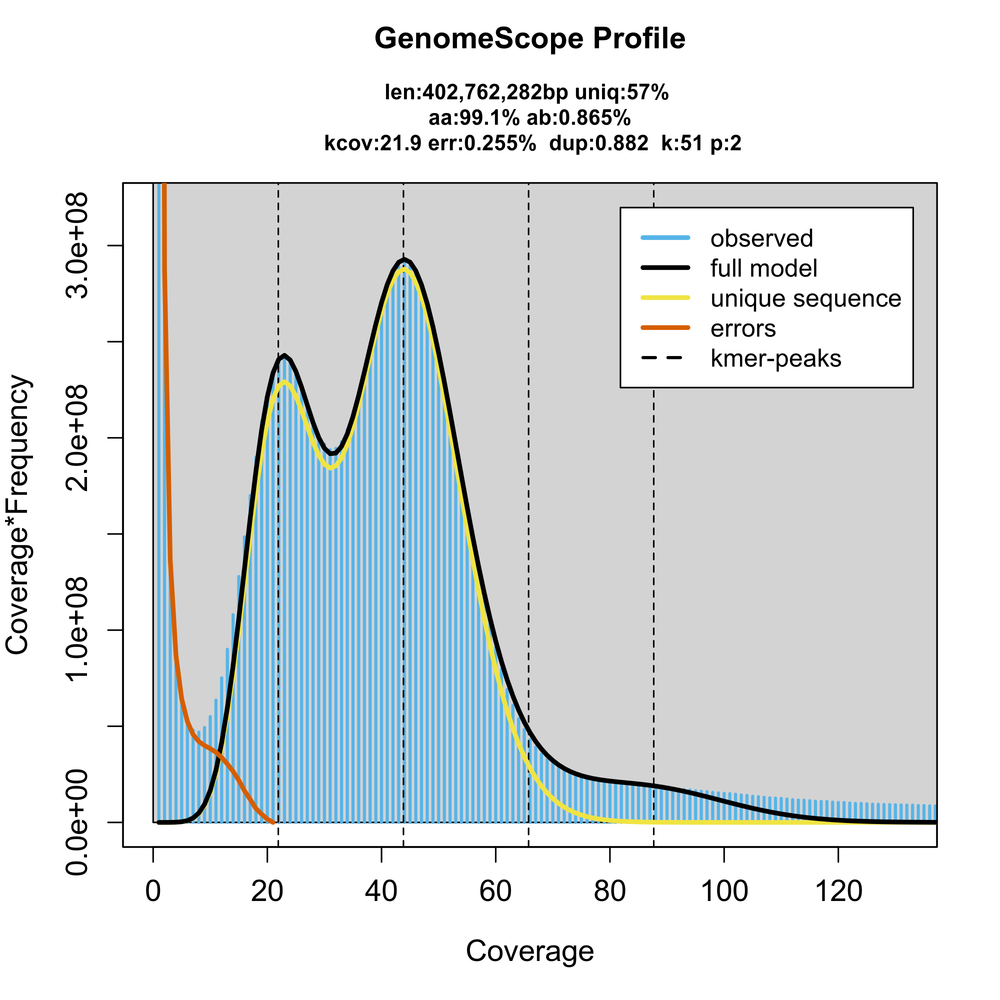

# Chapter 1

## A Haplotype-Resolved, Near Telomere-to-Telomere Genome Assembly of the Desiccation-Tolerant Plant *Vellozia tubiflora*

**Authors:**  
Francine A. N. de Almeida$^{1,2,*}$, Nicholas A. Allsing$^{3,*}$, Marina P. Marone$^{1,2,4}$, **Mariana F. Cavalheiro**$^{1,5}$, Lucas E. C. Canesin$^{1,2}$, Merly Escalona$^{6,7}$, Oanh H. Nguyen$^{8}$, Ruta Sahasrabudhe$^{8}$, Diego Riaño-Pachón$^{9}$, Stephen Richards$^{10}$, Harris A. Lewin$^{11}$, Paulo Arruda$^{1,2,5}$, Todd P. Michael$^{3,12,13,14}$, Ricardo A. Dante$^{1,2,4}$, and Isabel R. Gerhardt$^{1,2,4,**}$

**Affiliations:**  
$^{1}$ Centro de Pesquisa em Genômica Aplicada às Mudanças Climáticas (GCCRC), Universidade Estadual de Campinas (UNICAMP), Campinas, SP, 13083-875, Brazil  
$^{2}$ Centro de Biologia Molecular e Engenharia Genética (CBMEG), Universidade Estadual de Campinas (UNICAMP), Campinas, SP, 13083-875, Brazil  
$^{3}$ Plant Molecular and Cellular Biology, Salk Institute for Biological Sciences, La Jolla, CA, 92037, USA  
$^{4}$ Embrapa Agricultura Digital, Campinas, SP, 13083-886, Brazil  
$^{5}$ Departamento de Genética, Evolução, Microbiologia e Imunologia, Instituto de Biologia, Universidade Estadual de Campinas (UNICAMP), Campinas, SP, 13083-970, Brazil  
$^{6}$ Institute for Systems Genomics, University of Connecticut, Storrs, CT, 06269, USA  
$^{7}$ Department of Biomolecular Engineering, University of California, Santa Cruz, Santa Cruz, CA, 95064, USA  
$^{8}$ DNA Technologies and Expression Analysis Core Laboratory, Genome Center, University of California, Davis, CA, 95616, USA  
$^{9}$ Centro de Energia Nuclear na Agricultura, Universidade de São Paulo, Piracicaba, SP, 13400-970, Brazil  
$^{10}$ Department of Entomology and Nematology, University of California, Davis, Davis, CA, 95616, USA  
$^{11}$ Julie Ann Wrigley Global Futures Laboratory, Walton Center for Planetary Health, Arizona State University, Tempe, AZ, 85287, USA  
$^{12}$ Department of Cell and Developmental Biology, School of Biological Sciences, University of California, San Diego, La Jolla, CA, 92093, USA  
$^{13}$ Center for Marine Biotechnology and Biomedicine, Scripps Institution of Oceanography, University of California, San Diego, La Jolla, CA, 92037, USA  
$^{14}$ Department of Science and Conservation, San Diego Botanic Garden, Encinitas, CA, 92024, USA  

$^{*}$ These authors contributed equally to this work.  
$^{**}$ Author for correspondence: Isabel R. Gerhardt (isabel.gerhardt@embrapa.br).

### Chapter Contextualization and Publication Statement

> This chapter is prepared for submission as a *Genome Report* to *Genome Biology and Evolution* (Oxford Academic / Society for Molecular Biology and Evolution). It establishes the phased, chromosome-scale, near telomere-to-telomere (*near-T2T*) reference nuclear genome for the desiccation-tolerant resurrection plant *Vellozia tubiflora*, providing the foundational chromosomal architecture that anchors the comparative investigations developed throughout this thesis. Specifically, this assembly provides the nuclear baseline required to isolate and resolve complete plastid and mitochondrial genomes in Chapter 2, reconstruct chromosome-scale macro-synteny and gene-family turnover relative to the evergreen congener *V. peripherica* in Chapter 3, and resolve the physical gene clusters, promoter architecture, and selective regimes of the mechanosensitive *OSCA* channel family in Chapter 4.
> 
> As a co-author, the doctoral candidate (Mariana Feitosa Cavalheiro) contributed across all experimental stages of this work. The candidate co-conceptualized the comparative genomic framework, conducted field expeditions in the Serra da Canastra National Park (Delfinópolis, MG, Brazil) to georeference, identify, and sample sympatric populations of *V. tubiflora* and *V. peripherica*, and executed laboratory protocols for high-molecular-weight DNA isolation and quality control for high-fidelity sequencing. Additionally, the candidate participated in bioinformatic curation and comparative genomic analyses, aligning this foundational resource with the overarching questions of this doctoral thesis.

## Abstract

Vegetative desiccation tolerance allows plants to survive the loss of up to 95% of their cellular water content and recover upon rehydration. The family Velloziaceae contains the largest number of desiccation-tolerant species among flowering plants, yet genomic resources for this lineage remain extremely limited. Here we report the first reference genome of the genus *Vellozia*, the most species-rich genus of the family. Using PacBio HiFi sequencing and Omni-C chromatin conformation data, we generated a haplotype-resolved genome assembly of *Vellozia tubiflora* with near telomere-to-telomere continuity. Hap1 and Hap2 span 423.2 Mb and 426.4 Mb, respectively, with both assemblies successfully anchored into nine chromosome-length scaffolds. The former presents a scaffold N50 of 49.8 Mb and 96.5% BUSCO completeness, while the latter reaches 50.0 Mb and 96.8%. Genome annotation predicted 23,328 and 23,671 protein-coding genes in Hap1 and Hap2, respectively. This resource is anticipated to foster new insights for comparative and evolutionary studies of vegetative desiccation tolerance across angiosperms and expands the genomic representation of plants from the Brazilian *campos rupestres*, a threatened biodiversity hotspot characterized by extreme environmental conditions.

**Significance:**  
The first haplotype-resolved genome of *V. tubiflora* provides a foundational resource for investigating the evolution and molecular basis of vegetative desiccation tolerance in the angiosperm lineage with the greatest number of resurrection species. As the most widely distributed species in Velloziaceae, *V. tubiflora* also represents a valuable model for comparative studies of genome evolution, structural variation, and adaptation across environmentally heterogeneous landscapes, while expanding the genomic representation of the Brazilian *campos rupestres*, a threatened ecosystem recognized for its exceptional biodiversity and high levels of endemism.

# 1. Introduction

Vegetative desiccation tolerance is a distinct strategy that very few plant species exhibit to cope with long and/or severe drought episodes, characterized by their ability to survive the loss of up to 95% of their cellular water and fully resume metabolic and photosynthetic activities upon rehydration (OLIVER et al., 2020; POREMBSKI; BARTHLOTT, 2000). While desiccation tolerance is widespread in orthodox seeds, its occurrence in vegetative tissues is restricted to a relatively small number of species, particularly among angiosperms (OLIVER et al., 2020; POREMBSKI; BARTHLOTT, 2000). Resurrection plants have evolved desiccation tolerance multiple times independently across diverse lineages (GAO et al., 2024; MARKS et al., 2024; MARKS et al., 2026a; OLIVER et al., 2020), exhibiting distinct morphological, physiological, and metabolic adaptations to prevent cellular damage and oxidative stress during drying and rehydration (MARKS et al., 2021, 2025; OLIVER et al., 2020). These include structural adaptations, antioxidant systems, accumulation of protective molecules like sugars and late embryogenesis abundant (LEA) proteins, and, in some cases, the disassembly and reassembly of the photosynthetic apparatus (OLIVER et al., 2020).

Despite the growing interest in understanding the molecular mechanisms underlying vegetative desiccation tolerance, genomic resources for resurrection plants remain scarce, with chromosome-scale assemblies available for only a few species (GAO et al., 2024; MARKS et al., 2024; MARKS et al., 2026b). The family Velloziaceae contains the largest number of desiccation-tolerant species among angiosperms (OLIVER et al., 2020; POREMBSKI; BARTHLOTT, 2000). However, genomic resources for this lineage are limited, with only one fragmented genome assembly available for the African species *Xerophyta viscosa* (COSTA et al., 2017) and one chromosome-level assembly for *Acanthochlamys bracteata* (GAO et al., 2021; XU et al., 2022), a morphologically distinct, non-desiccation tolerant species restricted to high altitudes in the Hengduan Mountains of southwest China.

Most Velloziaceae species are concentrated in the Neotropics, particularly in the Brazilian *campos rupestres* (rocky fields) (BUGADO et al., 2025; ZAPPI et al., 2017). These ancient, mountaintop ecosystems are considered biodiversity hotspots and are characterized by extremely poor and shallow soils, high UV radiation, wide temperature fluctuations, and severe seasonal drought (OLIVEIRA et al., 2015; ZAPPI et al., 2017). Species of the Velloziaceae family display remarkable morphological and physiological adaptations to these harsh environmental conditions, with some species being desiccation-tolerant while others are not, even within the same genus (ALCÂNTARA et al., 2015; LAROCCA et al., 2022). This phenotypic diversity, combined with their adaptation to distinct microhabitats, makes the Velloziaceae family an exceptional model system for comparative genomic studies aimed at dissecting the evolution and genetic basis of vegetative desiccation tolerance and environmental adaptation (ALCÂNTARA et al., 2015; ALCÂNTARA; REE; MELLO-SILVA, 2018; LAROCCA et al., 2022).

Here, we present the reference genome of the desiccation-tolerant species *V. tubiflora* (LAROCCA et al., 2022; PINTO et al., 2025), to our knowledge a first for the genus. It is also the first haplotype-resolved assembly within the Velloziaceae family and achieves near telomere-to-telomere continuity. This level of completeness enables detailed analyses of genome structure, allelic variation, and repetitive landscape, providing new opportunities to investigate the evolutionary origins, conservation, and diversification of the molecular mechanisms underlying vegetative desiccation tolerance and adaptation to drought. In addition, while most species in the family are highly endemic (MAGRI et al., 2025), *V. tubiflora* exhibits the broadest geographic distribution in the family, occurring from southeastern Brazil to Panama, across diverse altitudes, soils, and habitats (MELLO-SILVA, 2010). This wide occurrence suggests a highly adaptable genetic background, making *V. tubiflora* an informative model for studying evolutionary diversification and molecular variation associated with desiccation tolerance.

# 2. Results and Discussion

## 2.1 Genome Size Estimation and Sequencing Resources for Genome Assembly

Using flow cytometry and *Arabidopsis thaliana* Col-0 as the internal standard, we estimated the haploid genome size of *V. tubiflora* at approximately 464 Mbp ± 1 (**Supplementary Fig. S1**) from three individuals accessed in a *campo rupestre* site in the Serra da Canastra National Park (**Fig. 1a**). Sequencing data was generated from a single individual. GenomeScope 2.0 (RANALLO-BENAVIDEZ; JARON; SCHATZ, 2020) $k$-mer based analysis estimated a smaller genome size of 402.76 Mb (**Supplementary Fig. S2**), with a sequencing error rate of 0.255% and heterozygosity of 0.86%. The $k$-mer spectrum exhibited a bimodal distribution, with two major peaks at approximately 22× and 44× coverage, corresponding to heterozygous and homozygous $k$-mers, respectively (**Supplementary Fig. S2**). The difference between the flow cytometry and $k$-mer-based genome size estimates may reflect underestimation by $k$-mer-based approaches in genomes with high repetitive content, particularly when repetitive $k$-mers are filtered or poorly represented in the fitted model (LI et al., 2025).

To generate a high-quality reference genome, we used approximately 21 Gb of PacBio HiFi reads, corresponding to ~45× genome coverage based on the genome size estimated by flow cytometry. The HiFi dataset comprised 1.30 million reads, with a mean read length of 15,888 bp, an N50 read length of 16,180 bp, and read lengths ranging from 45 to 45,488 bp. For chromosome-scale scaffolding, three Omni-C libraries generated approximately 64 Gb of sequence data, comprising 212,852,036 read pairs.

## 2.2 Genome Assembly

We generated a chromosome-level, haplotype-resolved *V. tubiflora* genome assembly with near telomere-to-telomere contiguity (**Fig. 1b,c**, **Supplementary Figs. S3 and S4**). Detailed assembly statistics are reported in **Table 1**.

Briefly, Hap1 consists of nine scaffolds spanning 423.2 Mb with contig N50 of 1.48 Mb, scaffold N50 of 49.8 Mb, longest contig of 7.56 Mb, and longest scaffold of 73.4 Mb. GC content is 40.67%. Hap2 comprises nine scaffolds spanning 426.5 Mb with contig N50 of 1.52 Mb, scaffold N50 of 50.0 Mb, longest contig of 8.7 Mb, and longest scaffold of 74.3 Mb. GC content for Hap2 is 40.74%. The nine chromosome-length scaffolds are consistent with the basic chromosome number reported for the genus *Vellozia* ($2n = 18, x = 9$; BRAZ et al., 2025). These chromosome-scale assemblies represent approximately 92% of the genome size estimated by flow cytometry. An additional 43.1 Mb of sequence remained unplaced and could not be confidently assigned to a chromosome or phased to either haplotype.

Telomeric motifs $\text{(AAACCCT)}_n$ were identified at 26 of the 36 chromosome ends, with at least one telomeric end in each chromosome (**Supplementary Table S1** and **Supplementary Fig. S4**), supporting the classification of both haplotype assemblies as near telomere-to-telomere. Genome completeness assessment using BUSCO (MANNI et al., 2021) showed 96.5% and 96.8% complete BUSCOs (`embryophyta_odb10` database) for Hap1 and Hap2, respectively. Most complete BUSCOs were single-copy (94.1% in both haplotypes), with only 2.4% and 2.7% duplicated BUSCOs in Hap1 and Hap2. The assemblies exhibit Merqury consensus quality values (QV) of 66.46 and 66.28 for Hap1 and Hap2, respectively, with a per-haplotype $k$-mer completeness of 79.71% for both assemblies. LTR Assembly Index (LAI) values of 23.47 and 23.54, respectively, further support the high accuracy and contiguity of the assemblies across repetitive regions.

## 2.3 Genome Annotation

The annotation of transposable elements (TEs) was conducted using the EDTA pipeline (OU et al., 2019), and identified a repeat-rich genome with repetitive sequences comprising 65.97% (279.2 Mb) and 66.27% (282.6 Mb) for Hap1 and Hap2, respectively (**Supplementary Table S2**). In Hap1, long terminal repeat retrotransposons (LTR) were the predominant class, accounting for 50.11% of the assembly, with *Gypsy* and *Copia* elements representing 38.49% and 5.13% of the genome, respectively. In Hap2, LTR retrotransposons comprise 48.67% of the genome, with *Gypsy* and *Copia* accounting for 36.42% and 5.92% of the assembly, respectively. DNA transposons account for 8.65% and 8.90% of the genome assemblies for Hap1 and Hap2, respectively. These genomic features are represented across the nine chromosome-length scaffolds in the *V. tubiflora* circos plot (**Fig. 1b**) generated with TBtools-II (CHEN et al., 2023).

Integration of Helixer predictions (HOLST et al., 2026) and BRAKER4 (ETP mode; GABRIEL et al., 2024) resulted in the final annotations of 23,328 and 23,671 protein-coding genes in Hap1 and Hap2, respectively. These genes were classified into high- and low-confidence according to transcriptomic and protein evidence (**Table 1**). The predicted proteomes showed 97.6% BUSCO completeness against the `embryophyta_odb10` dataset in both haplotypes. Functional annotation using eggNOG-mapper resulted in orthology assignments for 92.9% genes in both haplotypes, of which 46.5% and 46.2% were associated to Gene Ontology (GO) terms, and 44.3% and 44.0% to KEGG Orthology (KO) terms (**Table 1**, **Supplementary Tables S3 and S4**).

## 2.4 Structural Variation Between the Two *V. tubiflora* Haplotypes

To characterize structural variation between haplotypes, Hap1 and Hap2 were aligned using NUCmer, and syntenic relationships and structural rearrangements were identified with SyRI. A total of 11,113 syntenic regions were identified, spanning approximately 301.5 Mb in Hap1 and 302.7 Mb in Hap2 (**Fig. 1c** and **Supplementary Table S5**), with 71.2% and 70.9% of the assembled sequences classified as syntenic in Hap1 and Hap2, respectively.

The analysis also revealed 155 inversions (~30 Mb) and 9,702 translocations (~37 Mb) between the two assemblies. Large inversions were observed on chromosomes 1, 2, 3, 6, and 7 (**Fig. 1c**). In addition, we identified 2,133 duplications in Hap1 (~8.8 Mb) and 2,015 duplications in Hap2 (~7.2 Mb) (**Fig. 1c** and **Supplementary Table S5**). This analysis yielded a total of 2,245,742 single-nucleotide polymorphism (SNP) differences, 303,366 insertions (~8.3 Mb), and 245,989 deletions (~7.6 Mb) (**Supplementary Table S5**). As the first haplotype-resolved genome in the Velloziaceae, this assembly provides a foundation for investigating the evolutionary and functional significance of intraspecific structural variation.

# 3. Material and Methods

## 3.1 Plant Materials

Three *V. tubiflora* individuals were accessed from a single population located in a *campo rupestre* site in Serra da Canastra National Park, Minas Gerais, Brazil. Young and healthy leaves from one individual were collected and immediately frozen in liquid nitrogen for high-molecular-weight genomic DNA (HMW gDNA) extraction, and used for PacBio HiFi sequencing. Leaf tissue from the same individual was crosslinked using formaldehyde for Omni-C library preparation. For RNA extraction and sequencing, root, stem, and leaf tissues were collected from three individuals. Herbarium vouchers were deposited at the Herbarium of the Universidade Estadual de Campinas (UEC).

## 3.2 Measurement of Genome Size Through Flow Cytometry

Genome size was estimated by flow cytometry using *A. thaliana* Col-0 (2C = 314 Mb; BENNETT et al., 2003) as the internal standard. Nuclei were isolated from fresh leaf tissue of three *V. tubiflora* individuals and *A. thaliana* Col-0 following the Galbraith buffer protocol with modifications (DILKES et al., 2002; EBIHARA et al., 2005). Leaf tissue was chopped with a razor blade in 1 mL of ice-cold Galbraith buffer. The homogenate was filtered through a 30-µm nylon mesh, treated with 20 µg/mL RNase A, and stained with 50 µg/mL propidium iodide (PI). Samples were analyzed on a BD FACSCalibur flow cytometer (BD Biosciences). Fluorescence emission of PI-stained nuclei was measured, and genome size was calculated based on the ratio between the mean fluorescence of *V. tubiflora* and *A. thaliana* 2C nuclei.

## 3.3 DNA Extraction

High-molecular-weight genomic DNA (HMW gDNA) was extracted from young leaves of a single *V. tubiflora* individual using a modified CTAB protocol (DOYLE; DOYLE, 1987). DNA quality and concentration were evaluated using the NanoDrop Spectrophotometer (Thermo Fisher Scientific) and Qubit Fluorometer (Thermo Fisher Scientific), respectively. DNA integrity was assessed by pulsed-field gel electrophoresis (PFGE) using the Pippin Pulse system (Sage Science).

## 3.4 HiFi Library Preparation and Sequencing

The PacBio HiFi library was prepared from HMW gDNA following the SMRTbell Express Template Prep Kit 2.0 protocol (Pacific Biosciences). Briefly, gDNA was sheared to an average size of 15-18 kb using the Megaruptor 3 (Diagenode). Sheared DNA was DNA damage-repaired, end-repaired, and ligated to SMRTbell adapters. Size selection was performed using the BluePippin system (Sage Science) to remove fragments smaller than 10 kb. The library was sequenced on the PacBio Sequel IIe platform using Sequel II Sequencing Kit 2.0 and SMRT Cell 8M with 30-hour movie times.

## 3.5 Omni-C Library Preparation and Sequencing

Three Omni-C libraries were prepared using the Dovetail Omni-C™ Kit (Dovetail Genomics) following the manufacturer’s instructions. Briefly, chromatin was fixed in situ with formaldehyde in leaf tissue, digested with DNase I, and proximity-ligated. Crosslinks were reversed, and DNA was purified. Sequencing libraries were constructed and sequenced on an Illumina NovaSeq 6000 platform to generate 2 × 150 bp paired-end reads.

## 3.6 RNA Extraction

Root, stem, and leaf tissues were collected from three *V. tubiflora* individuals growing in a *campo rupestre* site in Serra da Canastra National Park, Minas Gerais, Brazil. Fresh tissues were immediately frozen in dry ice and stored at −80 °C for further RNA extraction. Total RNA was extracted independently from each tissue and individual using a CTAB-based protocol followed by purification with the RNeasy Plant Mini Kit (Qiagen). RNA concentration and quality were assessed prior to library preparation, and only samples with an RNA integrity number (RIN) greater than 7 were used for sequencing.

## 3.7 RNA-seq Library Preparation and Sequencing

A total of nine RNA-seq libraries were prepared, representing three biological replicates for each tissue (root, stem, and leaf). Stranded mRNA libraries were generated using the Illumina Stranded mRNA Prep, Ligation kit according to the manufacturer’s instructions. Libraries were sequenced on an Illumina NextSeq 2000 platform using a P3 200-cycle sequencing kit to generate 2 × 100 bp paired-end reads.

## 3.8 Nuclear Genome Assembly

HiFi reads were assembled using `hifiasm` v0.20.0 (CHENG et al., 2021) with the Hi-C read integration parameters. The assembled contigs were then filtered for contamination using v0.5.4 of NCBI’s Foreign Contamination Screening - GX package (`FCS-GX`; ASTASHYN et al., 2024). The filtered contigs were subsequently scaffolded using the Omni-C data and `HapHiC` v1.0.6 (ZENG et al., 2024) with manual correction using `Juicebox` v1.11.08 (DURAND et al., 2016).

## 3.9 Genome Annotation

Initial transposable element annotation of the genome assembly was conducted using The Extensive de novo TE Annotator (`EDTA`) v1.9.6 (OU et al., 2019). Protein-coding genes were predicted independently with `Helixer` v0.3.5 using the `land_plant` lineage parameter (HOLST et al., 2026), and `BRAKER4` v0.5.0-beta. BRAKER4 was run in ETP mode (GABRIEL et al., 2024), using RNA-seq reads from root, stem, and leaf tissues mapped to each haplotype assembly with `HISAT2` v2.2.1, and Viridiplantae protein evidence from `OrthoDB` (TEGENFELDT et al., 2025). Genes exclusively predicted by Helixer were identified using `gffcompare` v0.12.10 (PERTEA; PERTEA, 2020) from class “u”.

BRAKER4 and Helixer-specific predictions were classified into high- (HC) and low-confidence (LC) sets based on transcriptomic and protein evidence. Predicted proteins were searched with `DIAMOND` v2.1.10 (BUCHFINK; REUTER; DROST, 2021) against the plant subset of Swiss-Prot, TrEMBL, and the whole PTREP (Release 25) using an E-value threshold of $1 \times 10^{-10}$. Swiss-Prot and TrEMBL matches with ≥ 80% query and subject coverage were considered strong protein support, while PTREP matches covering ≥ 70% of the query were considered evidence of a TE-related protein.

For BRAKER4 predictions, transcript-level structural support was evaluated using the evidence reported by BRAKER4. Multi-exon transcripts were considered structurally HC when ≥ 50% of introns were supported by RNA-seq or protein evidence, or, in the absence of intron support, when exon support was complete. Single-exon transcripts required complete RNA-seq or protein support. Genes with at least one supported transcript were classified as HC, while unsupported genes were retained as HC when supported by strong protein sequence similarity. Genes with strong PTREP matches were classified as LC.

For Helixer-specific models, RNA-seq support was assessed from exonic coverage and splice-junction support. Splice junctions were extracted with `RegTools` v1.0.0 (COTTO et al., 2023) and converted to intron coordinates, which were exactly matched by position and strand to predicted introns using `BEDTools` v2.31.1 (QUINLAN; HALL, 2010). Exonic support required ≥ 50% coverage of total predicted exonic bases and ≥ 10 exon-level alignment overlaps. Models were classified as HC when they had:
1. a strong Swiss-Prot match,
2. a strong TrEMBL match combined with exonic or exact splice-junction support, or
3. exonic support combined with at least one exact splice-junction match.

Models with strong PTREP matches were classified as LC unless supported by Swiss-Prot. All remaining models were assigned to the LC set. HC and LC annotations from both approaches were merged separately, and models with incomplete coding sequences were removed using `AGAT` v1.7.0 (DAINAT et al., 2026). Detailed classification criteria and scripts are available in the GCCRC repository (`https://github.com/GCCRC-dev/annotation-BRAKER-Helixer`).

Functional annotation was performed on the longest protein isoform of each gene using `eggNOG-mapper` v2.1.12 (CANTALAPIEDRA et al., 2021) with the eggNOG database v5.0.2.

## 3.10 Telomere Repeats Annotation

Telomeric repeat arrays were identified using the `QuarTeT` toolkit with the `-c plant` option to screen the assembled genome for the canonical plant telomeric repeat $\text{(AAACCCT)}_n$ (LIN et al., 2023).

## 3.11 Structural Variation Between Haplotypes

To identify structural rearrangements between the two haplotype assemblies of *V. tubiflora*, whole-genome alignments were generated using NUCmer, implemented in `MUMmer4` (v3.1) (KURTZ et al., 2004; MARÇAIS et al., 2018), with the parameters `--mum -l 50 -b 500 -c 200`. The resulting delta alignments were filtered using `delta-filter` to retain alignments of at least 200 bp and with a minimum sequence identity of 95% (`-l 200 -i 95 -r -q`). Filtered alignments were converted to tab-delimited coordinates using `show-coords`, and structural rearrangements were identified using `SyRI` (v1.7.1) with default parameters (GOEL et al., 2019). The resulting syntenic regions and structural rearrangements were visualized using `plotsr` (v1.1.5) (GOEL; SCHNEEBERGER, 2022).

# 4. Integration and Thesis Continuity Note

The generation of this chromosome-scale, haplotype-resolved reference genome for *Vellozia tubiflora* provides the structural cornerstone for the subsequent chapters of this doctoral thesis:

1. **Articulation with Chapter 2 (Organellar Genomes):**  
   The high-fidelity PacBio HiFi reads and long-range chromosomal scaffolding generated in this chapter provided the primary dataset to successfully isolate and resolve the complete chloroplast quadripartite structure and the complex multipartite mitochondrial conformation of *V. tubiflora*, establishing the baseline for cytonuclear comparisons with *V. peripherica*.
2. **Articulation with Chapter 3 (Macroevolution and Comparative Genomics):**  
   Anchoring the *V. tubiflora* assembly into nine pseudochromosomes matching the ancestral diploid karyotype ($2n = 18, x = 9$) provides the physical reference against which the nuclear genome of the evergreen congener *V. peripherica* was compared. This enabled the macro-synteny reconstructions, duplication classifications, and birth-death gene family turnover models evaluated across Velloziaceae.
3. **Articulation with Chapter 4 (Mechanosensitive OSCA Family):**  
   The phased chromosomal architecture and rigorous annotation pipeline (combining BRAKER4, Helixer, and extensive RNA-seq support) resolved the exact genomic coordinates, physical clusters (such as the conserved tandem array on chromosome 7), and promoter regions of the *OSCA* gene family, allowing direct tests of selection and tissue-specific expression without the confounding artifacts of collapsed or fragmented assemblies.

# 5. Declarations and Acknowledgments

## Acknowledgments
We thank the Life Sciences Core Facility (LaCTAD) at the Universidade Estadual de Campinas for flow cytometric analysis.

## Author Contributions
RAD and IRG conceived and designed the study. MFC, RAD, and IRG collected and identified plant material for genomic analyses. MFC, OHN, and RS performed laboratory work and generated sequencing data. LECC, ME, DRP, and SR performed preliminary genome assembly. NAA and TPM generated the final genome assemblies and annotations, with MPM contributing to the latter. FANA and MPM performed statistical analyses. FANA, NAA, MPM, TPM, RAD, and IRG wrote the initial manuscript draft. HAL and PA provided infrastructure and financial support. All authors reviewed, edited, and approved the final manuscript.

## Funding
This work was supported by grants 2016/23218-0 from Fundação de Amparo à Pesquisa do Estado de São Paulo (FAPESP) and Seed Grant for International Activities from Global Affairs and the College/School of Biological Sciences from University of California, Davis. FANA (2024/11068-0 and 2026/00072-1), LECC (2018/19099-0), MFC (2022/049293), and MPM (2026/15267-2) received fellowships from FAPESP.

## Conflict of Interest
The authors declare no conflict of interest.

## Data Availability
PacBio sequencing and data are available through NCBI BioProject PRJXXXXX, and RNA-seq data are available under PRJXXXXX.

# 6. Supplementary Material

The full supplementary tables are archived in the institutional repository and provided in the digital annex:  
- **[Supplementary Tables.xlsx](file:///home/mfcaval/github/doutorado/docs/chapter_tubiflora/Supplementary%20Tables.xlsx)**

### Descriptive Inventory of Supplementary Tables

* **Supplementary Table S1:** Statistics of telomeric repeat arrays $\text{(AAACCCT)}_n$ for the *Vellozia tubiflora* genome across all chromosome ends in Hap1 and Hap2.
* **Supplementary Table S2:** Comprehensive classification and summary of transposable elements and repetitive sequences annotated by the EDTA pipeline in Hap1 and Hap2.
* **Supplementary Table S3:** Functional annotation of *V. tubiflora* Hap1 gene models (both high-confidence and low-confidence sets) generated with eggNOG-mapper (Gene Ontology, KEGG, and COG categories).
* **Supplementary Table S4:** Functional annotation of *V. tubiflora* Hap2 gene models (both high-confidence and low-confidence sets) generated with eggNOG-mapper.
* **Supplementary Table S5:** Detailed metrics of synteny, inversions, translocations, duplications, and sequence variants (SNPs, insertions, and deletions) identified between Hap1 and Hap2 by SyRI.

Supplementary figures (Supplementary Figures S1-S4) and their corresponding legends are presented in Section 7 (Figures and Figure Legends).

# 7. Tables

### Table 1. Summary of the *Vellozia tubiflora* genome assembly, annotation, and quality assessment.

| Metric / Genomic Feature | Hap1 | Hap2 |
| :--- | :--- | :--- |
| **Assembly Contiguity & Metrics** | | |
| Number of contigs | 581 | 587 |
| Contig N50 (bp) | 1,484,089 | 1,522,552 |
| Largest contig (bp) | 7,562,809 | 8,688,145 |
| Number of scaffolds | 9 | 9 |
| Scaffold N50 (bp) | 49,831,073 | 50,022,744 |
| Largest scaffold (bp) | 73,413,042 | 74,284,787 |
| Size of final assembly (bp) | 423,227,911 | 426,455,733 |
| GC content (%) | 40.67% | 40.74% |
| **Accuracy & Completeness** | | |
| Base pair QV (Merqury) | 66.46 | 66.28 |
| *k*-mer completeness (%) | 83.97% | 83.96% |
| LTR Assembly Index (LAI) | 23.47 | 23.54 |
| **BUSCO Completeness (`embryophyta_odb10`, *n* = 1,614)** | | |
| Complete (C) | 96.5% | 96.8% |
| Complete & Single-copy (S) | 94.1% | 94.1% |
| Complete & Duplicated (D) | 2.4% | 2.7% |
| Fragmented (F) | 1.5% | 1.5% |
| Missing (M) | 2.0% | 1.7% |
| **Protein-coding Gene Models** | | |
| Total predicted genes | 23,328 | 23,671 |
| &nbsp;&nbsp;&nbsp;&nbsp;High confidence (HC) | 21,093 | 21,175 |
| &nbsp;&nbsp;&nbsp;&nbsp;Low confidence (LC) | 2,235 | 2,496 |
| Total transcripts | 29,050 | 29,232 |
| **Functional Annotation (eggNOG-mapper)** | | |
| Total annotated genes | 21,672 | 21,991 |
| &nbsp;&nbsp;&nbsp;&nbsp;High confidence (HC) | 20,400 | 20,485 |
| &nbsp;&nbsp;&nbsp;&nbsp;Low confidence (LC) | 1,272 | 1,506 |
| Total Gene Ontology (GO) terms | 10,859 | 10,943 |
| Total KEGG Orthology (KO) terms | 10,355 | 10,424 |

# 8. Figures and Figure Legends

### Figure 1. *Vellozia tubiflora* morphology, landscape, and genome landscape.

> **Figure 1. *Vellozia tubiflora* and its genome.** **(a)** *Campo rupestre* site at Serra da Canastra National Park accessed in this study (left; photograph by Isabel R. Gerhardt); hydrated *V. tubiflora* individual in the rainy season (center; photograph by Isabel R. Gerhardt); and desiccated individual in the dry season (right; photograph by Rafael S. C. de Souza). **(b)** Circos plots of Hap1 (top) and Hap2 (bottom) generated with TBtools-II. Features are represented by tracks labeled with Roman numerals: I, chromosomes (length expressed in Mb); II, GC content; III, *Gypsy* and IV, *Copia* LTR retrotransposon densities; V, gene density. Flower and immature fruit photographs adapted from original versions authored by, respectively, Mauricio Mercadante (CC BY-NC-SA 4.0) and Pablo Preliasco (CC BY-NC 4.0). **(c)** Synteny and structural variation between the two *V. tubiflora* genome haplotypes. Chromosomes 1-9 of Hap1 and Hap2 were aligned, and genomic regions were classified as syntenic, inverted, translocated, duplicated (as indicated by chromatic colors), and haplotype-specific (white). Lengths are expressed in Mb.

### Supplementary Figure S1. Estimation of *V. tubiflora* genome sizes through flow cytometry.

> **Figure S1. Estimation of *V. tubiflora* genome sizes through flow cytometry.** Leaf homogenates containing nuclei were prepared from *V. tubiflora* individuals and the standard *A. thaliana* Col-0, treated with ribonuclease and stained with PI. The homogenates of *V. tubiflora* were individually pooled with that of *A. thaliana* and examined by flow cytometry. **(a)** Uniparametric distributions of fluorescence emission in linear scale of a *V. tubiflora* individual and *A. thaliana* standard. *At* and *Vt*, peaks corresponding to *A. thaliana* and *V. tubiflora* nuclei, respectively; $C$, haploid nuclear DNA content. *A. thaliana* leaf homogenate yields both 2C and endoreduplicated (4C and 8C) nuclei; conversely, *V. tubiflora* leaf homogenate yields a single peak corresponding to 2C nuclei with DNA content sized between *A. thaliana* 4C (628 Mb) and 8C (1,256 Mb) peaks. **(b)** Samples, standards, PI fluorescence values, and calculated 2C and C genome sizes (expressed in Mb) of the three *V. tubiflora* individuals using the 2C genome content of the *A. thaliana* Col-0 standard.

### Supplementary Figure S2. *k*-mer profile (*k* = 51) spectral analysis to estimate genome size of *V. tubiflora*.

> **Figure S2. $k$-mer profile ($k = 51$) spectral analysis to estimate genome size of *V. tubiflora*.** The two peaks represent two distinct $k$-mer frequency distributions: the first peak (lower frequency, ~22×) corresponds to heterozygous $k$-mers, reflecting variation between the two phased chromosomal haplotypes. The second peak (higher frequency, ~44×) represents homozygous $k$-mers, which are present in both copies of the genome.

### Supplementary Figure S3. Omni-C contact heatmap of the haplotype-resolved *V. tubiflora* genome assembly.

> **Figure S3. Omni-C contact heatmap of the haplotype-resolved *V. tubiflora* genome assembly.** Display of chromatin interaction frequencies across the chromosome-scale scaffolds of Hap1 and Hap2, demonstrating strong intrachromosomal interaction boxes and clean separation between chromosomes.

### Supplementary Figure S4. Gene density and telomeric repeat distribution in the *V. tubiflora* genome.

> **Figure S4. Gene density and telomeric repeat distribution in the *V. tubiflora* genome.** Gene density across the nine chromosome-length scaffolds of **(a)** Hap1 and **(b)** Hap2 is represented by the color gradient from low to high density. Black arrowheads indicate chromosome ends containing confirmed plant telomeric repeat arrays $\text{(AAACCCT)}_n$.

# 9. References

ALCÂNTARA, S. et al. Carbon assimilation and habitat segregation in resurrection plants: a comparison between desiccation- and non-desiccation-tolerant species of Neotropical Velloziaceae (Pandanales). **Functional Ecology**, v. 29, n. 12, p. 1499-1512, 2015. DOI: https://doi.org/10.1111/1365-2435.12462.

ALCÂNTARA, S.; REE, R. H.; MELLO-SILVA, R. Accelerated diversification and functional trait evolution in Velloziaceae reveal new insights into the origins of the campos rupestres' exceptional floristic richness. **Annals of Botany**, v. 122, n. 1, p. 165-180, 2018. DOI: https://doi.org/10.1093/aob/mcy063.

ASTASHYN, A. et al. Rapid and sensitive detection of genome contamination at scale with FCS-GX. **Genome Biology**, v. 25, art. 60, p. 1-17, 2024. DOI: https://doi.org/10.1186/s13059-024-03198-7.

BENNETT, M. D. et al. Comparisons with *Caenorhabditis* (~100 Mb) and *Drosophila* (~175 Mb) using flow cytometry show genome size in *Arabidopsis* to be ~157 Mb and thus ~25% larger than the Arabidopsis Genome Initiative estimate of ~125 Mb. **Annals of Botany**, v. 91, n. 5, p. 547-557, 2003. DOI: https://doi.org/10.1093/aob/mcg057.

BRAZ, G. T. et al. Revisiting the cytogenetics of *Vellozia* Vand.: immunolocalization of KNL1 elucidates the chromosome number for the genus. **Brazilian Journal of Botany**, v. 48, art. 6, 2025. DOI: https://doi.org/10.1007/s40415-024-01064-1.

BUCHFINK, B.; REUTER, K.; DROST, H.-G. Sensitive protein alignments at tree-of-life scale using DIAMOND. **Nature Methods**, v. 18, n. 4, p. 366-368, 2021. DOI: https://doi.org/10.1038/s41592-021-01101-x.

BUGADO, R. E. et al. Vanishing ecosystems: The vulnerability of Brazilian *campos rupestres* to climate change and human impacts. **Biological Conservation**, v. 302, art. 110947, 2025. DOI: https://doi.org/10.1016/j.biocon.2024.110947.

CANTALAPIEDRA, C. P. et al. eggNOG-mapper v2: functional annotation, orthology assignments, and domain prediction at the metagenomic scale. **Molecular Biology and Evolution**, v. 38, n. 12, p. 5825-5829, 2021. DOI: https://doi.org/10.1093/molbev/msab293.

CHEN, C. et al. TBtools-II: A "one for all, all for one" bioinformatics platform for biological big-data mining. **Molecular Plant**, v. 16, n. 11, p. 1733-1742, 2023. DOI: https://doi.org/10.1016/j.molp.2023.09.010.

CHENG, H. et al. Haplotype-resolved de novo assembly using phased assembly graphs with hifiasm. **Nature Methods**, v. 18, n. 2, p. 170-175, 2021. DOI: https://doi.org/10.1038/s41592-020-01056-5.

COSTA, M. C. D. et al. A footprint of desiccation tolerance in the genome of *Xerophyta viscosa*. **Nature Plants**, v. 3, art. 17038, 2017. DOI: https://doi.org/10.1038/nplants.2017.38.

COTTO, K. C. et al. Integrated analysis of genomic and transcriptomic data for the discovery of splice-associated variants in cancer. **Nature Communications**, v. 14, art. 1589, 2023. DOI: https://doi.org/10.1038/s41467-023-37266-6.

DAINAT, J. et al. NBISweden/AGAT: AGAT v1.7.0 (Version v1.7.0) [Computer software]. **Zenodo**, 2026. DOI: https://doi.org/10.5281/zenodo.10654316.

DILKES, B. P. et al. Genetic analyses of endoreduplication in *Zea mays* endosperm: evidence of sporophytic and zygotic maternal control. **Genetics**, v. 160, n. 3, p. 1163-1177, 2002. DOI: https://doi.org/10.1093/genetics/160.3.1163.

DOYLE, J. J.; DOYLE, J. L. A rapid DNA isolation procedure for small quantities of fresh leaf tissue. **Phytochemical Bulletin**, v. 19, p. 11-15, 1987.

DURAND, N. C. et al. Juicebox provides a visualization system for Hi-C contact maps with unlimited zoom. **Cell Systems**, v. 3, n. 1, p. 99-101, 2016. DOI: https://doi.org/10.1016/j.cels.2015.07.012.

EBIHARA, A. et al. Nuclear DNA, chloroplast DNA, and ploidy analysis clarified biological complexity of the *Vandenboschia radicans* complex (Hymenophyllaceae) in Japan and adjacent areas. **American Journal of Botany**, v. 92, n. 9, p. 1535-1547, 2005. DOI: https://doi.org/10.3732/ajb.92.9.1535.

GABRIEL, L. et al. BRAKER3: Fully automated genome annotation using RNA-seq and protein evidence with GeneMark-ETP, AUGUSTUS, and TSEBRA. **Genome Research**, v. 34, n. 5, p. 769-777, 2024. DOI: https://doi.org/10.1101/gr.278090.123.

GAO, B. et al. Drying without dying: A genome database for desiccation-tolerant plants and evolution of desiccation tolerance. **Plant Physiology**, v. 194, n. 4, p. 2249-2262, 2024. DOI: https://doi.org/10.1093/plphys/kiad672.

GAO, Z.-Y. et al. Chromosome-scale genome assembly of the resurrection plant *Acanthochlamys bracteata* (Velloziaceae). **Genome Biology and Evolution**, v. 13, n. 7, art. evab147, 2021. DOI: https://doi.org/10.1093/gbe/evab147.

GOEL, M.; SCHNEEBERGER, K. plotsr: visualizing structural similarities and rearrangements between multiple genomes. **Bioinformatics**, v. 38, n. 10, p. 2922-2926, 2022. DOI: https://doi.org/10.1093/bioinformatics/btac196.

GOEL, M. et al. SyRI: finding genomic rearrangements and local sequence differences from whole-genome assemblies. **Genome Biology**, v. 20, art. 277, 2019. DOI: https://doi.org/10.1186/s13059-019-1911-0.

HOLST, F. et al. Helixer: ab initio prediction of primary eukaryotic gene models combining deep learning and a hidden Markov model. **Nature Methods**, v. 23, p. 732-739, 2026. DOI: https://doi.org/10.1038/s41592-025-02939-1.

KURTZ, S. et al. Versatile and open software for comparing large genomes. **Genome Biology**, v. 5, art. R12, 2004. DOI: https://doi.org/10.1186/gb-2004-5-2-r12.

LAROCCA, P. D. F. et al. Recent divergence in functional traits affects rates of speciation in the Neotropical Velloziaceae (Pandanales). **Botanical Journal of the Linnean Society**, v. 199, n. 1, p. 144-172, 2022. DOI: https://doi.org/10.1093/botlinnean/boab102.

LI, M. et al. Is it time to abandon the flow cytometry in estimations of genome size when the K-mer analysis is available? The case of *Engelhardia* species. **Genomics Communications**, v. 2, art. e013, 2025. DOI: https://doi.org/10.48130/gcomm-0025-0014.

LIN, Y. et al. quarTeT: a telomere-to-telomere toolkit for gap-free genome assembly and centromeric repeat identification. **Horticulture Research**, v. 10, n. 9, art. uhad127, 2023. DOI: https://doi.org/10.1093/hr/uhad127.

MAGRI, R. A. et al. Historical biogeography of *Vellozia* (Velloziaceae) reveals range expansion in South American mountaintops after climatic cooling events and increased diversification rates after the occupation of Southern Espinhaço Province. **Botanical Journal of the Linnean Society**, v. 207, n. 2, p. 115-127, 2025. DOI: https://doi.org/10.1093/botlinnean/boae072.

MANNI, M. et al. BUSCO update: novel and streamlined workflows along with broader and deeper phylogenetic coverage for scoring of eukaryotic, prokaryotic, and viral genomes. **Molecular Biology and Evolution**, v. 38, n. 10, p. 4647-4654, 2021. DOI: https://doi.org/10.1093/molbev/msab199.

MARÇAIS, G. et al. MUMmer4: A fast and versatile genome alignment system. **PLOS Computational Biology**, v. 14, n. 1, art. e1005944, 2018. DOI: https://doi.org/10.1371/journal.pcbi.1005944.

MARKS, R. A.; ABRAHAMS, R. S.; EKWEALOR, J. T. B. Shaped by context: Evolutionary trajectories of desiccation tolerance in land plants. **American Journal of Botany**, v. 113, art. e70180, 2026a. DOI: https://doi.org/10.1002/ajb2.70180.

MARKS, R. A. et al. Unexplored dimensions of variability in vegetative desiccation tolerance. **American Journal of Botany**, v. 108, n. 2, p. 346-358, 2021. DOI: https://doi.org/10.1002/ajb2.1588.

MARKS, R. A. et al. Convergent evolution of desiccation tolerance in grasses. **Nature Plants**, v. 10, n. 7, p. 1112-1125, 2024. DOI: https://doi.org/10.1038/s41477-024-01729-5.

MARKS, R. A. et al. Life on the dry side: a roadmap to understanding desiccation tolerance and accelerating translational applications. **Nature Communications**, v. 16, art. 3284, 2025. DOI: https://doi.org/10.1038/s41467-025-58656-y.

MARKS, R. A. et al. The architecture of resilience: a genome assembly of *Myrothamnus flabellifolia* sheds light on desiccation tolerance and sex determination. **New Phytologist**, v. 249, p. 1063-1084, 2026b. DOI: https://doi.org/10.1111/nph.70700.

MELLO-SILVA, R. Circumscribing *Vellozia hirsuta* and *V. tubiflora* (Velloziaceae). **Hoehnea**, v. 37, n. 3, p. 617-646, 2010. DOI: https://doi.org/10.1590/S2236-89062010000300009.

OLIVEIRA, R. S. et al. Mineral nutrition of campos rupestres plant species on contrasting nutrient-impoverished soil types. **New Phytologist**, v. 205, n. 3, p. 1183-1194, 2015. DOI: https://doi.org/10.1111/nph.13175.

OLIVER, M. J. et al. Desiccation tolerance: avoiding cellular damage during drying and rehydration. **Annual Review of Plant Biology**, v. 71, p. 435-460, 2020. DOI: https://doi.org/10.1146/annurev-arplant-071219-105542.

OU, S. et al. Benchmarking transposable element annotation methods for creation of a streamlined, comprehensive pipeline. **Genome Biology**, v. 20, art. 275, 2019. DOI: https://doi.org/10.1186/s13059-019-1905-y.

PERTEA, G.; PERTEA, M. GFF Utilities: GffRead and GffCompare. **F1000Research**, v. 9, art. 304, 2020. DOI: https://doi.org/10.12688/f1000research.23297.2.

PINTO, O. H. B. et al. Seasonal bacterial profiles of *Vellozia* with distinct drought adaptations in the megadiverse *campos rupestres*. **Scientific Data**, v. 12, art. 636, 2025. DOI: https://doi.org/10.1038/s41597-025-04984-z.

POREMBSKI, S.; BARTHLOTT, W. Granitic and gneissic outcrops (inselbergs) as centers of diversity for desiccation-tolerant vascular plants. **Plant Ecology**, v. 151, n. 1, p. 19-28, 2000. DOI: https://doi.org/10.1023/A:1026565817218.

QUINLAN, A. R.; HALL, I. M. BEDTools: a flexible suite of utilities for comparing genomic features. **Bioinformatics**, v. 26, n. 6, p. 841-842, 2010. DOI: https://doi.org/10.1093/bioinformatics/btq033.

RANALLO-BENAVIDEZ, T. R.; JARON, K. S.; SCHATZ, M. C. GenomeScope 2.0 and Smudgeplot for reference-free profiling of polyploid genomes. **Nature Communications**, v. 11, art. 1432, 2020. DOI: https://doi.org/10.1038/s41467-020-14998-3.

TEGENFELDT, F. et al. OrthoDB and BUSCO update: annotation of orthologs with wider sampling of genomes. **Nucleic Acids Research**, v. 53, n. D1, p. D516-D522, 2025. DOI: https://doi.org/10.1093/nar/gkae987.

XU, B. et al. Chromosome-level de novo genome assembly and whole-genome resequencing of the threatened species *Acanthochlamys bracteata* (Velloziaceae) provide insights into alpine plant divergence in a biodiversity hotspot. **Molecular Ecology Resources**, v. 22, n. 4, p. 1582-1595, 2022. DOI: https://doi.org/10.1111/1755-0998.13562.

ZAPPI, D. C. et al. Plant biodiversity drivers in Brazilian *campos rupestres*: insights from phylogenetic structure. **Frontiers in Plant Science**, v. 8, art. 2141, 2017. DOI: https://doi.org/10.3389/fpls.2017.02141.

ZENG, X. et al. Chromosome-level scaffolding of haplotype-resolved assemblies using Hi-C data without reference genomes. **Nature Plants**, v. 10, n. 8, p. 1184-1200, 2024. DOI: https://doi.org/10.1038/s41477-024-01755-3.
