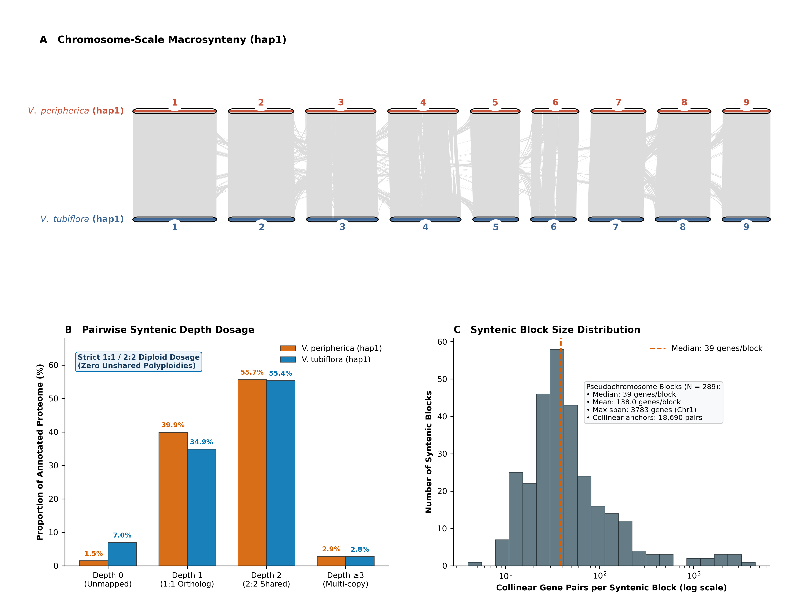
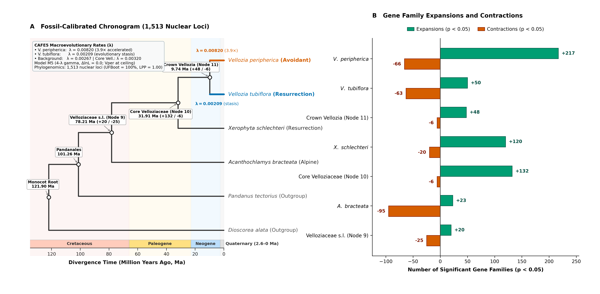
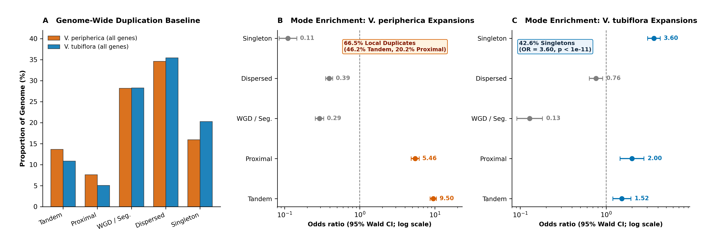
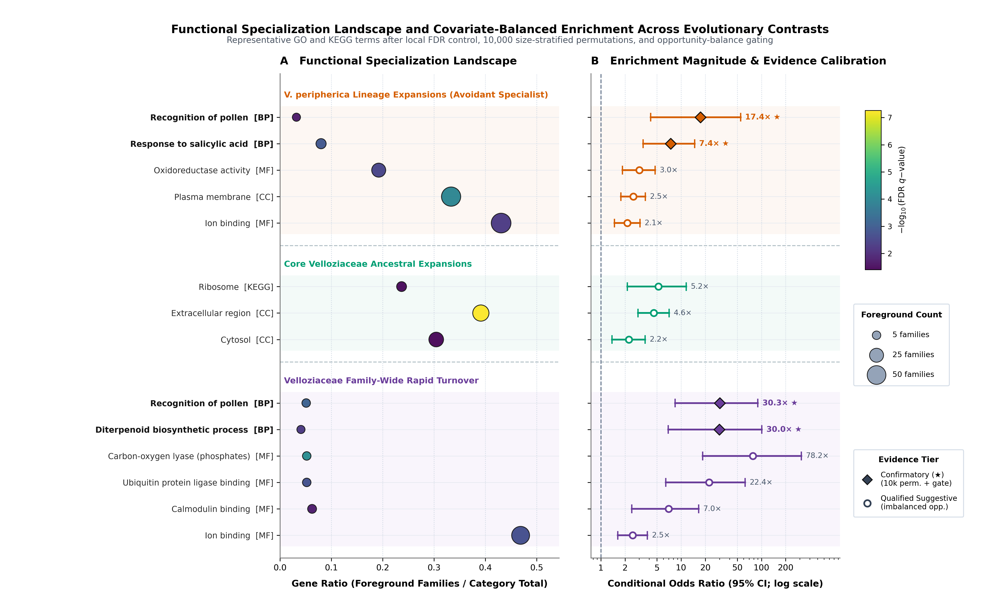
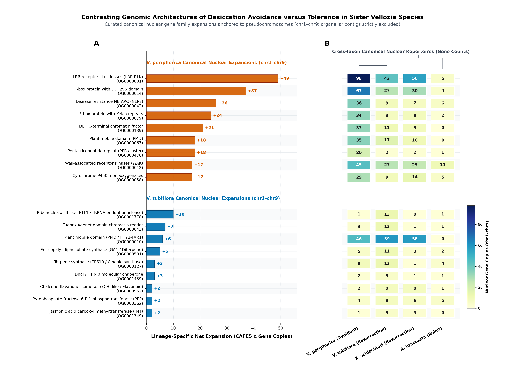
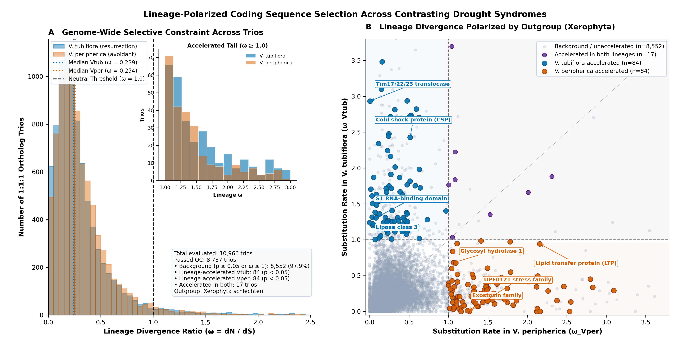
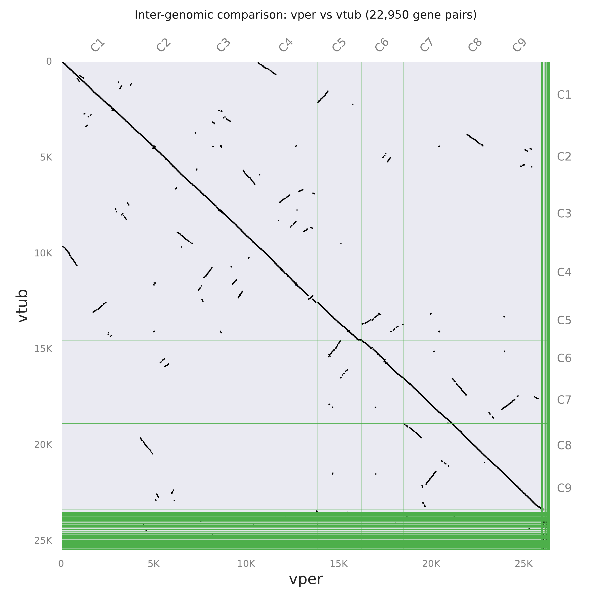

# Chapter 3

## Ancestral Gene-Family Expansion and Asymmetric Local Duplication in Two *Vellozia* Species with Contrasting Drought-Survival Strategies

**Authors:**  
**Mariana Feitosa Cavalheiro**$^{1,2}$, **Francine A. N. de Almeida**$^{1,3}$, **Ricardo A. Dante**$^{1,3,4}$, **Isabel Rodrigues Gerhardt**$^{1,3,4,*}$

**Affiliations:**  
$^{1}$ Centro de Pesquisa em Genômica Aplicada às Mudanças Climáticas (GCCRC), Universidade Estadual de Campinas (UNICAMP), Campinas, SP, 13083-875, Brazil  
$^{2}$ Departamento de Genética, Evolução, Microbiologia e Imunologia, Instituto de Biologia, Universidade Estadual de Campinas (UNICAMP), Campinas, SP, 13083-970, Brazil  
$^{3}$ Centro de Biologia Molecular e Engenharia Genética (CBMEG), Universidade Estadual de Campinas (UNICAMP), Campinas, SP, 13083-875, Brazil  
$^{4}$ Embrapa Agricultura Digital, Campinas, SP, 13083-886, Brazil  
$^{*}$ Corresponding author: Isabel Rodrigues Gerhardt (isabel.gerhardt@embrapa.br)

### Chapter Contextualization and Publication Statement

> This chapter is prepared for submission to an international peer-reviewed journal in plant evolutionary genomics. It investigates the genome-wide macroevolutionary dynamics separating the desiccation-tolerant resurrection plant *Vellozia tubiflora* from its sympatric, dehydration-avoidant evergreen congener *Vellozia peripherica*. Building directly upon the chromosome-scale assemblies established in Chapter 1 and the organellar foundations of Chapter 2, this chapter provides the comparative phylogenomic and macroevolutionary baseline of the thesis. Specifically, it reconstructs whole-genome synteny, models asymmetric gene-family expansions and contractions via birth-death processes, classifies localized duplication mechanisms, and quantifies coding-sequence evolutionary constraints across single-copy ortholog trios polarized by *Xerophyta schlechteri*. These findings establish the macroevolutionary framework that motivates the fine-scale investigation of primary environmental perception in Chapter 4.
> 
> As first author of this study, the doctoral candidate (Mariana Feitosa Cavalheiro) led the conceptualization, execution, and synthesis of the research under the supervision of Isabel Rodrigues Gerhardt. The candidate performed the comparative orthology delineation, CAFE5 gene-family turnover modeling across multiple rate parameterizations, synteny and duplication-mode classifications, PAML branch-site coding-sequence selection analyses, and functional enrichment testing. Furthermore, the candidate prepared all figures, tables, and supplementary datasets and wrote the original manuscript draft, subsequently integrating revisions from co-authors.

## Abstract

Closely related species displaying contrasting survival strategies provide an ideal comparative system for investigating how genomic architecture, gene-family turnover, and coding-sequence evolution accompany physiological divergence. In the ancient quartzitic *campos rupestres* of eastern Brazil, congeners of the genus *Vellozia* (Pandanales) exhibit divergent drought adaptations: the evergreen shrub *Vellozia peripherica* delays tissue dehydration, whereas the sympatric resurrection plant *Vellozia tubiflora* survives foliar desiccation. Here, we present a chromosome-scale genome assembly for *V. peripherica* (493.30 Mb, scaffold N50 = 64.68 Mb, 98.05% anchored into nine pseudomolecules) and compare it with the companion reference genome of *V. tubiflora* within a fossil-calibrated phylogenomic framework. Macrosynteny and syntenic depth were strictly conserved across all nine chromosomes without evidence of recent whole-genome duplication. However, macroevolutionary birth-death modeling revealed marked asymmetry in terminal copy-number turnover, with *V. peripherica* exhibiting 217 expanding families compared with 50 in *V. tubiflora*. This expansion in *V. peripherica* was driven predominantly by local duplications (tandem and proximal events accounted for 66.47% of classified models), with expanded families enriched for cell-wall integrity sensors, G-type lectin receptor kinases, and salicylic acid-associated defense networks. Conversely, *V. tubiflora* prioritized ancestral stress-repertoire retention, supplemented by specialized chromatin regulators, small RNA processing enzymes, and elevated copy numbers in chloroplast Toc/Tic translocons shared with the African resurrection plant *Xerophyta schlechteri*. Proteome-wide analyses of 8,737 single-copy ortholog trios polarized by *X. schlechteri* revealed pervasive purifying constraint (89.25% with $\omega \le 1.0$), with lineage-specific coding-sequence divergence (elevated branch $\omega$ ratios) restricted to 14 loci per species displaying diverse functional annotations, including examples involved in membrane transport and barrier deposition. Together, these findings demonstrate that physiological divergence in *Vellozia* evolved through asymmetric local gene proliferation, organellar specialization, and targeted coding divergence operating within a structurally stable chromosomal framework.

**Keywords:** Velloziaceae, desiccation tolerance, drought avoidance, macroevolution, CAFE5, tandem duplication, synteny, coding-sequence divergence, *campos rupestres*.

## Introduction

Water deficit is a primary environmental factor constraining the physiology, geographic distribution, and evolutionary diversification of terrestrial plants (VOLAIRE, 2018). During seasonal dry periods, co-occurring species exposed to identical climatic regimes can decouple cellular hydration status from environmental moisture decline by deploying contrasting adaptive strategies across successive phases of drying (VOLAIRE, 2018; VOLAIRE et al., 2026). Under moderate moisture deficit, dehydration avoidance delays cellular turgor loss through continuous root foraging, cuticular waterproofing, and tight stomatal regulation (ALCÂNTARA et al., 2015; VOLAIRE, 2018; TEODORO et al., 2021; VOLAIRE et al., 2026). Once environmental drying exceeds the threshold for vegetative growth, survival depends either on preventing lethal water loss through sustained tissue dehydration avoidance or, in desiccation-tolerant lineages, on activating cellular protection networks as tissues equilibrate with dry air (VOLAIRE, 2018; VOLAIRE et al., 2026). At the extreme threshold of this survival continuum, vegetative desiccation tolerance (VDT) enables differentiated tissues to survive severe cellular dehydration and restore physiological and metabolic activity upon rehydration without undergoing meristematic dormancy (GAFF; OLIVER, 2013; ALCÂNTARA et al., 2015). In poikilochlorophyllous (chlorophyll-dismantling) resurrection plants, this survival mode entails disassembling thylakoid membranes and degrading chlorophyll during foliar drying to limit photo-oxidative damage, followed by rebuilding the photosynthetic machinery upon rewatering (ALCÂNTARA et al., 2015; COSTA et al., 2017). While the ecophysiological trade-offs separating dehydration avoidance from desiccation tolerance are well characterized (TEODORO et al., 2021; VOLAIRE et al., 2026), the genomic mechanisms underlying the evolutionary divergence between these contrasting strategies in closely related congeners remain largely unresolved.

Velloziaceae (order Pandanales) represents an exemplary system for addressing this question in the Neotropical *campos rupestres* (ALCÂNTARA et al., 2018; TEODORO et al., 2021). Distributed along the crystalline plateaus of southeastern and central Brazil, the *campos rupestres* form an ancient montane ecosystem characterized by shallow, nutrient-impoverished quartzitic soils with low water-holding capacity, high solar irradiance, and severe seasonal precipitation deficits, serving as a global center of plant endemism (SILVEIRA et al., 2016; MORELLATO; SILVEIRA, 2018). Within these rocky-outcrop habitats, where negligible soil moisture buffering amplifies seasonal drought, Velloziaceae lineages have repeatedly diversified across both dehydration-avoidant and desiccation-tolerant survival modes in response to independent climatic events (ALCÂNTARA et al., 2015, 2018; TEODORO et al., 2021; VIEIRA et al., 2022, 2025). On the quartzitic plateaus of the Serra da Canastra (Minas Gerais, Brazil), the poikilochlorophyllous resurrection herb *Vellozia tubiflora* and the perennial, dehydration-avoidant evergreen shrub *Vellozia peripherica* occur within the same montane landscape (PINTO et al., 2025). While both congeners experience the same regional macroclimate across these plateaus, rocky-outcrop microtopography and substrate fissures create localized variation in moisture retention across adjacent microhabitats (SILVEIRA et al., 2016; PINTO et al., 2025). This regional co-occurrence provides a controlled comparative setting to examine how lineage-specific genomic modifications accompany physiological divergence against a shared macroclimatic and evolutionary background.

Determining whether the distinct adaptations of *V. tubiflora* and *V. peripherica* represent recent congeneric innovations or the differential retention of ancestral traits requires situating this Neotropical pair within the broader macroevolutionary history of Velloziaceae. Crown Velloziaceae displays a deep transcontinental disjunction: the relictual southwest Chinese endemic *Acanthochlamys bracteata* is sister to core Velloziaceae, which unites the African and Malagasy genus *Xerophyta* with South American lineages, including the species-rich Brazilian genera *Vellozia* and *Barbacenia* alongside the Andean *Barbacenopsis* (MELLO-SILVA et al., 2011; ALCÂNTARA et al., 2018; GAO et al., 2021). Genomic analyses of the African resurrection plant *Xerophyta schlechteri* (originally published as *Xerophyta viscosa*; COSTA et al., 2017) demonstrated that vegetative desiccation tolerance recruits ancestral seed-associated protective pathways, including late embryogenesis abundant (LEA) proteins, small heat-shock proteins, antioxidant enzymes, and abscisic acid-regulated transcriptional networks governed by ABI3 and ABI5 orthologs, whereas the sister lineage *Acanthochlamys bracteata*, a cold-tolerant alpine resurrection plant, exhibits expansions in chilling- and desiccation-responsive families (GAO et al., 2021). However, because these existing genomic resources in Velloziaceae have focused exclusively on desiccation-tolerant taxa, integrating both resurrection and dehydration-avoidant congeners into a calibrated comparative framework is required to provide the phylogenetic polarity needed to distinguish ancestral genomic repertoires established prior to the core Velloziaceae radiation from terminal modifications that accompanied congeneric divergence in South America.

These evolutionary contrasts support the formulation of three testable hypotheses regarding the genomic trajectories of *V. peripherica* and *V. tubiflora* within a conserved karyotypic framework. First, if core cellular protection mechanisms were established in the common ancestor of core Velloziaceae without subsequent lineage-specific polyploidy, we hypothesized that vegetative desiccation tolerance in *V. tubiflora* relies predominantly on the retention and regulatory deployment of an inherited ancestral stress repertoire rather than extensive terminal gene proliferation (COSTA et al., 2017; LYALL et al., 2020; PARDO et al., 2020; MARKS et al., 2025). Second, because tandem and proximal duplications in angiosperms preferentially amplify gene families involved in environmental perception, specialized metabolism, and biotic defense (FREELING, 2009; BIRCHLER; VEITIA, 2012; SALOJÄRVI et al., 2017; QIAO et al., 2019), and because maintaining perennial foliage across drought-prone, oligotrophic environments requires continuous cell-wall reinforcement and foliar defense (COLEY et al., 1985; NIINEMETS et al., 2009), we hypothesized that the dehydration-avoidant *V. peripherica* experienced accelerated local gene duplication compared with *V. tubiflora*. Third, because essential metabolic pathways under harsh rocky-outcrop conditions remain under strong functional constraint, we hypothesized that coding sequences in conserved single-copy orthologs evolve under genome-wide purifying selection, with accelerated nonsynonymous substitution rates restricted to specialized loci mediating strategy-specific adaptations.

To test these hypotheses, we generated a chromosome-scale nuclear genome assembly for the dehydration-avoidant *V. peripherica* and compared it with the companion reference genome of the desiccation-tolerant *V. tubiflora* (`hap1`; ALMEIDA et al., in prep.; Chapter 1). We contextualized this congeneric comparison within a seven-species phylogenomic dataset integrating predicted proteomes from confamilial Velloziaceae relatives (*Xerophyta schlechteri* and *Acanthochlamys bracteata*), external monocot outgroups (*Pandanus tectorius* and *Dioscorea alata*), and *Arabidopsis thaliana*, using *X. schlechteri* to polarize coding-sequence evolution in *Vellozia*. Specifically, we addressed four central questions: (i) whether the two *Vellozia* genomes exhibit conserved chromosomal synteny or lineage-specific structural reorganizations; (ii) whether ancestral gene-family expansions originated in the common ancestor of core Velloziaceae and whether subsequent turnover rates diverged asymmetrically between the two congeners; (iii) to what extent local tandem and proximal duplications drove lineage-specific expansions and enriched distinct physiological pathways; and (iv) whether coding sequences in conserved single-copy orthologs evolved under pervasive purifying constraint or underwent lineage-specific rate acceleration.

## Material and Methods

### 2.1 Genome sequencing, assembly, and annotation

To establish a chromosome-scale reference for comparative genomics between contrasting drought-survival strategies in *Vellozia*, we generated a high-continuity nuclear genome assembly and structural annotation for the dehydration-avoidant *V. peripherica*. Fresh foliar tissue was collected from a wild individual in the quartzitic *campos rupestres* of Serra da Canastra National Park, São Roque de Minas, Minas Gerais, Brazil (20°15′36.9″S, 46°25′22.0″W; PINTO et al., 2025). High-molecular-weight genomic DNA was extracted and sequenced using circular consensus sequencing on a Pacific Biosciences Sequel IIe platform (PacBio HiFi, ~30x coverage), supplemented by high-throughput chromosome conformation capture using Dovetail Omni-C libraries (Dovetail Genomics, Scotts Valley, CA, USA) sequenced on an Illumina NovaSeq 6000 platform. HiFi reads were first assembled de novo into contig graphs using hifiasm v0.20.0 in standalone HiFi mode (CHENG et al., 2021). Contaminant contigs were filtered using NCBI FCS-GX v0.5.4 (ASTASHYN et al., 2024). Omni-C paired-end reads were mapped to contigs using BWA-MEM (-5SP) and processed with pairtools to remove PCR duplicates and retain high-quality mappings (MAPQ >= 30). Chromosome-scale scaffolding was then performed using HapHiC v1.0.6 (ZENG et al., 2024) with manual curation in Juicebox v1.11.08 (DURAND et al., 2016) guided by the cytogenetic baseline of *Vellozia* ($2n = 18, x = 9$; BRAZ et al., 2024). Repetitive elements were modeled de novo using EDTA v2.0 (OU et al., 2019) and masked with RepeatMasker v4.1.5 (SMIT et al., 2013-2015), followed by structural gene prediction using BRAKER2 v2.1.6 (BRŮNA et al., 2021) combining GeneMark-EP+ and AUGUSTUS v3.4.0 trained with Viridiplantae OrthoDB v10 protein evidence. Primary functional annotation was performed using eggNOG-mapper v2.1.9 against the eggNOG v5.0 database (HUERTA-CEPAS et al., 2019; CANTALAPIEDRA et al., 2021). Completeness of the predicted gene space was evaluated using BUSCO v5.4.3 (MANNI et al., 2021) in protein mode against the `embryophyta_odb10` (n = 1,614) and `liliopsida_odb10` (n = 3,278) lineage datasets.

### 2.2 Chromosome synteny, macrosynteny depth, and gene duplication modes

Chromosome-scale structural conservation, macrosynteny, and syntenic depth between the two *Vellozia* congeners were evaluated using gene coordinates and primary chromosome-level protein and nucleotide sequences from *Vellozia peripherica* and the companion reference genome of *Vellozia tubiflora* (`hap1`; ALMEIDA et al., in prep.; Chapter 1) within the JCVI comparative-genomics framework v1.6.5 (TANG et al., 2015). Pairwise intergenomic synteny searches between the two species were performed using LAST v1650 (KIEŁBASA et al., 2011) integrated within JCVI (`jcvi.compara.catalog ortholog`) with parameters C-score $\ge 0.50$, tandem duplication collapse distance $\le 10$ genes (`--dist=10`), and a minimum block threshold of $\ge 5$ collinear anchor gene pairs (`--minspan=5`) to detect collinear anchor pairs and construct chromosome-scale block summaries across the nine pseudomolecules. Syntenic-depth distributions were calculated using `jcvi.compara.synteny depth`, which tallies the number of distinct collinear blocks spanning each annotated gene model. Each gene model in both assemblies was assigned to an integer depth class: depth 0 (non-syntenic loci), depth 1 (strict 1:1 orthologous blocks), depth 2 (two overlapping syntenic blocks reflecting ancestral duplication), and depth $\ge 3$ (higher-order duplication). Relative frequencies across depth classes were compared between assemblies to verify ploidy stasis and assess the presence of lineage-specific whole-genome duplications.

Intragenomic duplication mechanisms across both genomes were classified from protein similarity searches conducted within each assembly using LAST in JCVI. The MCScanX classifier (`duplicate_gene_classifier`; WANG et al., 2012) was applied with parameters `-s 5 -m 25 -n 10` to categorize all predicted gene models into five mutually exclusive classes: whole-genome duplication (WGD)/segmental, tandem, proximal, dispersed, and singleton. Baseline duplication frequencies for each class were quantified across the complete predicted gene space of both assemblies.

### 2.3 Comparative taxon sampling and orthology inference

For comparative orthology, phylogenomics, and gene-family turnover analyses, we compiled a dataset comprising the deduced primary proteomes of seven angiosperm species: the predicted protein-coding repertoires from the newly established chromosome-scale assembly of *Vellozia peripherica* and the companion reference assembly of *Vellozia tubiflora* (`hap1`; ALMEIDA et al., in prep.; Chapter 1); two additional Velloziaceae representatives, *Xerophyta schlechteri* (published as *X. viscosa*; COSTA et al., 2017) and *Acanthochlamys bracteata* (GAO et al., 2021); two monocotyledonous outgroups, *Pandanus tectorius* (XU et al., 2026) and *Dioscorea alata* (BREDESON et al., 2022); and the eudicot *Arabidopsis thaliana* (TAIR10.1, GCF_000001735.4; BERARDINI et al., 2015; CHENG et al., 2017) as an external phylogenetic anchor and functional annotation reference (source assembly accessions in Data Availability). To eliminate isoform redundancy across the seven reference proteomes, only the amino acid sequence corresponding to the transcript with the longest open reading frame per locus was retained for comparative orthology inference.

Orthologous gene clusters (orthogroups) across the seven primary proteomes were delineated using OrthoFinder v3.1.5 (EMMS; KELLY, 2015, 2019). Pairwise sequence searches were performed with DIAMOND v2.2.4 (BUCHFINK et al., 2021) in more-sensitive mode (`--more-sensitive -e 0.001`) using the BLOSUM62 substitution matrix (gap open: 11; gap extend: 1). Sequence alignment and maximum-likelihood gene-tree reconstruction within orthogroups were performed with FAMSA v2.4.1 (DEOROWICZ et al., 2016) and FastTree v2.2.0 (PRICE et al., 2010), respectively. Graph clustering used the Markov Cluster Algorithm (MCL; ENRIGHT et al., 2002) with an inflation parameter of 1.2. Strictly single-copy orthogroups present in all seven genomes were selected as phylogenomic markers. Protein sequences for each single-copy locus were aligned using MAFFT v7.520 (KATOH; STANDLEY, 2013) with automated algorithm selection (`--auto`). Columns with gaps in more than 50% of taxa were removed, and the filtered single-copy alignments were concatenated into a partitioned amino acid supermatrix for phylogenomic inference.

### 2.4 Phylogenomic reconstruction and gene-tree concordance analyses

From the concatenated amino acid supermatrix, phylogenomic relationships within Velloziaceae and outgroup lineages were inferred using IQ-TREE v2.3.6 (MINH et al., 2020) under an edge-unlinked partitioned maximum-likelihood framework. The optimal amino acid substitution model for each locus partition was determined using ModelFinder (KALYAANAMOORTHY et al., 2017) under the Bayesian Information Criterion (BIC). Branch support was assessed using 1,000 ultrafast bootstrap (UFBoot2) replicates (HOANG et al., 2018).

In parallel, a coalescent species tree was reconstructed under the multi-species coalescent (MSC) model using ASTRAL-III v5.7.8 (ZHANG et al., 2018), taking as input the individual maximum-likelihood gene trees to estimate normalized quartet support across alternative topological resolutions. Genealogical discordance across individual loci was quantified by calculating gene concordance factors (gCF) and site concordance factors (sCF) across all decisive single-copy alignments in IQ-TREE against the reference species-tree topology (which shared an identical branching order between the concatenated maximum-likelihood and ASTRAL-III reconstructions). For each internal branch of this reference tree, gCF represents the percentage of decisive individual gene trees that contain that branch, whereas sCF represents the percentage of decisive alignment sites that support that bipartition.

### 2.5 Molecular dating under fossil-calibrated relaxed clocks

Divergence times along the inferred species-tree topology were estimated using the approximate likelihood method implemented in the MCMCtree module of PAML v4.10 (YANG, 2007; dos REIS; YANG, 2011), conditioned on the concatenated amino acid supermatrix. The molecular clock was modeled under an independent lognormal rates specification (`clock = 2`) using a Poisson amino acid substitution model with five discrete Gamma rate categories (`model = 0, alpha = 0.5, ncatG = 5`). Evolutionary time was parameterized in units of 100 million years (1 time unit = 100 Ma). Prior distributions on the birth-death process and rate parameters were specified as `BDparas = 1 1 0.1`, `rgene_gamma = 2 20 1`, and `sigma2_gamma = 1 10 1`.

The calibration tree used in MCMCtree encoded five paired minimum and maximum bounds (specified in 100-Ma units) based on fossil evidence and multi-locus chronograms. First, the root split (*Arabidopsis* versus monocots; 130-145 Ma) was constrained by a minimum of 130 Ma from early Cretaceous crown angiosperm fossils (BENTON et al., 2015; MAGALLÓN et al., 2015) and a soft maximum of 145 Ma corresponding to the Jurassic-Cretaceous boundary (MAGALLÓN et al., 2015). Second, the divergence between *Dioscorea* and Pandanales (115-128 Ma) was bounded using monocot plastid phylogenomic chronograms (JANSSEN; BREMER, 2004; GIVNISH et al., 2018). Third, the *Pandanus* versus Velloziaceae split (90-105 Ma) was anchored by a minimum of 90 Ma from Turonian fossil flowers of Triuridaceae (*Mabelia connatifila*, ~90 Ma; GANDOLFO et al., 2002; ILES et al., 2015), which provide a well-substantiated minimum age for crown Pandanales (ALCÂNTARA et al., 2018). Although fossil fruits assigned to Pandanaceae (such as *Gruenbachia pandanoides*) have been described from the Late Cretaceous, their taxonomic placement within crown Pandanales carries morphological uncertainty (ALCÂNTARA et al., 2018), making Triuridaceae the more reliable constraint; the maximum bound of 105 Ma follows monocot phylogenomic estimates (GIVNISH et al., 2018). Fourth, the divergence of the relictual Tibetan endemic *Acanthochlamys bracteata* from core Velloziaceae (75-90 Ma) was bounded based on multi-gene chronograms (ALCÂNTARA et al., 2018; GAO et al., 2021). Finally, the split between the two sampled *Vellozia* species was bounded between 2 and 25 Ma based on species-level dating of *Vellozia* diversification in the *campos rupestres* (ALCÂNTARA et al., 2018), where 2 Ma defines the minimum bound for recent speciation and 25 Ma provides a conservative upper bound within mid-Cenozoic clade radiation, constraining the divergence between these two sampled congeners rather than the crown radiation of the entire genus. The split between *Xerophyta* and *Vellozia* carried no direct calibration; its age was estimated conditionally on the sequence data, the surrounding node calibrations, and the remaining relaxed-clock priors.

The workflow included a prior-only run (`usedata = 0`) to evaluate the joint prior distribution and two independent posterior chains initialized with distinct random seeds (`1234567` and `7654321`). Both chains followed identical run specifications: an initial burn-in of 50,000 iterations discarded prior to sampling, followed by 3,000,000 sampling iterations with states recorded every 100 iterations (`sampfreq = 100`), yielding 30,000 parameter samples per run and 60,000 pooled samples across the two chains (totaling 3,050,000 iterations per run). Convergence between independent runs was evaluated using the Gelman-Rubin potential scale reduction factor ($\hat{R}$), calculated by comparing between-chain variance to within-chain variance across recorded samples for each continuous parameter (GELMAN; RUBIN, 1992), with $\hat{R} < 1.01$ indicating convergence to the stationary distribution. Posterior sampling adequacy and mixing were assessed via effective sample sizes (ESS), calculated from autocorrelation times across the sample trace; a threshold of combined $\text{ESS} > 200$ across both chains was enforced to ensure negligible Monte Carlo sampling error (DRUMMOND et al., 2006). The resulting combined posterior distribution was summarized into a time-calibrated ultrametric species tree.

### 2.6 Gene-family turnover and birth-death modeling

Macroevolutionary gene-family size fluctuations and ancestral copy-number dynamics along the calibrated timescale were modeled using CAFE5 v5.1.0 (MENDES et al., 2020). As phylogenetic input, the time-calibrated ultrametric tree from MCMCtree was pruned of the eudicot outgroup *Arabidopsis thaliana* to retain a six-taxon monocot chronogram (*V. peripherica*, *V. tubiflora*, *X. schlechteri*, *A. bracteata*, *P. tectorius*, and *D. alata*). While *A. thaliana* was necessary to anchor the root fossil calibration in MCMCtree, it was excluded from birth-death modeling because the continuous-time Markov process in CAFE assumes a shared baseline turnover dynamic across branches. Spanning the deep monocot-eudicot divergence (~150 Ma) along an isolated, single-species lineage would introduce independent paleopolyploidization histories (such as Brassicaceae-specific duplications) into root ancestral state reconstructions, confounding monocot-specific turnover rates. Restricting the modeling framework to monocots therefore ensures that estimated birth-death parameters reflect gene family dynamics within a shared macroevolutionary and syntenic context.

Input family counts were compiled from the OrthoFinder clustering. Families lacking representation in the common ancestor of the sampled monocots (requiring $\ge 1$ copy in outgroup monocots *Pandanus* or *Dioscorea* and $\ge 1$ copy in Velloziaceae) were excluded prior to dynamic modeling to establish an ancestral baseline. Following recommended CAFE protocols to prevent numerical instability and non-finite log-likelihood calculations during transition matrix exponentiation for very large copy numbers (MATHERS et al., 2017), 12 orthogroups containing $\ge 100$ genes in at least one monocot genome were filtered prior to global rate optimization. These extreme clusters, predominantly comprising transposable element bursts alongside the high-copy chloroplast Toc/Tic translocon complex (`OG0000007`), were evaluated separately via direct copy-count summaries. Because these 12 groups constitute less than 0.1% of all families and were tracked independently, turnover rate estimates and lineage-specific expansion inferences across the remaining 12,876 families remained unaffected by their exclusion.

Turnover-rate variation across the phylogeny was evaluated by comparing five nested branch-rate models representing alternative evolutionary hypotheses: (i) a global one-rate model (M1, uniform $\lambda$ across all monocots); (ii) a two-rate model testing a family-wide shift in Velloziaceae versus background monocots (M2); (iii) a three-rate model isolating the *Vellozia* crown from earlier Velloziaceae branches and background monocots (M3); (iv) an alternative three-rate model testing an accelerated turnover shift restricted to *V. peripherica* (M4); and (v) a four-rate model assigning separate terminal rates to *V. peripherica* and *V. tubiflora* alongside shared Velloziaceae and background rates (M5).

Assembly and annotation count errors were explicitly accounted for by estimating an empirical error distribution parameter ($\epsilon$) across the six taxa and incorporating the calibrated error model into subsequent dynamic analyses. Rate variation among gene families was modeled using discrete Gamma distributions with $k = 2$ and $k = 3$ categories, with the branch-rate comparison evaluated under Gamma $k = 3$ throughout so that models differed only in their branch assignments. To guard against local optima during maximum-likelihood estimation, five independent optimization starts were evaluated for models M1-M4, and ten independent starts were run for the most parameterized model (M5).

Models were compared using the Akaike Information Criterion (AIC), evaluated from the replicate with the lowest negative log-likelihood for each parameterization. Under the best-fitting model, ancestral gene-family sizes across internal nodes were reconstructed using the Viterbi algorithm implemented in CAFE5, which determines the most likely sequence of ancestral copy numbers and yields the inferred net copy-number change along each branch ($\Delta = N_{\text{child}} - N_{\text{parent}}$). In parallel, CAFE5 calculates branch-specific empirical $p$-values based on transition probabilities under the birth-death process given branch length and fitted turnover parameter $\lambda$. Gene-family changes were classified using two explicit, decoupled criteria: the sign of $\Delta$ defined the direction of change, while the branch-specific transition probability defined statistical significance. Specifically, a family was classified as expanding on a given branch if $\Delta > 0$ and $p_{\text{branch}} < 0.05$, or contracting if $\Delta < 0$ and $p_{\text{branch}} < 0.05$, without requiring an additional global family-wide significance filter. Families with $p_{\text{branch}} \ge 0.05$ or $\Delta = 0$ were classified as unchanged. Reproducible family calls were defined as those satisfying both the direction of change and $p_{\text{branch}} < 0.05$ across all replicate runs within the near-optimal set (within 0.1 negative log-likelihood units of the best run).

### 2.7 Duplication-mode enrichment, functional annotation, and protein domain profiling

To determine whether lineage-specific gene-family expansions were driven by specific duplication mechanisms, duplication-class assignments from MCScanX were intersected with CAFE5 terminal-expansion calls in both *V. peripherica* and *V. tubiflora*. For each duplication mode, two-sided Fisher's exact tests and odds ratios (ORs) evaluated statistical overrepresentation by comparing genes in expanded families against the non-overlapping reference of genes outside expanded families, as well as against the whole-genome total.

Functional annotations associated with gene-family turnover were transferred from *Arabidopsis thaliana* orthologs within each orthogroup using Gene Ontology (GO; GENE ONTOLOGY CONSORTIUM, 2021) and Kyoto Encyclopedia of Genes and Genomes (KEGG; KANEHISA et al., 2023) databases, propagating terms along ontological hierarchies while excluding uninformative root terms. In parallel, primary eggNOG v5.0 annotations (HUERTA-CEPAS et al., 2019) from the reference assemblies were used to cross-reference gene descriptions and identify organellar or transposable-element families.

To avoid paralog pseudoreplication and family-size bias, functional overrepresentation was evaluated at the gene-family level using SCB-Enrich (github.com/mfcaval/scbenrich), treating orthogroups as the independent sampling units. Stratification was structured across three confounding family-level covariates: total monocot family size (16 bins, controlling for CAFE5 detection power), mapped *Arabidopsis* ortholog count (6 bins, controlling for annotation opportunity), and overall annotation degree (6 bins, controlling for term ubiquity in databases), defragmented to $N_{\text{bg}} \ge 2$ per stratum without extrinsic expression covariates.

Overrepresentation was evaluated in a two-stage framework across the 12,876 modeled monocot families. First, all functional terms were screened using one-sided Fisher's exact tests, controlling genome-wide multiple testing via the Benjamini-Hochberg procedure (BENJAMINI; HOCHBERG, 1995) at both the local contrast level ($q_{\text{local}} < 0.05$, calculated across all terms within a focal branch) and the global multi-contrast level ($q_{\text{global}} < 0.05$, calculated across all pooled tests). Second, candidate terms passing the local FDR threshold were tested against an empirical null distribution generated through 10,000 stratified permutations jointly balancing the three family-level covariates. Because multiple hypothesis testing across the functional universe was controlled in the initial screening stage, empirical $p_{\text{strat}}$ values were evaluated as unadjusted per-term permutation statistics serving as a validation filter against covariate confounding. Terms satisfying both FDR thresholds ($q_{\text{local}} < 0.05$ and $q_{\text{global}} < 0.05$), empirical permutation support ($p_{\text{strat}} < 0.05$), and verified covariate balance (standardized mean differences $|\text{SMD}| < 0.10$) were designated as stringently supported candidates; terms with $q_{\text{local}} < 0.05$ and $p_{\text{strat}} < 0.05$ but non-significant global FDR or residual covariate imbalance were classified as suggestive; and terms failing $p_{\text{strat}} < 0.05$ were flagged as family-size artifacts. Redundant ancestor-descendant terms along the Gene Ontology directed acyclic graph were reduced to representative terms for visualization.

Representative protein sequences from expanding and contracting families in *V. peripherica* and *V. tubiflora* were further characterized with InterProScan v5.68-100.0 (JONES et al., 2014) to refine functional classifications and resolve domain architectures. For each family, the longest predicted protein in the focal species was selected as the representative. Domain architectures were annotated using member databases integrated into InterProScan, including Pfam (MISTRY et al., 2021), SMART (LETUNIC et al., 2021), CDD (LU et al., 2020), PANTHER (THOMAS et al., 2022), and SUPERFAMILY v1.75 (WILSON et al., 2007; PANDURANGAN et al., 2019), supplemented by transmembrane helix and signal-peptide predictions from TMHMM v2.0 (KROGH et al., 2001) and Phobius v1.01 (KÄLL et al., 2004).

### 2.8 Ortholog trios and between-branch coding-sequence heterogeneity

Coding-sequence divergence and polarized lineage-specific substitution rates between the two *Vellozia* congeners were evaluated across ortholog trios assembled by intersecting reciprocal one-to-one *V. peripherica*-*V. tubiflora* pairs with pairwise one-to-one assignments to the outgroup *Xerophyta schlechteri*. Protein-guided codon alignments were generated with MAFFT (`--auto`). Strict quality filters excluded sequences shorter than 30 codons, alignments with ambiguous or internal stop codons, and positions containing alignment gaps.

Branch-specific nonsynonymous-to-synonymous substitution rate ratios ($\omega = dN/dS$) were estimated in `codeml` (PAML v4.10) using F3X4 codon frequencies (`NSsites = 0`). A null one-ratio model was compared with a three-ratio branch model assigning independent rates to each lineage via likelihood ratio tests ($2\Delta\ln L \sim \chi^2_2$). This test evaluates branch rate heterogeneity across lineages rather than site-specific positive selection on isolated codons, which would require branch-site models (ZHANG et al., 2005). Multiple testing across candidate trios was controlled using the standard Benjamini-Hochberg procedure ($q_{\text{FDR}} < 0.05$), with candidate domain architectures verified via InterProScan. Complete configuration controls, alignment scripts, and filtering thresholds are documented in the workflow repository.

## Results

### 3.1 Chromosome-scale genome assembly and conserved chromosomal synteny between *Vellozia* congeners

PacBio HiFi sequencing and Omni-C scaffolding of the dehydration-avoidant *Vellozia peripherica* yielded a 493.30 Mb nuclear genome assembly (`Vper.hap1.v1`), with 98.05% of the sequence (483.68 Mb) anchored into nine pseudomolecules matching the diploid genus baseline ($2n = 18, x = 9$; BRAZ et al., 2024; scaffold N50 = 64.68 Mb; Supplementary Table S1). Gene-space completeness was high (BUSCO 96.2% complete against `embryophyta_odb10` and 95.8% against `liliopsida_odb10`), comparable to the companion reference genome of the sympatric, desiccation-tolerant *V. tubiflora* (466.32 Mb, 95.8% BUSCO recovery; ALMEIDA et al., in prep.; Chapter 1).

Pairwise synteny revealed extensive macrosyntenic stasis between the two congeners: each pseudomolecule in *V. peripherica* corresponded 1:1 to its orthologous pseudomolecule in *V. tubiflora* without evidence of Robertsonian fusions, fissions, or reciprocal translocations (Figure 1A; Supplementary Figure S1). The primary orthologous backbone was spanned by 42 collinear blocks (25,147 anchor assignments), where detectable macrosyntenic divergence at gene-anchor resolution was characterized primarily by localized intra-chromosomal inversions (<3.1% of backbone anchors; predominantly on `chr1`, `chr4`, and `chr6`). Syntenic depth distributions were concordant between genomes (Figure 1B): combined depth-1 (strict 1:1 orthology) and depth-2 (shared paleoduplications) assignments accounted for 95.6% of the analyzed gene space in *V. peripherica* (39.9% depth 1 and 55.7% depth 2) and 90.2% in *V. tubiflora* (34.9% depth 1 and 55.4% depth 2), with non-syntenic loci (depth 0; 1.5% and 7.0%) and higher-order duplications (depth $\ge 3$; 2.9% and 2.8%) comprising the remaining fractions. No unshared whole-genome duplication occurred after congeneric divergence. Instead, secondary syntenic blocks connecting non-orthologous chromosomes reflected ancient paralogies inherited from shared monocot paleoduplications rather than recent inter-chromosomal rearrangements (Figure 1C; Supplementary Table S1).

### 3.2 Phylogenomic timescale and ancestral gene-family expansions in core Velloziaceae

Across the seven sampled angiosperm genomes, OrthoFinder clustered 93.2% of predicted proteins into 17,750 orthogroups (Supplementary Table S1), including 1,513 strictly single-copy nuclear orthologs (732,066 aligned amino acid positions). Phylogenomic relationships and divergence times inferred from this single-copy dataset yielded a fully resolved, highly supported concatenated maximum-likelihood topology across all nodes (100% ultrafast bootstrap support; Figure 2A). The species tree placed *Dioscorea alata* (Dioscoreales) as the sister lineage to Pandanales, within which *Pandanus tectorius* (Pandanaceae) diverged prior to Velloziaceae. Within Velloziaceae, *Acanthochlamys bracteata* was resolved as sister to core Velloziaceae (*Xerophyta schlechteri* + *Vellozia*), and the two focal *Vellozia* species formed a well-supported monophyletic clade. Multi-species coalescent analysis in ASTRAL-III based on all 1,513 individual maximum-likelihood gene trees recovered the same branching order as the concatenated supermatrix, with maximal local posterior probabilities across all internal nodes ($\text{LPP} = 1.00$; Supplementary Table S2). Within Velloziaceae, coalescent branch lengths were 2.43 coalescent units (CU) for the node uniting *V. peripherica* and *V. tubiflora* and 3.32 CU for the core Velloziaceae node. In parallel, evaluating gene trees and alignment sites against this shared reference topology revealed strong concordance for the species-tree bipartitions: $\text{gCF} = 93.92\%$ (1,421 of 1,513 trees) for the sampled *Vellozia* pair and $\text{gCF} = 97.16\%$ (1,470 of 1,513 trees) for core Velloziaceae, with corresponding site concordance factors of $\text{sCF} = 86.44\%$ and $\text{sCF} = 79.12\%$ (Supplementary Table S2). The concordance between concatenated maximum-likelihood and multi-species coalescent reconstructions provided a consistent topological framework for subsequent divergence-time and gene-family modeling.

Convergence across independent MCMCtree runs was confirmed by Gelman-Rubin diagnostics ($\hat{R} < 1.01$ across all continuous parameters; GELMAN; RUBIN, 1992), with posterior inference conducted on the combined chain distribution where total effective sample sizes exceeded 200 ($\text{ESS} > 200$; DRUMMOND et al., 2006). For the core Velloziaceae divergence age, the combined ESS was 262 (with individual run ESS values of 100 and 129 reflecting consistent posterior exploration across separate initializations; Supplementary Table S3). The chronogram used for CAFE5 reports ages of 121.90 Ma (combined-chain 95% credible interval: 115.48 to 128.07 Ma) for *Dioscorea*-Pandanales, 101.26 Ma (92.69 to 105.16 Ma) for *Pandanus*-Velloziaceae, 78.21 Ma (74.43 to 85.45 Ma) for *Acanthochlamys*-core Velloziaceae, 31.91 Ma (22.41 to 48.11 Ma) for the *Xerophyta*-*Vellozia* divergence, and 9.74 Ma (5.85 to 15.72 Ma) for the split between the sampled *Vellozia* species (Figure 2A; Supplementary Table S3). Because compiling independent marginal node heights can distort ancestor-descendant intervals, these node ages were extracted from the primary maximum-posterior ultrametric tree used as the fixed input chronogram for CAFE5 modeling, which guarantees internal branch-length coherence while remaining well within the 95% credible intervals of the combined-chain posterior means (33.77 and 9.68 Ma for the two youngest nodes, respectively; Supplementary Table S3). Within this chronogram, the core Velloziaceae stem branch spans 78.21 to 31.91 Ma, defining the temporal window to which ancestral gene-family gains were assigned.

After excluding 12 orthogroups with $\ge 100$ genes in at least one monocot genome (Supplementary Table S4) and families absent from the monocot root, 12,876 monocot-rooted gene families were modeled in CAFE5. Models incorporating count error ($\epsilon = 0.0044$), Gamma-distributed rate heterogeneity, and branch-specific rates decisively outperformed simpler specifications. Within the Gamma $k=3$ model set, the four-rate model M5 had the lowest AIC ($\text{AIC} = 190,947.35$; $\Delta\text{AIC} \ge 43.63$ relative to all alternative nested models; Table 1; Supplementary Table S5), firmly supporting lineage-specific turnover rates for the two focal *Vellozia* congeners. Three M5 runs fell within 0.1 negative log-likelihood units of the optimal solution and defined the near-optimal sensitivity set.

Ancestral copy-number reconstruction across the 12,876 modeled monocot families revealed a major expansion pulse along the core Velloziaceae stem branch (*Xerophyta* + *Vellozia*; Node 10 in the dated tree, corresponding to Node 12 in the six-taxon CAFE5 tree; Figure 2B), which spans the ~46.3 Ma interval between 78.21 and 31.91 Ma. Most modeled families remained stable (98.93%; 12,738 families). However, under nominal branch-specific transition probability testing without an additional family-wide significance threshold, the optimal M5 run identified 132 expanding gene families ($\Delta > 0$, nominal $p_{\text{branch}} < 0.05$, 1.03% of modeled families) against only six contracting families ($\Delta < 0$, nominal $p_{\text{branch}} < 0.05$, 0.05%) on this stem branch, yielding a pronounced 22.0:1 expansion-to-contraction ratio of which 126 expansions and all six contractions were consistently recovered across all three near-optimal optimization runs (Table 1). By contrast, the older ancestral node uniting *Acanthochlamys* with core Velloziaceae (Node 9 in the dated tree, Node 11 in CAFE5, ~78.21 Ma) was characterized by stability (99.65% unchanged, 12,831 families), displaying 20 expanding (0.16%) and 25 contracting families (0.19%; $p_{\text{branch}} < 0.05$), of which 19 and 25, respectively, were reproducible across near-optimal runs.

The catalog of 132 ancestral expansions on the core Velloziaceae stem branch included families associated with stress protection, transcriptional regulation, secondary metabolism, and photosynthesis (Figure 2B; Supplementary Table S6). The small heat-shock protein HSP20 family (`OG0000340`) showed an inferred net gain of five copies ($p < 0.0001$). Expanded transcriptional regulators included B3-domain proteins (`OG0000136`, net gain of five copies), basic leucine zipper (bZIP) transcription factors (`OG0000858`, net gain of four copies), and MYB transcription factors (`OG0000750`, net gain of four copies). Additional expanded families included anthocyanin 5-aromatic acyltransferase (`OG0000038`, net gain of five copies) and germin-like proteins (`OG0000035`, net gain of 12 copies), alongside families encoding chloroplast NAD(P)H-quinone oxidoreductase (NDH) subunits (`OG0000014`, net gain of 17 copies; `OG0000036`, net gain of five copies).

Subsequent copy-number turnover along the *Vellozia* stem was modest. On the branch leading to the common ancestor of the sampled *Vellozia* pair (*V. peripherica* + *V. tubiflora*; Node 11 in the dated tree, Node 13 in CAFE5, ~9.74 Ma), 99.58% of families remained unchanged (12,822 families), with 48 families expanding (0.37%) and six contracting (0.05%; $p_{\text{branch}} < 0.05$); 46 expansions and all six contractions were reproducible across the near-optimal runs (Table 1). Subsequent turnover along the terminal *V. tubiflora* branch was conservative: most of these focal ancestral families showed no nominally significant additional expansion in the optimal model run. One MYB-associated family (`OG0000750`) was an exception, exhibiting an inferred net gain of two copies, whereas one chloroplast NDH subunit family (`OG0000014`) exhibited an inferred net loss of three copies.

### 3.3 Asymmetric gene-family turnover and accelerated terminal expansions in *Vellozia peripherica*

Following the late Miocene divergence of *V. peripherica* and *V. tubiflora*, branch-specific rate modeling revealed pronounced turnover heterogeneity between the two focal lineages. In the optimal M5 run, the dehydration-avoidant lineage *V. peripherica* exhibited $\lambda_{Vper} = 0.008204$ events/gene/Ma, compared with $\lambda_{Vtub} = 0.002092$ in the desiccation-tolerant *V. tubiflora*, yielding a fitted turnover-rate ratio of approximately 3.92 across near-optimal runs (3.92 to 3.94). Background monocot and shared Velloziaceae rates were $\lambda_{bg} = 0.002674$ and $\lambda_{Velloziaceae} = 0.003202$, respectively. Because the estimated parameter $\lambda_{Vper}$ converged directly at the analytical stability boundary enforced by CAFE5 ($1/t_{\max} = 1/121.8979 \approx 0.008204$ events/gene/Ma, set by the root-to-tip distance of *Dioscorea alata*), this rate and the resulting 3.92-fold ratio reflect the upper boundary of the optimization procedure rather than an interior point estimate (Figure 2B; Supplementary Table S5).

This rate asymmetry was directly reflected in inferred terminal branch copy-number changes (CAFE5 branch-specific family significance threshold $p_{\text{branch}} < 0.05$; Table 1). In the optimal model run (maximum-likelihood M5 replicate), CAFE5 identified 217 expanding (1.69% of modeled families) and 66 contracting (0.51%) gene families in *V. peripherica* (12,593 families unchanged, 97.80%; expansion-to-contraction ratio of 3.29:1), compared with 50 expanding (0.39%) and 63 contracting (0.49%) families in *V. tubiflora* (12,763 families unchanged, 99.12%; ratio 0.79:1; Figure 2B). This asymmetry held consistently across independent optimization starts: strict intersections across all near-optimal runs retained 199 expansions in *V. peripherica* and recovered all 50 expansions in *V. tubiflora* (Table 1).

Beyond the 12,876 modeled families, the 12 high-copy orthogroups excluded prior to rate optimization ($\ge 100$ copies in at least one monocot genome) also exhibited large copy-number differences in both focal lineages (Supplementary Table S4). In *V. tubiflora*, `OG0000000` contained 541 copies, compared with one in *V. peripherica* and 13 in *X. schlechteri*; the catalog annotates this family as retrotransposon-associated. Other high-copy families included `OG0000023` (133 copies in *V. tubiflora*) and the putative Toc/Tic-associated `OG0000007` (105 in *V. tubiflora*, 72 in *X. schlechteri*, and 14 in *V. peripherica*). In *V. peripherica*, plant-mobile-domain-associated `OG0000013` contained 138 copies versus 14 in *V. tubiflora*, and retroelement-associated `OG0000021` contained 102 copies. These high-copy clusters, analyzed outside the continuous birth-death model, document extreme lineage-specific copy-number variation that complements the macroevolutionary turnover inferred across the broader gene space (Supplementary Table S4).

### 3.4 Tandem and proximal duplicates predominate in expanded *Vellozia peripherica* families

Classification of all predicted genes in *V. peripherica* (26,466 genes) and *V. tubiflora* (25,551 genes) into duplication modes using MCScanX revealed contrasting structural architectures between the two genomes (Figure 3A). Across the whole genome, local duplications accounted for 21.25% of models in *V. peripherica* (13.65% tandem, 3,613 genes; 7.60% proximal, 2,012 genes) and 15.96% in *V. tubiflora* (10.88% tandem, 2,779 genes; 5.08% proximal, 1,299 genes; Table 2). WGD/segmental duplicates accounted for 28.18% in *V. peripherica* (7,459 genes) and 28.27% in *V. tubiflora* (7,224 genes), indicating similar genome-wide proportions of collinear duplicates.

Within the 217 gene families expanded in *V. peripherica*, 66.47% of 2,344 classified genes were local duplicates: 46.25% tandem (1,084 genes; odds ratio (OR) = 9.50 relative to non-expanded background families, Fisher's exact $p < 10^{-300}$) and 20.22% proximal (474 genes; OR = 5.46, $p = 9.98 \times 10^{-138}$). WGD/segmental duplicates were depleted in this set (12.16%, 285 genes; OR = 0.29, $p = 2.33 \times 10^{-102}$; Figure 3B; Table 2). The 50 families expanded in *V. tubiflora* displayed a distinct composition: 13.53% tandem, 7.36% proximal, and 42.64% singleton genes. When duplication modes were evaluated against the non-expanded background gene space in *V. tubiflora*, singleton genes showed the strongest overrepresentation (OR = 3.60, $p = 2.43 \times 10^{-45}$), even though tandem (OR = 1.52, $p = 1.17 \times 10^{-3}$) and proximal (OR = 2.00, $p = 8.23 \times 10^{-5}$) duplicates also exhibited moderate statistical enrichment (Figure 3C). Local gene amplification drives this congeneric copy-number asymmetry. Although tandem arrays occur widely across plant genomes and frequently encompass stress-related loci without diagnosing desiccation tolerance (SCHUSTER; VANBUREN, 2026), their sixfold relative excess in *V. peripherica* establishes local structural proliferation as the primary mechanism differentiating terminal family expansion between the two species.

### 3.5 Functional enrichment identifies salicylic-acid and defense-associated categories in expanded *V. peripherica* families

Gene Ontology and KEGG overrepresentation analyses across expanding lineages comprised 30,394 primary tests evaluated under family-size-stratified permutations. After local and global false-discovery assessment, 10,000 stratified permutations, and category-specific balance checks, six tests met all four criteria and were classified as stringently supported; one additional test (cell recognition, GO:0008037) met all criteria except global significance ($q_{global} = 0.053$) and was classified as suggestive; 26 additional tests showed compatible permutation support with residual covariate imbalance and were therefore classified as qualified suggestive hypotheses (Figure 4; Supplementary Table S7). Representative terms are shown for *V. peripherica* terminal expansions, core Velloziaceae ancestral expansions, and the tree-wide rapid-evolution set (Figure 4A,B).

In the terminal *V. peripherica* lineage, two transferred functional categories satisfied all four stringent reporting criteria: response to salicylic acid (GO:0009751; 10 of 125 annotated foreground families; OR = 7.41, $q_{local} = 0.00133$, $q_{global} = 0.00252$, $p_{strat} = 0.0232$) and recognition of pollen (GO:0048544; four of 125; OR = 17.40, $q_{local} = 0.0193$, $q_{global} = 0.0387$, $p_{strat} = 0.0173$; Figure 4B). Additional prominent categories, including oxidoreductase activity (OR = 3.02, $q = 0.00319$), plasma membrane localization (OR = 2.53, $q = 1.07 \times 10^{-4}$), and ion binding (OR = 2.13, $q = 0.00514$), passed the local-FDR and permutation thresholds but exhibited category-specific opportunity imbalance, representing qualified suggestive hypotheses.

For the 132 families expanded on the core Velloziaceae branch, three annotation categories passed local and permutation thresholds: ribosome (ath03010; OR = 5.23, $q = 0.0348$), extracellular region (GO:0005576; OR = 4.55, $q = 5.41 \times 10^{-8}$), and cytosol (GO:0005829; OR = 2.24, $q = 0.03998$). All three were classified as qualified suggestive because of residual covariate imbalance in this descriptive ancestral contrast (Supplementary Table S7).

Within the tree-wide rapid-evolution set, stringently supported representative terms included recognition of pollen (OR = 30.26, $q_{local} = 7.92 \times 10^{-4}$, $q_{global} = 0.00188$, $p_{strat} = 0.0064$) and diterpenoid biosynthetic process (GO:0016102; OR = 29.95, $q_{local} = 0.00538$, $q_{global} = 0.00924$, $p_{strat} = 0.0202$; Figure 4B). These were accompanied by high-magnitude qualified suggestive signals in carbon-oxygen lyase activity acting on phosphates (OR = 78.17, $q = 6.52 \times 10^{-5}$), ubiquitin-protein ligase binding (OR = 22.36, $q = 0.00186$), and calmodulin binding (OR = 6.99, $q = 0.0182$).

In contrast to *V. peripherica* and the ancestral nodes, no functional category survived stratified permutation filtering for expansions at the common ancestor of the sampled *Vellozia* species (Node 11 in the dated tree; nominal photosynthesis terms yielded $p_{strat} = 0.0808$) or along the terminal *V. tubiflora* branch (Supplementary Table S7). Annotation coverage also differed between the terminal expansion sets: 28 of the 50 terminal expansions in *V. tubiflora* (56.0%) lacked Gene Ontology Biological Process annotations, and eight (16.0%) lacked *Arabidopsis* orthologs entirely, restricting their representation in orthology-based overrepresentation tests. In *V. peripherica*, 49 of the 217 expanding families (22.6%) likewise lacked *Arabidopsis* counterparts, and 92 (42.4%) lacked Biological Process terms, showing that both expansion sets include families with limited representation in the transferred annotation system.

### 3.6 Protein domain architectures characterize lineage-specific copy-number contrasts and concordant gains

To resolve functional identities beyond transferred *Arabidopsis* annotations, direct sequence-level domain profiling and copy-number contrasts were evaluated across expanding and contracting gene families (Figure 5; Supplementary Table S6). In *V. peripherica*, prominent terminal gains included families annotated with receptor-associated, defense-related, and metabolic functions (Figure 5A,B). These included leucine-rich-repeat proteins (`OG0000001`, net gain of +49 copies; $p = 2.56 \times 10^{-31}$), NB-ARC-containing resistance-protein candidates (`OG0000042`, +26 copies; $p = 3.71 \times 10^{-23}$), F-box proteins (`OG0000079`, +24 copies; $p = 3.73 \times 10^{-21}$), wall-associated receptor kinases (`OG0000012`, +17 copies; $p = 5.80 \times 10^{-10}$), and cytochrome P450 monooxygenases (`OG0000058`, +17 copies; $p = 1.61 \times 10^{-13}$; Figure 5A,B). In *V. tubiflora*, the largest terminal expansions comprised ribonuclease III-like endoribonucleases (`OG0001778`, +10 copies; $p = 3.07 \times 10^{-16}$), Tudor/Agenet-domain proteins (`OG0000643`, +7 copies; $p = 1.81 \times 10^{-10}$), and plant mobile domain proteins (`OG0000010`, +6 copies; $p = 5.32 \times 10^{-4}$; Figure 5A,B; Supplementary Table S6).

InterProScan provided domain assignments for representatives of several families with limited prior functional annotation (Supplementary Table S6). In *V. peripherica*, these included a DUF6490-containing protein (`OG0000112`, +10 copies; PF20100), a WRKY-domain protein (`OG0000077`, +4 copies; PF03106), and a proton-dependent oligopeptide transporter family representative (`OG0005019`, +3 copies; PF00854). Both TMHMM and Phobius predicted four transmembrane helices for the `OG0000112` representative. For `OG0005019`, they predicted ten and twelve helices, respectively, supporting a membrane-protein assignment while differing in the detailed topology. The *V. tubiflora* expansion `OG0000216` exhibited an inferred net gain of four copies and contained 18 copies in *V. tubiflora* and 19 in *X. schlechteri*; its selected representative remained uncharacterized in the current domain summary.

Domain matches obtained for representative proteins (selected as the longest predicted sequence per family; Supplementary Table S6) were not uniformly consistent with initial catalog labels. Representatives of `OG0000107`, `OG0000639`, and `OG0001087`, cataloged as subtilase, multidrug and toxic compound extrusion (MATE), and Argonaute, returned lectin/kinase, synthetase/glycosyltransferase/phosphohydrolase, and glycerophosphoryl-diester-phosphodiesterase domains, respectively. Likewise, the representative of `OG0000581`, cataloged as a nitrate transporter 1/peptide transporter family (NPF) member, returned terpene-synthase and reverse-transcriptase domains. Because single-representative profiling characterizes the focal protein model rather than the full paralog complement, these discrepancies do not conclusively demonstrate whole-family misclassification, as individual members may harbor modular or divergent domain architectures; establishing definitive functional annotations requires sequence reconciliation and comprehensive domain profiling across all paralogs (Supplementary Table S6).

Family-level counts also revealed copy-number divergence among ancestral expansions established on the core Velloziaceae stem branch (Supplementary Table S6). While small heat-shock proteins (`OG0000340`, HSP20) retained identical copy numbers in both *Vellozia* congeners (seven copies each), `OG0000858` (ten versus five copies) and `OG0000750` (one versus eight copies) differed in count between *V. peripherica* and *V. tubiflora*, respectively, reflecting lineage-specific copy-number turnover following congeneric divergence. In these two families, initially cataloged as bZIP and MYB, the profiled representative sequences returned short-chain-dehydrogenase and ubiquitin domains, respectively (Supplementary Table S6).

Cross-lineage comparison between the two desiccation-tolerant species identified 36 candidate families with concordant net copy gains ($\Delta > 0$) in both *V. tubiflora* and *X. schlechteri*. However, branch-level statistical significance ($p < 0.05$ in CAFE5 on both branches) was restricted to six families (`OG0000070`, `OG0000010`, `OG0000134`, `OG0000071`, `OG0000216`, and `OG0000229`; Supplementary Table S6), with the remaining 30 representing numerical gains without dual-branch significance. Functional annotations across these 36 families are heterogeneous: while subsets correspond to photoprotection, chromatin regulation, and proteostasis, others represent general metabolic enzymes or uncharacterized proteins (Supplementary Table S6).

### 3.7 Coding-sequence divergence reveals widespread purifying constraint and lineage-specific rate heterogeneity

Sequence-level selective constraint evaluated across 10,966 candidate one-to-one ortholog trios polarized by *Xerophyta schlechteri* yielded 8,737 quality-filtered alignments (excluding 2,225 with internal stop codons, two with short CDS, and two with fewer than 30 aligned codons; Supplementary Tables S8 and S9). Among these 8,737 analyzed trios, 7,798 (89.25%) had estimated $\omega \le 1.0$ across both *Vellozia* branches, with median ratios of 0.2541 in *V. peripherica* and 0.2391 in *V. tubiflora* (Figure 6A; Supplementary Table S8).

Screening for branch-specific rate heterogeneity combined with elevated coding divergence ($\omega > 1.0$, focal $dS \ge 0.005$, and no branch $dS > 2.0$) identified three mutually exclusive candidate sets: 84 trios accelerated exclusively in *V. tubiflora*, 84 accelerated exclusively in *V. peripherica*, and 17 trios with elevated ratios on both focal branches (Figure 6B; Supplementary Table S8). Following genome-wide false discovery rate correction across all 8,737 filtered trios, 32 loci retained significant branch heterogeneity ($q < 0.05$): 14 accelerated exclusively in *V. tubiflora*, 14 accelerated exclusively in *V. peripherica*, and four additional loci with simultaneous elevation in both lineages (Table 3; Figure 6B; Supplementary Table S8). All 32 statistically supported candidates are presented in Table 3.

Among the candidates with heterogeneity-test $q<0.05$ in Table 3, *V. tubiflora* loci include a cold-shock-domain protein (`PAIR001123`, $\omega_{Vtub}=2.4274$, $\omega_{Vper}=0.5120$, $q = 0.0286$), an S1 RNA-binding-domain protein (`PAIR015088`, $\omega_{Vtub}=1.3065$, $\omega_{Vper}=0.0793$, $q=0.00539$), a Tim17/22/23-family mitochondrial-import annotation (`PAIR012080`, $\omega_{Vtub}=2.9336$, $\omega_{Vper}=0.0032$, $q = 0.0166$), and a class-3-lipase annotation (`PAIR008298`, $\omega_{Vtub}=1.1378$, $\omega_{Vper}=0.4088$, $q=0.00125$). Corresponding *V. peripherica* loci include a plant lipid-transfer protein (`PAIR004160`, $\omega_{Vper}=2.1553$, $\omega_{Vtub}=0.9438$, $q = 0.0124$), an exostosin-family glycosyltransferase (`PAIR012128`, $\omega_{Vper}=1.2399$, $\omega_{Vtub}=0.0134$, $q=0.00178$), and a glycosyl hydrolase family 1 protein (`PAIR010277`, $\omega_{Vper}=1.1798$, $\omega_{Vtub}=0.1336$, $q=0.00935$; Table 3; Supplementary Table S8).

## Discussion

### 4.1 Ancestral stress-tolerance repertoires predate recent copy-number divergence in *Vellozia*

The collinearity and syntenic-depth summaries establish a structurally conserved baseline between the two *Vellozia* congeners (Figure 1; Supplementary Figure S1). The preservation of 1:1 macrosynteny across all nine chromosome pairs, where structural divergence along the orthologous backbone was restricted to local intra-chromosomal micro-inversions rather than karyotypic reshuffling or inter-chromosomal translocations, and matching syntenic-depth distributions (with depth-1 and depth-2 assignments comprising 95.6% and 90.2% of the gene space in *V. peripherica* and *V. tubiflora*, respectively) indicate that no independent whole-genome duplication occurred following their late Miocene divergence (~9.74 Ma; Figure 2A). Against this shared structural foundation, the 132 inferred expansions on the branch leading to core Velloziaceae place key copy-number gains prior to the *Xerophyta*-*Vellozia* divergence (Figure 2B; Table 1). Expanded ancestral families include small heat-shock proteins (HSP20, `OG0000340`, +5 copies), B3-domain transcriptional regulators (`OG0000136`, +5 copies), bZIP factors (`OG0000858`, +4 copies), and germin-like proteins (`OG0000035`, +12 copies; Supplementary Table S6). Because these components are central to protective and desiccation-associated responses in *Xerophyta schlechteri* (COSTA et al., 2017), their ancestral proliferation indicates that an essential stress-protection repertoire was already established in the common ancestor of core Velloziaceae between 78.21 and 31.91 Ma.

Present-day copy numbers separate ancestral inheritance from lineage-specific turnover. The HSP20 family `OG0000340` retains an identical complement of seven copies in both *Vellozia* species, whereas `OG0000858` and `OG0000750` exhibit copy-number divergence (Supplementary Table S6). Superimposed upon this ancestral core, branch-specific birth-death modeling revealed pronounced turnover heterogeneity following congeneric divergence: terminal expansions reached 217 families in *V. peripherica* compared with 50 in *V. tubiflora* (199 versus 50 across near-optimal runs; Table 1; Figure 2B). Although the continuous rate estimate in *V. peripherica* ($\lambda_{Vper} = 0.008204$ versus $\lambda_{Vtub} = 0.002092$ events/gene/Ma) converged at the numerical optimization boundary imposed by the monocot root age in CAFE5 (Supplementary Table S5), the fourfold excess of expanding families and the predominance of local duplicates independently establish substantial turnover acceleration in this lineage. This asymmetry is compatible with distinct macroevolutionary trajectories: the retention and regulatory deployment of an ancestral stress repertoire in the desiccation-tolerant *V. tubiflora*, contrasted with elevated local gene proliferation in the dehydration-avoidant *V. peripherica*. While tandem duplications occur widely across plant genomes and can encompass stress-responsive loci without specifically diagnosing desiccation survival (VANBUREN et al., 2019; SCHUSTER; VANBUREN, 2026), this asymmetric expansion provides a candidate genomic substrate for physiological divergence between the two congeners.

Although outgroup comparisons with *Xerophyta schlechteri* and *Acanthochlamys bracteata* provide phylogenetic context to interpret evolutionary changes, distinguishing strategy-specific adaptations from demographic history or differences in effective population size ($N_e$) remains constrained by the study of a single congeneric species pair. Concordant net copy gains across 36 candidate families in both *V. tubiflora* and *X. schlechteri* (of which six display statistically significant branch expansions in both lineages; Supplementary Table S6) may reflect either convergent specialization or ancestral retention. By delineating these concordant expansions against the core Velloziaceae background, this congeneric comparison establishes prioritized genomic candidates to evaluate the relative contributions of convergence versus ancestral retention across independent resurrection lineages (MARKS et al., 2024). Whether the desiccation-tolerant *V. tubiflora* relies exclusively on this inherited core Velloziaceae repertoire or supplements it with lineage-specific modifications along its terminal branch therefore requires examining the functional identity of its 50 expanded families and high-copy organellar complexes.

### 4.2 Genomic architecture of desiccation tolerance in *Vellozia tubiflora*: ancestral inheritance, post-transcriptional regulators, and organellar dynamics

Despite exhibiting a conservative terminal expansion rate (50 expanding families, $\lambda_{Vtub} = 0.002092$ events/gene/Ma) and no categories surviving stratified Gene Ontology enrichment, *V. tubiflora* combines its inherited core Velloziaceae stress repertoire with targeted copy-number gains in post-transcriptional regulators, metabolic enzymes, and plastid protein-import machinery. For this desiccation-tolerant herb, the restrained number of terminal expansions (50 families; Table 1) and the absence of overrepresented Gene Ontology biological processes following permutation filtering (Supplementary Table S7) support the hypothesis that vegetative desiccation tolerance relies predominantly on the deployment and fine-tuning of an inherited ancestral stress repertoire rather than widespread lineage-specific family proliferation. This pattern is consistent with comparative studies in other resurrection systems, where desiccation survival frequently involves the co-option and differential regulation of pre-existing seed-maturation and stress-responsive networks without necessitating de novo whole-genome or large-scale family expansions (COSTA et al., 2017; LYALL et al., 2020; PARDO et al., 2020).

The absence of statistically enriched functional pathways in *V. tubiflora* also reflects partial ortholog coverage in mesophytic reference databases: 56.0% of its terminal expansions lacked Biological Process terms, and 16.0% lacked *Arabidopsis* orthologs entirely (Supplementary Table S7). While protein domain profiling resolved specific domain architectures for prioritized candidates, prominent expansions such as `OG0000216` (+4 copies; 18 copies in *V. tubiflora* and 19 in *X. schlechteri*; Supplementary Table S6) yielded no public domain signatures. Absence of GO enrichment does not imply functional neutrality. Rather, it points to lineage-specific or extremophyte-restricted candidate genes whose biological roles cannot be captured by orthology-based annotation transfer from mesophytic model plants.

Where domain architectures were resolved, prominent candidates among the terminal expansions in *V. tubiflora* included post-transcriptional and epigenetic regulators. These include ribonuclease III-like endoribonucleases (`OG0001778`, net gain of +10 copies, PF14622/PF00636) and Tudor/Agenet domain-containing proteins (`OG0000643`, +7 copies, PF05641; Figure 5A; Supplementary Table S6). Tudor/Agenet domains recognize methylated histone marks and participate in chromatin remodeling (MAURER-STROH et al., 2003; HUANG et al., 2016), whereas RNase III enzymes mediate small RNA processing and post-transcriptional gene silencing (MARGIS et al., 2006; BOLOGNA; VOINNET, 2014). Evidence for chromatin dynamics and post-transcriptional mRNA management under extreme dehydration derives from specific desiccation-tolerant models. In the resurrection angiosperm *Haberlea rhodopensis*, water deficit induces extensive chromatin remodeling and shifts in chromatin accessibility (MLADENOV et al., 2023). Similarly, in the desiccation-tolerant moss *Tortula ruralis*, stored mRNAs are sequestered into messenger ribonucleoprotein (mRNP) particles during dehydration and preserved for translational recovery upon rehydration (WOOD; OLIVER, 1999). Although these mechanisms represent system-specific responses rather than universal features demonstrated across all desiccation-tolerant plants, the lineage-specific amplification of Agenet and RNase III candidates identifies chromatin modification and RNA processing as prioritized regulatory layers for empirical testing across dehydration-rehydration time courses in *Vellozia*.

Gene-family expansions in *V. tubiflora* also target organellar import. Examination of high-copy families excluded from birth-death modeling identified elevated copy numbers in the chloroplast protein import translocon complex (Toc/Tic, `OG0000007`; Supplementary Table S4). While the dehydration-avoidant *V. peripherica* possesses 14 copies and external monocot outgroups possess $\le 7$, `OG0000007` harbors 105 copies in *V. tubiflora* and 72 in the African resurrection plant *X. schlechteri*. Both species are poikilochlorophyllous, dismantling thylakoid membranes and degrading chlorophyll during foliar drying (ALCÂNTARA et al., 2015; COSTA et al., 2017). In African *Xerophyta*, chlorophyll and thylakoid proteins reaccumulate within 24 h of rewatering and photosynthetic competence recovers within three days (FARRANT et al., 2015), accompanied by chloroplast structural reorganization by 72 h in *X. schlechteri* (RADERMACHER et al., 2019). Rebuilding this photosynthetic apparatus relies primarily on the import of nuclear-encoded proteins from the cytosol (SUN; JARVIS, 2023). Although *V. tubiflora* similarly survives desiccation and degrades chlorophyll (ALCÂNTARA et al., 2015), plastid-import translocons were not recovered as a general convergent feature across diverse resurrection lineages (MARKS et al., 2024). Nevertheless, recovering elevated Toc/Tic copy numbers in both poikilochlorophyllous lineages establishes chloroplast protein import as a candidate organellar module for post-desiccation biogenesis in Velloziaceae, providing a targeted foundation for transcriptional profiling across rehydration time courses. Understanding why the sympatric congener *V. peripherica* accumulated more than four times as many terminal family expansions without evolving vegetative desiccation tolerance in turn depends on dissecting the functional architecture of its tandemly amplified gene space.

### 4.3 Local gene duplications expand cell-surface surveillance, defense, and hormone-signaling repertoires in *Vellozia peripherica*

In direct contrast to the ancestral retention strategy of *V. tubiflora*, the dehydration-avoidant *V. peripherica* underwent extensive terminal gene-family proliferation (217 expanding families), with 66.47% of genes within expanding families arising from tandem (46.25%) and proximal (20.22%) duplications (Figure 3B; Table 2). In angiosperms, tandem and proximal duplications frequently expand gene families involved in environmental perception and stress response (FREELING, 2009; BIRCHLER; VEITIA, 2012; QIAO et al., 2019), providing a localized mechanism of copy-number expansion within the conserved syntenic framework of the genus.

Cell-surface surveillance dominates this local proliferation. Domain profiling resolved multiple expanded families into receptor-like kinases, including wall-associated receptor kinases (WAKs, `OG0000012`, net gain of +17 copies; Figure 5A) and multiple families of G-type lectin receptor-like kinases (G-LecRLKs / S-domain RLKs, including `OG0000026`, `OG0000286`, and `OG0000107`, which was reconciled from an initial subtilase catalog label; Supplementary Table S6). While Gene Ontology analyses transferred the annotation "recognition of pollen" (GO:0048544; OR = 17.40, $q_{global} = 0.0387$, $p_{strat} = 0.0173$; Figure 4B) owing to sequence similarity with Brassicaceae S-locus receptor systems, domain profiling revealed S-locus glycoprotein (PF00954), Bulb-type mannose-binding lectin (PF01453), PAN/Apple (PF08276), and intracellular kinase (PF07714/PF00069) signatures (Supplementary Table S6). In vegetative tissues, WAKs physically bind native cell-wall pectins (KOHORN; KOHORN, 2012), although knockout of all five canonical WAKs in *Arabidopsis* demonstrated that they are dispensable for oligogalacturonide-induced signaling and immune responses (HEROLD et al., 2024). Concurrently, G-LecRLKs represent candidate cell-surface surveillance sensors implicated in oligosaccharide perception and cell-wall integrity signaling (BELLANDE et al., 2017; WOLF, 2017). The amplification of both receptor classes identifies cell-wall surveillance and mechanical monitoring as prioritized regulatory layers for experimental testing under prolonged water deficit in *V. peripherica*.

Coordinated with cell-surface surveillance, expanded families in *V. peripherica* are enriched in defense and stress-signaling pathways, particularly response to salicylic acid (GO:0009751; OR = 7.41, $q_{global} = 0.00252$, $p_{strat} = 0.0232$; Figure 4B). While salicylic acid can promote stomatal closure under specific concentrations via reactive oxygen species (MIURA et al., 2013), SA and ABA signaling frequently exhibit dose- and context-dependent antagonism (YASUDA et al., 2008). Consequently, gene-family enrichment alone does not establish that expanded SA-associated loci contribute to drought-induced stomatal control in *V. peripherica*. Instead, because *V. peripherica* maintains persistent green foliage year-round across wet and dry seasons under severe seasonal drought, oligotrophy, and high UV irradiance in the Serra da Canastra (PINTO et al., 2025), expanding these defense-associated repertoires may prioritize pathogen surveillance and foliar protection in long-lived leaves (COLEY et al., 1985).

The functional profiles of co-expanding families support this integrated physiological defense. Cytochrome P450 monooxygenases (`OG0000058`, +17 copies; Supplementary Table S6) encompass lineages implicated in antioxidant flavonoid production (PANDIAN et al., 2020) and cuticular lipid biosynthesis, where characterized CYP86 and CYP77 enzymes catalyze fatty acid hydroxylation in other angiosperms (GRAUSEM et al., 2014; MIZUTANI, 2012). If these duplicated *V. peripherica* loci share related catalytic activities, their expansion could contribute to minimizing non-stomatal transpiration during drought. Concurrently, intracellular NB-ARC resistance genes (`OG0000042`, +26 copies; Supplementary Table S6) experienced substantial lineage-specific duplication. In model angiosperms, NB-ARC-containing NLR receptors mediate effector-triggered immunity and pathogen-induced stomatal closure via salicylic acid signaling (JONES; DANGL, 2006; SAIJO; LOO, 2020; WANG et al., 2023). In *V. peripherica*, this expanded receptor repertoire may support enhanced pathogen surveillance in persistent green leaves throughout seasonal dry periods. In parallel, the transporter family `OG0005019` (+3 copies) carries the proton-dependent oligopeptide transporter domain PF00854 (NPF family; LÉRAN et al., 2014). Beyond nitrogen reallocation in nutrient-depleted soils, members of this family, such as *Arabidopsis* NRT1.2/NPF4.6, act as cellular abscisic acid (ABA) uptake transporters that regulate stomatal aperture under water deficit (KANNO et al., 2012). Rather than undergoing seasonal foliar desiccation, *V. peripherica* retains persistent foliage and maintains an expanded local repertoire that coordinates foliar surveillance, defense, and water-conservation pathways, establishing prioritized targets for ecophysiological and functional validation. Whether this pronounced divergence in gene-family copy number was accompanied by pervasive sequence acceleration across the shared single-copy proteome or unfolded against a conserved coding backbone requires evaluating lineage-specific substitution rates across polarized ortholog trios.

### 4.4 Predominant purifying constraint and targeted coding divergence in specialized stress-related genes

Coding-sequence evolution across the shared proteome was predominantly conservative. Across 8,737 1:1:1 ortholog trios polarized with the African resurrection plant *Xerophyta schlechteri*, descriptive point estimates of $\omega \le 1.0$ along both focal *Vellozia* branches characterized 89.25% of loci (7,798 trios; median $\omega = 0.2541$ in *V. peripherica* and 0.2391 in *V. tubiflora*; Figure 6A; Supplementary Table S8), indicating that although these baseline ratios do not constitute locus-specific hypothesis tests against neutrality ($\omega = 1$), essential cellular housekeeping and basal metabolic machinery remained under broad purifying constraint while congeneric drought strategies diverged.

Superimposed upon this conserved background, codon-based branch models (`NSsites = 0`) identified candidate loci with lineage-specific coding divergence. Because this framework estimates an average $\omega$ across the entire coding sequence, it tests for branch-level rate heterogeneity across lineages rather than site-specific positive selection on isolated codons (which would require codon-level branch-site models; YANG, 2007; ZHANG et al., 2005). Consequently, loci exhibiting significant rate heterogeneity ($q < 0.05$) alongside focal $\omega > 1.0$ identify candidate genes that experienced accelerated nonsynonymous substitution, potentially driven by lineage-specific adaptive diversification or localized relaxation of selective constraint. While 84 candidate trios per species met nominal heterogeneity thresholds ($p < 0.05$), 14 loci per species retained significance after stringent genome-wide false discovery rate correction ($q < 0.05$; Table 3; Figure 6B). 

These prioritized candidates identify concrete physiological targets. In *V. tubiflora*, accelerated loci feature cold-shock nucleic-acid binding (`PAIR001123`), S1 RNA-binding (`PAIR015088`), class-3 lipase (`PAIR008298`), and the mitochondrial inner membrane translocase TIM22 (`PAIR012080`; Table 3; Supplementary Table S8). Cold-shock domain proteins function as essential RNA chaperones that prevent deleterious RNA secondary structures and preserve transcript stability during cellular dehydration (KIM et al., 2009), while lipase-mediated turnover facilitates membrane lipid remodeling and triacylglycerol accumulation to preserve membrane integrity during protoplasmic shrinkage (GASULLA et al., 2013). Divergence of plant TIM22 components from yeast and metazoan counterparts, including an expanded family of PRAT proteins, has been documented (CARRIE et al., 2010), and mitochondrial respiration in the resurrection plant *Haberlea rhodopensis* reactivates almost immediately upon rehydration (IVANOVA et al., 2022). In this context, sequence divergence in TIM22 is consistent with lineage-specific modulation of the mitochondrial protein import machinery (MURCHA et al., 2014), which is required to preserve inner membrane transport and support bioenergetic recovery during rehydration (RADERMACHER et al., 2019).

In *V. peripherica*, accelerated candidates correspond to a non-specific lipid-transfer protein (`PAIR004160`), a predicted exostosin-family glycosyltransferase (`PAIR012128`), glycosyl hydrolases (`PAIR010277`), and the endoplasmic reticulum membrane protein POM33 (`PAIR008817`; Table 3). Although *in vivo* roles across lipid-transfer protein families remain diverse and unresolved, specific members contribute to cuticular lipid export and surface barrier deposition (DEBONO et al., 2009; EDQVIST et al., 2018). Accelerated divergence in `PAIR004160` may thus reflect candidate adjustments in cuticular permeability to limit non-stomatal transpiration in persistent foliage. Similarly, sequence similarity to animal exostosins characterizes plant glycosyltransferase family 47 (GT47) members, including the xyloglucan galactosyltransferase MUR3 (MADSON et al., 2003). While GT47 enzymes participate in cell-wall matrix polysaccharide biosynthesis and remodeling (TENHAKEN, 2014; AMOS; MOHNEN, 2019), `PAIR012128` represents an uncharacterized candidate within this family whose accelerated nonsynonymous divergence points to lineage-specific modification of cell-wall matrix polysaccharides during sustained foliar dehydration. Together, these lineage-specific substitution patterns are compatible with divergence in distinct physiological modules: intracellular transcript stability and organellar preservation in the desiccation-tolerant *V. tubiflora*, contrasted with extracellular barrier reinforcement and cell-wall remodeling in the dehydration-avoidant *V. peripherica*, identifying candidate loci for targeted expression profiling and functional characterization across progressive dehydration time courses.

## Conclusion

The physiological continuum separating dehydration avoidance from vegetative desiccation tolerance in *Vellozia* was shaped by asymmetric gene-family dynamics and lineage-specific sequence divergence operating within a conserved syntenic framework. Congeneric divergence did not require whole-genome duplication or structural reorganization. Instead, vegetative desiccation tolerance in *V. tubiflora* is characterized by the retention of an inherited ancestral stress core shared with African resurrection lineages, complemented by copy-number enrichment in chromatin regulators and small RNA processing enzymes, alongside elevated Toc/Tic translocon copies compatible with plastid reconstruction during rehydration. Conversely, the dehydration-avoidant shrub *V. peripherica* accumulated extensive local duplications in cell-wall surveillance systems, G-type lectin receptor kinases, and salicylic acid signaling components.

Across the broader proteome, genome-wide purifying constraint preserved basal metabolic machinery, while accelerated coding divergence was restricted to a subset of loci with diverse functional annotations, including transcriptional regulators, ATPases, and candidates involved in membrane integrity, organellar transport, and barrier deposition. These contrasting genomic architectures are compatible with distinct molecular trajectories separating avoidance and tolerance in *campos rupestres*: the retention and organellar focus of an inherited stress repertoire in the desiccation-tolerant specialist, alongside duplicate expansion of surveillance and defense candidates in the dehydration-avoidant shrub.

## Data availability

Primary sequencing datasets, the chromosome-level genome assembly, and structural annotations for *Vellozia peripherica* (alongside the companion *Vellozia tubiflora* reference dataset; ALMEIDA et al., in prep.; Chapter 1) are associated with National Center for Biotechnology Information (NCBI) BioProject PRJNA984512, with public release of BioSample, raw reads, and assembly accessions scheduled upon formal publication. External reference assemblies and annotations for comparative analyses were obtained from NCBI Assembly under accessions GCA_002076135.1 (*Xerophyta schlechteri*, published as *X. viscosa*), GCA_019914995.1 (*Acanthochlamys bracteata*), GCA_058218965.1 (*Pandanus tectorius*), GCA_020875875.1 (*Dioscorea alata*), and RefSeq GCF_000001735.4 (*Arabidopsis thaliana* TAIR10.1).

## Code and analysis availability

The project repository contains the comparative workflow, model summaries, annotation tables, supplementary outputs, and Conda environment manifests. All supplementary tables (Tables S1-S10) are consolidated into a single unified Excel workbook (`Supplementary_Tables.xlsx`) deposited alongside the manuscript. A public release identifier and archive DOI will accompany the final deposit.

## Genetic heritage compliance

Access to Brazilian genetic heritage was registered in the National System for the Management of Genetic Heritage and Associated Traditional Knowledge (SisGen, Ministry of the Environment, Brazil) under registration AF30A4D for *Vellozia peripherica*.

## Author contributions

M.F.C., F.A.N.d.A., R.A.D., and I.R.G. conceptualized the comparative framework. F.A.N.d.A. performed the de novo genome assembly and chromosome-scale scaffolding of *Vellozia peripherica*. M.F.C. conducted comparative phylogenomics, synteny analyses, gene family expansion/contraction modeling, coding-sequence rate estimations, and drafted the manuscript. R.A.D. and I.R.G. supervised the project, contributed resources, and reviewed and edited the manuscript. I.R.G. acquired funding and administered the research project. All authors reviewed and approved the final manuscript.

## Funding

This study was financed in part by the Conselho Nacional de Desenvolvimento Científico e Tecnológico (CNPq; doctoral fellowship grant 140481/2020-6 to M.F.C. and research productivity fellowship to I.R.G.) and the Fundação de Amparo à Pesquisa do Estado de São Paulo (FAPESP; doctoral fellowship grant 2020/02084-0 to M.F.C. and research grant 2016/23218-0 to I.R.G.).

## Acknowledgements

We thank the Instituto Chico Mendes de Conservação da Biodiversidade (ICMBio) for granting botanical collection permits for *campos rupestres* field surveys in Serra da Canastra National Park and colleagues from Genomics Climate Change Research Center (UNICAMP) for valuable scientific discussions.

## Tables

**Table 1. Inferred gene family expansions and contractions across key phylogenetic nodes in Velloziaceae.** Branch and node estimates derived from the best-fitting four-rate Gamma model (M5, *k* = 3) in CAFE5 v5.1.0. Expansions (Δ > 0) and contractions (Δ < 0) are defined by the direction of inferred copy-number change and reported at nominal branch-specific transition probability *p*~branch~ < 0.05, alongside reproducible counts consistently recovered across all near-optimal optimization replicates (within 0.1 negative log-likelihood units).

| Node or Branch | Clade or Taxon | Estimated Age (Ma) | Significant Expansions (*p* < 0.05) | Significant Contractions (*p* < 0.05) | Expansion-to-Contraction Ratio | Reproducible Expansions (Near-Optimal) | Reproducible Contractions (Near-Optimal) |
| :--- | :--- | :---: | :---: | :---: | :---: | :---: | :---: |
| Node 9 | Velloziaceae sensu lato (MRCA *Acanthochlamys* + Core Velloziaceae) | 78.21 | 20 | 25 | 0.80 | 19 | 25 |
| Node 10 | Core Velloziaceae (MRCA *Xerophyta* + *Vellozia*) | 31.91 | 132 | 6 | 22.00 | 126 | 6 |
| Node 11 | Crown *Vellozia* (MRCA *V. peripherica* + *V. tubiflora*) | 9.74 | 48 | 6 | 8.00 | 46 | 6 |
| Terminal *V. tubiflora* | *Vellozia tubiflora* (desiccation-tolerant resurrection herb) | Terminal | 50 | 63 | 0.79 | 50 | 57 |
| Terminal *V. peripherica* | *Vellozia peripherica* (dehydration-avoidant evergreen shrub) | Terminal | 217 | 66 | 3.29 | 199 | 62 |
| Terminal *X. schlechteri* | *Xerophyta schlechteri* (desiccation-tolerant African resurrection shrub) | Terminal | 120 | 20 | 6.00 | 112 | 18 |
| Terminal *A. bracteata* | *Acanthochlamys bracteata* (desiccation-tolerant alpine outgroup) | Terminal | 23 | 95 | 0.24 | 22 | 93 |

\
**Table 2. Whole-genome and expanded family duplication mode distributions in *Vellozia peripherica* and *V. tubiflora*.** Gene classifications assigned using MCScanX (`duplicate_gene_classifier`). Overrepresentation of local duplicates (tandem and proximal) in expanded gene families was evaluated using two-sided Fisher's exact tests. Primary odds ratios (OR) compare genes in expanded families against the non-overlapping background of genes outside expanded families (24,122 genes in *V. peripherica* and 24,967 genes in *V. tubiflora*); values evaluated against the complete genome-wide total are provided for comparison.

| Species | Gene Set | Total Classified Genes | WGD / Segmental (% / n) | Tandem (% / n) | Proximal (% / n) | Dispersed (% / n) | Singleton (% / n) | Local Duplicates (Tandem + Proximal) | Enrichment Odds Ratio (Local Duplicates) |
| :--- | :--- | :---: | :---: | :---: | :---: | :---: | :---: | :---: | :---: |
| *Vellozia peripherica* | Genome-wide (all classified genes) | 26,466 | 28.18% (7,459) | 13.65% (3,613) | 7.60% (2,012) | 34.60% (9,156) | 15.97% (4,226) | 21.25% (5,625) | Reference |
| *Vellozia peripherica* | Non-expanded families (disjoint) | 24,122 | 29.74% (7,174) | 10.48% (2,529) | 6.38% (1,538) | 36.10% (8,709) | 17.30% (4,172) | 16.86% (4,067) | Disjoint reference |
| *Vellozia peripherica* | Expanded families (217 families) | 2,344 | 12.16% (285) | 46.25% (1,084) | 20.22% (474) | 19.07% (447) | 2.30% (54) | 66.47% (1,558) | 9.77 (*p* < 10^-15^); 7.34 vs. genome |
| *Vellozia tubiflora* | Genome-wide (all classified genes) | 25,551 | 28.27% (7,224) | 10.88% (2,779) | 5.08% (1,299) | 35.47% (9,063) | 20.30% (5,186) | 15.96% (4,078) | Reference |
| *Vellozia tubiflora* | Non-expanded families (disjoint) | 24,967 | 28.79% (7,189) | 10.81% (2,700) | 5.03% (1,256) | 35.59% (8,885) | 19.77% (4,937) | 15.85% (3,956) | Disjoint reference |
| *Vellozia tubiflora* | Expanded families (50 families) | 584 | 5.99% (35) | 13.53% (79) | 7.36% (43) | 30.48% (178) | 42.64% (249) | 20.89% (122) | 1.40 (*p* = 1.36 × 10^-3^); 1.39 vs. genome |

\
**Table 3. Single-copy ortholog candidates exhibiting significant lineage-specific coding-sequence rate acceleration.** Evaluated across 8,737 filtered 1:1:1 ortholog trios polarized by *Xerophyta schlechteri*. Listed are all 32 candidate loci exhibiting lineage-specific *ω* > 1.0 and retaining significant branch rate heterogeneity following genome-wide false discovery rate correction (likelihood ratio test *q*~FDR~ < 0.05), categorized by accelerated lineage: 14 loci accelerated exclusively in *V. tubiflora*, 14 accelerated exclusively in *V. peripherica*, and four dual-accelerated loci (*Both lineages*). Full alignment metrics and domain profiles are detailed in Supplementary Tables S8 and S10.

| Pair ID | Accelerated Lineage | *ω*~*Vtub*~ | *ω*~*Vper*~ | *ω*~*Xsch*~ | LRT χ² (2Δ ln *L*) | LRT *q*~FDR~ | Functional Annotation | *Arabidopsis* Orthologs |
| :--- | :--- | :---: | :---: | :---: | :---: | :---: | :--- | :--- |
| `PAIR008298` | *V. tubiflora* | 1.1378 | 0.4088 | 0.0938 | 24.87 | 0.00125 | Lipase (class 3) (PF01764; PF03893) | AT3G49050; AT4G00500 |
| `PAIR000190` | *V. tubiflora* | 1.7683 | 0.4752 | 0.2054 | 22.71 | 0.00256 | L-type lectin-domain receptor kinase (PF00069; PF00139) | AT2G37710; AT3G53810 |
| `PAIR015088` | *V. tubiflora* | 1.3065 | 0.0793 | 0.2454 | 20.48 | 0.00539 | S1 RNA-binding domain protein (PF00575) | AT3G23700 |
| `PAIR004088` | *V. tubiflora* | 1.7528 | 0.5775 | 0.2292 | 17.55 | 0.01339 | CCT motif transcription factor (PF06203) | AT1G63820; AT5G41380 |
| `PAIR014008` | *V. tubiflora* | 1.2188 | 0.4149 | 0.2181 | 17.55 | 0.01339 | 6-TM transmembrane protein DUF8558 (PF29520) | None |
| `PAIR005277` | *V. tubiflora* | 2.4783 | 0.2430 | 0.1318 | 17.44 | 0.01396 | Yip1 domain membrane protein (PF04893) | AT2G36300; AT3G52760 |
| `PAIR012080` | *V. tubiflora* | 2.9336 | 0.0032 | 0.2544 | 16.88 | 0.01658 | Mitochondrial import inner membrane translocase TIM22 (IPR004547) | AT3G25120 |
| `PAIR001123` | *V. tubiflora* | 2.4274 | 0.5120 | 0.1282 | 15.30 | 0.02864 | Cold-shock DNA/RNA-binding domain protein (PF00313; PF00098) | AT2G21060 |
| `PAIR003189` | *V. tubiflora* | 1.1575 | 0.1861 | 0.1028 | 15.06 | 0.03010 | AAA+ ATPase family protein (PF00004; PF17862) | AT1G64110; AT4G28000 |
| `PAIR005808` | *V. tubiflora* | 2.7256 | 0.5102 | 0.2918 | 14.90 | 0.03148 | bZIP transcription factor bZIP63 (PF00170; PF12498) | AT5G28770 |
| `PAIR012002` | *V. tubiflora* | 1.1363 | 0.2082 | 0.0851 | 14.74 | 0.03341 | V-type proton ATPase subunit H (PF03224) | AT3G42050 |
| `PAIR003517` | *V. tubiflora* | 1.6291 | 0.4133 | 0.2262 | 13.92 | 0.04381 | Arf GTPase-activating protein AGD14-like (PF01412) | AT5G54340 |
| `PAIR001978` | *V. tubiflora* | 2.8240 | 0.5926 | 0.2280 | 13.85 | 0.04449 | WRKY transcription factor WRKY70-like (PF03106) | AT3G56400 |
| `PAIR000041` | *V. tubiflora* | 1.3077 | 0.3571 | 0.2080 | 13.66 | 0.04691 | Cytochrome P450 monooxygenase CYP71A-like (PF00067) | AT5G24930 |
| `PAIR008817` | *V. peripherica* | 0.0001 | 1.2637 | 0.1707 | 58.93 | 1.40 × 10^-9^ | Transmembrane protein 33 / Nucleoporin POM33 (PF03661) | AT3G02420 |
| `PAIR012128` | *V. peripherica* | 0.0134 | 1.2399 | 0.1662 | 23.76 | 0.00178 | Exostosin family glycosyltransferase GT47 (PF03016) | AT4G38040 |
| `PAIR013889` | *V. peripherica* | 0.1376 | 1.3216 | 0.1336 | 22.01 | 0.00296 | Hgh1 / Armadillo-like helical chaperone (PF04063; PF04064) | AT1G14300 |
| `PAIR010580` | *V. peripherica* | 0.6810 | 1.0637 | 0.1576 | 21.62 | 0.00346 | Agmatine deiminase / peptidyl-arginine deiminase (PF04371) | AT5G08170 |
| `PAIR010277` | *V. peripherica* | 0.1336 | 1.1798 | 0.0758 | 18.82 | 0.00935 | Glycosyl hydrolase family 1 (PF00232) | AT1G26560 |
| `PAIR008610` | *V. peripherica* | 0.0001 | 1.1574 | 0.0491 | 18.81 | 0.00935 | CCR4/Nocturin family exonuclease/phosphatase (PF03372) | AT4G30900 |
| `PAIR000500` | *V. peripherica* | 0.1609 | 1.5587 | 0.1135 | 18.44 | 0.01057 | Secondary metabolite acyltransferase (PF02458) | None |
| `PAIR016032` | *V. peripherica* | 0.1515 | 2.3748 | 0.1205 | 18.26 | 0.01123 | SPARK receptor-like protein kinase (PF19160; PF00069) | None |
| `PAIR004160` | *V. peripherica* | 0.9438 | 2.1553 | 0.3354 | 17.90 | 0.01236 | Plant non-specific lipid-transfer protein LTP (PF14368) | AT2G13820; AT5G09370 |
| `PAIR016489` | *V. peripherica* | 0.6760 | 1.0909 | 0.4267 | 17.89 | 0.01236 | NBS-LRR disease resistance protein RPS2-like (PF00931) | None |
| `PAIR016581` | *V. peripherica* | 0.1153 | 1.3423 | 0.1479 | 15.48 | 0.02691 | GDP-L-galactose phosphorylase GDPGP1 (PF26216) | AT4G26850 |
| `PAIR006831` | *V. peripherica* | 0.5496 | 1.7867 | 0.3121 | 14.89 | 0.03158 | MYB-related transcription factor (PF00249) | AT3G11280 |
| `PAIR002227` | *V. peripherica* | 0.0598 | 1.1675 | 0.0471 | 13.87 | 0.04426 | Flowering-promoting factor 1 FPF1 (IPR007204) | AT5G44810 |
| `PAIR011359` | *V. peripherica* | 0.0001 | 2.1197 | 0.2008 | 13.82 | 0.04463 | Transcriptional coactivator p15/PC4-like (PF02229) | AT5G05470 |
| `PAIR014847` | Both lineages | 1.3653 | 13.1202 | 0.2255 | 23.44 | 0.00197 | Domain of unknown function DUF7874 (PF25284) | AT1G21420 |
| `PAIR014065` | Both lineages | 999.0000 | 1.2574 | 0.3856 | 22.33 | 0.00269 | Calcium-binding EF-hand protein (PF25284) | AT1G64850 |
| `PAIR003156` | Both lineages | 1.6592 | 2.0114 | 0.4160 | 15.62 | 0.02597 | Reticulon-like protein RTNLB (PF02453) | AT4G28430 |
| `PAIR010205` | Both lineages | 999.0000 | 1.0353 | 0.2701 | 15.60 | 0.02597 | PAP2/DUF212 acid phosphatase-like protein (PF02681) | AT1G13930 |

## Figure Legends

**Figure 1. Intergenomic collinearity and syntenic-depth summaries for *Vellozia peripherica* and *V. tubiflora*.** (A) JCVI representation of anchors between the nine principal pseudomolecules of each assembly. (B) Plotted proportions of annotated gene space assigned to each syntenic-depth class. (C) Block-size distribution for 289 chromosome-anchored blocks, with a median of 39 and a mean of 137.97 gene pairs. The distribution encompasses 42 primary collinear blocks linking orthologous chromosomes (25,147 anchors) and 247 secondary blocks linking non-orthologous chromosomes (14,726 anchors) derived from shared ancestral duplications.

**Figure 2. Sampled phylogeny, modeling chronogram and gene-family changes.** (A) Topology inferred from 1,513 single-copy orthologs and 732,066 amino acid sites, with the node ages used in the CAFE5 input tree. The MCMCtree specification contains five paired calibration bounds, based on the fossil and secondary-calibration framework (Supplementary Table S3). (B) Counts of expanded and contracted families under the selected four-rate Gamma model (M5, $k=3$) at nominal branch $p<0.05$. Counts are uncorrected branch calls; near-optimal-run intersections are reported in Table 1. Rate estimates are conditional on this tree, and the *V. peripherica* estimate reaches the optimization boundary.

**Figure 3. Duplication classes associated with terminal family expansions.** (A) MCScanX classifications for 26,466 *V. peripherica* and 25,551 *V. tubiflora* genes. (B) Mode-specific enrichment within the 217 *V. peripherica* expanding families, including tandem (46.25%, OR 9.50), proximal (20.22%, OR 5.46) and WGD/segmental (12.16%, OR 0.29) classes. (C) Corresponding comparison for 50 *V. tubiflora* expanding families, including 42.64% singleton assignments (OR 3.60). Error bars show the plotted 95% Wald intervals.

**Figure 4. Family-level annotation enrichment across specified contrasts.** (A) Representative GO and KEGG categories for *V. peripherica* expansions, core Velloziaceae ancestral expansions and the tree-wide rapid-evolution set. Point sizes denote foreground family counts and colors denote local adjusted significance ($q_{\text{local}}$). (B) Conditional odds ratios and 95% confidence intervals. Filled symbols denote stringently supported candidates meeting all four statistical reporting criteria: (1) local FDR ($q_{\text{local}} < 0.05$), (2) global family-wide FDR ($q_{\text{global}} < 0.05$), (3) stratified permutation support ($p_{\text{strat}} < 0.05$) across 10,000 permutations, and (4) covariate balance with standardized mean difference ($|\text{SMD}| < 0.10$). Open symbols denote qualified suggestive associations with residual covariate imbalance or marginal global significance (Supplementary Table S7).

**Figure 5. Copy-number contrasts in prioritized families.** (A) Inferred terminal net changes and (B) observed counts across the four sampled Velloziaceae genomes. The numerical comparisons and domain annotations are detailed in Supplementary Table S6.

**Figure 6. Lineage-specific coding-sequence selection and candidate divergence categories.** (A) Density distribution of branch $\omega$ ($dN/dS$) estimates across 8,737 single-copy orthologous trios. A total of 7,798 trios (89.25%) evolved under purifying constraint ($\omega \le 1.0$ in both *Vellozia* branches; median $\omega = 0.2541$ for *V. peripherica* and 0.2391 for *V. tubiflora*). Inset shows the distribution for loci with $1.0 \le \omega \le 3.0$. (B) Number of candidate trios exhibiting branch-specific coding-sequence divergence. Loci were classified as having elevated focal rates when $\omega > 1.0$, accompanied by non-zero synonymous divergence ($dS \ge 0.005$) and absence of mutational saturation ($dS \le 2.0$), coupled with nominal rate heterogeneity against the one-ratio null model (likelihood ratio test $p < 0.05$; Table 3). Gold bars indicate candidates retaining significance after Benjamini-Hochberg adjustment ($q < 0.05$; 14 exclusive to *V. tubiflora*, 14 exclusive to *V. peripherica*, and four dual-accelerated loci; 32 loci total). Rates were polarized against the outgroup *Xerophyta schlechteri* (Table 3; Supplementary Tables S8-S10).

## Supplementary Figure Legends

**Figure S1. Pairwise whole-genome synteny dotplot between *Vellozia peripherica* and *Vellozia tubiflora*.** High-resolution dotplot showing collinear gene anchor pairs identified via LAST/MCScan across the nine orthologous pseudomolecules (chr1-chr9), comparing `vper` (*V. peripherica*, horizontal axis) against `vtub` (*V. tubiflora*, vertical axis) with a minimum threshold of $\ge 5$ collinear gene pairs. Prominent continuous diagonal blocks along corresponding chromosomes demonstrate 1:1 macrosyntenic conservation and chromosomal stasis between the two genomes. At the resolution of collinear gene anchors, detectable structural divergence is characterized primarily by localized intra-chromosomal inversions (<3.1% of primary backbone anchors; Figure 1A), although rearrangements below the minimum block span or in unanchored regions cannot be excluded. Off-diagonal anchor clusters are consistent with shared ancestral paleoduplications, supported by the uninterrupted continuity of the primary 1:1 orthologous backbone and pairwise depth-2 syntenic dosage across both assemblies (Figure 1B), rather than recent inter-chromosomal translocations.

## Supplementary Tables

All supplementary tables are consolidated into a single unified workbook file, **`Supplementary_Tables.xlsx`**, deposited alongside this manuscript. Individual worksheets correspond to each supplementary table as detailed below:

**Supplementary Table S1 (Sheet `Table S1`). Taxon sampling, assembly accessions, and comparative orthology summary across seven representative angiosperms.** Taxonomic classification, drought-survival strategies, genome accessions, and per-species OrthoFinder v3.1.5 clustering statistics for the seven profiled proteomes (*V. peripherica*, *V. tubiflora*, *X. schlechteri*, *A. bracteata*, *P. tectorius*, *D. alata*, and *A. thaliana*).

**Supplementary Table S2 (Sheet `Table S2`). Phylogenomic branch support, multi-species coalescent metrics, and gene and site concordance factors.** Concatenated maximum-likelihood bootstrap support (IQ-TREE UFBoot2), ASTRAL-III local posterior probabilities and branch lengths in coalescent units, and gene/site concordance factors (gCF/sCF) across 1,513 single-copy nuclear orthologs.

**Supplementary Table S3 (Sheet `Table S3`). Fossil calibrations, prior intervals, and posterior divergence-time estimates from MCMCtree modeling.** Prior calibration bounds, fossil constraints, posterior mean ages, 95% highest posterior density (HPD) credible intervals, and MCMC convergence diagnostics (ESS) across sampled phylogenetic nodes.

**Supplementary Table S4 (Sheet `Table S4`). Repertoire size and functional annotation of twelve high-copy monocot orthogroups excluded prior to CAFE5 optimization.** Gene copy counts and biological characterization for the 12 outlier orthogroups ($\ge 100$ genes in at least one monocot genome), detailing retrotransposon proliferation, transposase-derived factors, and convergent Toc/Tic plastid translocon expansions in desiccation-tolerant species.

**Supplementary Table S5 (Sheet `Table S5`). Model selection and parameter estimates for CAFE5 gene family turnover across evolutionary branches.** Information-theoretic comparison (AIC, $\Delta\text{AIC}$, Akaike weights $w_i$) and fitted turnover rates ($\lambda$) across 12 candidate birth-death parameterizations, establishing the four-rate Gamma model (M5) as the best-fitting parameterization.

**Supplementary Table S6 (Sheet `Table S6`). Candidate catalog of gene-family copy-number dynamics, structural domains, and resurrection convergence across Velloziaceae.** Detailed catalog of 357 prioritized orthogroups, integrating 356 significantly expanded families ($p_{\text{branch}} < 0.05$), the ancestral NDH-1 candidate (`OG0000036`), lineage-specific contractions, 36 concordant desiccation-tolerant gain families, Pfam domain architectures, and transmembrane topology predictions.

**Supplementary Table S7 (Sheet `Table S7`). Statistical enrichment of Gene Ontology terms and KEGG pathways across focal evolutionary branches.** Results of functional overrepresentation analyses across seven lineage and ancestral contrasts in Velloziaceae, detailing 30,394 primary inferential tests across 45,906 tested annotation records with Fisher's exact tests, false discovery rates, and stratified permutations ($p_{\text{strat}}$).

**Supplementary Table S8 (Sheet `Table S8`). Genome-wide coding-sequence evolutionary rate variation in single-copy ortholog trios.** PAML codeml branch-specific rate estimates ($\omega$, $d_N$, $d_S$) and likelihood-ratio tests across 8,737 quality-filtered 1:1:1 ortholog trios polarized by *Xerophyta schlechteri*.

**Supplementary Table S9 (Sheet `Table S9`). Quality control filtering funnel, rate distribution flags, and divergence bounds for ortholog trios.** Preprocessing exclusion breakdown (internal stop codons, short CDS, and alignment truncations), divergence bounds, and candidate classification counts across the 10,966 evaluated trios.

**Supplementary Table S10 (Sheet `Table S10`). InterProScan domain annotations and structural validation for coding sequences in accelerated ortholog trios.** Complete protein lengths, consensus functional descriptions, Pfam domains, transmembrane topology, signal peptides, and Gene Ontology annotations for the 370 coding sequences in accelerated candidate loci ($\omega > 1.0$).

## References

ALCÂNTARA, S. et al. Carbon assimilation and habitat segregation in resurrection plants: a comparison between desiccation- and non-desiccation-tolerant species of Neotropical Velloziaceae (Pandanales). **Functional Ecology**, v. 29, n. 12, art. 1499-1512, 2015. DOI: https://doi.org/10.1111/1365-2435.12462.

ALCÂNTARA, S.; REE, R. H.; MELLO-SILVA, R. Accelerated diversification and functional trait evolution in Velloziaceae reveal new insights into the origins of the campos rupestres’ exceptional floristic richness. **Annals of Botany**, v. 122, n. 1, art. 165-180, 2018. DOI: https://doi.org/10.1093/aob/mcy063.

ALMEIDA, F. A. N. de et al. A Haplotype-Resolved, Near Telomere-to-Telomere Genome Assembly of the Desiccation-Tolerant Plant *Vellozia tubiflora*. **Genome Biology and Evolution**, in prep. (Chapter 1 of this thesis).

AMOS, R. A.; MOHNEN, D. Critical review of plant cell wall matrix polysaccharide glycosyltransferase activities verified by heterologous protein expression. **Frontiers in Plant Science**, v. 10, p. 915, 2019. DOI: https://doi.org/10.3389/fpls.2019.00915.

ASTASHYN, A. et al. Rapid and accurate detection of foreign contamination in genome assemblies using FCS-GX. **Genome Biology**, v. 25, p. 41, 2024. DOI: https://doi.org/10.1186/s13059-024-03198-7.

BELLANDE, K. et al. Plant lectin receptor-like kinases: emerging players in environmental stress responses. **Plant & Cell Physiology**, v. 58, n. 8, art. 1291-1301, 2017. DOI: https://doi.org/10.1093/pcp/pcx082.

BENJAMINI, Y.; HOCHBERG, Y. Controlling the false discovery rate: a practical and powerful approach to multiple testing. **Journal of the Royal Statistical Society: Series B (Methodological)**, v. 57, n. 1, art. 289-300, 1995. DOI: https://doi.org/10.1111/j.2517-6161.1995.tb02031.x.

BENTON, M. J. et al. Constraints on the timescale of animal evolutionary history. **Palaeontologia Electronica**, v. 18, n. 1, p. 1-106, 2015. DOI: https://doi.org/10.26879/424.

BERARDINI, T. Z. et al. The Arabidopsis Information Resource: Making and mining malleable plant genomes. **Genesis**, v. 53, n. 8, art. 458-468, 2015. DOI: https://doi.org/10.1002/dvg.22877.

BIRCHLER, J. A.; VEITIA, R. A. Gene balance hypothesis: Connecting issues of dosage sensitivity across biological disciplines. **Proceedings of the National Academy of Sciences**, v. 109, n. 37, art. 14746-14753, 2012. DOI: https://doi.org/10.1073/pnas.1207726109.

BOLOGNA, N. G.; VOINNET, O. The diversity, mechanisms, and consequences of RNA silencing in plants. **Annual Review of Plant Biology**, v. 65, art. 473-503, 2014. DOI: https://doi.org/10.1146/annurev-arplant-050213-035728.

BRAZ, G. T. et al. Revisiting the cytogenetics of *Vellozia* Vand.: immunolocalization of KNL1 elucidates the chromosome number for the genus. **Brazilian Journal of Botany**, v. 48, p. 6, 2024. DOI: https://doi.org/10.1007/s40415-024-01064-1.

BREDESON, J. V. et al. Chromosome evolution and the genetic basis of agronomically important traits in greater yam. **Nature Communications**, v. 13, n. 1, p. 2001, 2022. DOI: https://doi.org/10.1038/s41467-022-29114-w.

BRŮNA, T. et al. BRAKER2: automatic eukaryotic genome annotation with GeneMark-EP+ and AUGUSTUS supported by a protein database. **GigaScience**, 10(3), giab010, 2021. DOI: https://doi.org/10.1093/gigascience/giab010.

BUCHFINK, B.; REUTER, K.; DROST, H.-G. Sensitive protein alignments at tree-of-life scale using DIAMOND. **Nature Methods**, v. 18, art. 366-368, 2021. DOI: https://doi.org/10.1038/s41592-021-01101-x.

CANTALAPIEDRA, C. P. et al. eggNOG-mapper v2: Functional Annotation, Orthology Assignments, and Domain Prediction at the Metagenomic Scale. **Molecular Biology and Evolution**, 2021. DOI: https://doi.org/10.1093/molbev/msab293.

CARRIE, C.; MURCHA, M. W.; WHELAN, J. An in silico analysis of the mitochondrial protein import apparatus of plants. **BMC Plant Biology**, v. 10, n. 1, p. 249, 2010. DOI: https://doi.org/10.1186/1471-2229-10-249.

CHENG, H. et al. Haplotype-resolved de novo assembly using phased assembly graphs with hifiasm. **Nature Methods**, v. 18, n. 2, art. 170-175, 2021. DOI: https://doi.org/10.1038/s41592-020-01056-5.

CHENG, S. et al. The *Arabidopsis thaliana* reference genome dataset. **GigaScience**, v. 6, n. 11, art. gix098, 2017. DOI: https://doi.org/10.1093/gigascience/gix098.

COLEY, P. D.; BRYANT, J. P.; CHAPIN, F. S. Resource availability and plant antiherbivore defense. **Science**, v. 230, n. 4728, art. 895-899, 1985. DOI: https://doi.org/10.1126/science.230.4728.895.

COSTA, M.-C. D. et al. A footprint of desiccation tolerance in the genome of *Xerophyta viscosa*. **Nature Plants**, v. 3, n. 4, p. 17038, 2017. DOI: https://doi.org/10.1038/nplants.2017.38.

DEBONO, A. et al. *Arabidopsis* LTPG is a glycosylphosphatidylinositol-anchored lipid transfer protein required for export of lipids to the plant surface. **The Plant Cell**, v. 21, n. 4, art. 1230-1238, 2009. DOI: https://doi.org/10.1105/tpc.108.064451.

DEOROWICZ, S.; DEBUDAJ-GRABYSZ, A.; GUDYŚ, A. FAMSA: Fast and accurate multiple sequence alignment of huge protein families. **Scientific Reports**, v. 6, p. 36114, 2016. DOI: https://doi.org/10.1038/srep36114.

DOS REIS, M.; YANG, Z. Approximate likelihood calculation on a phylogeny for Bayesian estimation of divergence times. **Molecular Biology and Evolution**, v. 28, n. 7, art. 2161-2172, 2011. DOI: https://doi.org/10.1093/molbev/msr045.

DRUMMOND, A. J. et al. Relaxed phylogenetics and dating with confidence. **PLoS Biology**, v. 4, n. 5, art. e88, 2006. DOI: https://doi.org/10.1371/journal.pbio.0040088.

DURAND, N. C. et al. Juicebox Provides a Flexible JavaScript Library for Exploring and Analyzing High-Resolution Hi-C Data. **Cell Systems**, v. 3, n. 1, p. 99-101, 2016. DOI: https://doi.org/10.1016/j.cels.2016.07.002.

EDQVIST, J. et al. Plant lipid transfer proteins: are we finally closing in on the roles of these enigmatic proteins. **Journal of Lipid Research**, v. 59, n. 8, art. 1374-1386, 2018. DOI: https://doi.org/10.1194/jlr.R083139.

EMMS, D. M.; KELLY, S. OrthoFinder: solving fundamental biases in whole genome comparisons dramatically improves orthogroup inference accuracy. **Genome Biology**, v. 16, p. 157, 2015. DOI: https://doi.org/10.1186/s13059-015-0721-2.

EMMS, D. M.; KELLY, S. OrthoFinder: phylogenetic orthology inference for comparative genomics. **Genome Biology**, v. 20, p. 238, 2019. DOI: https://doi.org/10.1186/s13059-019-1832-y.

ENRIGHT, A. J.; VAN DONGEN, S.; OUZOUNIS, C. A. An efficient algorithm for large-scale detection of protein families. **Nucleic Acids Research**, v. 30, n. 7, art. 1575-1584, 2002. DOI: https://doi.org/10.1093/nar/30.7.1575.

FARRANT, J. M. et al. A molecular physiological review of vegetative desiccation tolerance in the resurrection plant *Xerophyta viscosa* (Baker). **Planta**, v. 242, n. 2, art. 407-426, 2015. DOI: https://doi.org/10.1007/s00425-015-2320-6.

FREELING, M. Bias in Plant Gene Content Following Different Sorts of Duplication: Tandem, Whole-Genome, Segmental, or by Transposition. **Annual Review of Plant Biology**, v. 60, n. 1, art. 433-453, 2009. DOI: https://doi.org/10.1146/annurev.arplant.043008.092122.

GAFF, D. F.; OLIVER, M. The evolution of desiccation tolerance in angiosperm plants: a rare yet common phenomenon. **Functional Plant Biology**, v. 40, n. 4, art. 315-328, 2013. DOI: https://doi.org/10.1071/FP12321.

GANDOLFO, M. A.; NIXON, K. C.; CREPET, W. L. Triuridaceae fossil flowers from the Upper Cretaceous of New Jersey. **American Journal of Botany**, v. 89, n. 12, art. 1940-1957, 2002. DOI: https://doi.org/10.3732/ajb.89.12.1940.

GAO, Z.-Y. et al. Chromosome-Scale Genome Assembly of the Resurrection Plant *Acanthochlamys bracteata* (Velloziaceae). **Genome Biology and Evolution**, 13(8), evab147, 2021. DOI: https://doi.org/10.1093/gbe/evab147.

GASULLA, F. et al. The role of triacylglycerol in the desiccation tolerance of the resurrection plant *Craterostigma plantagineum*. **The Plant Journal**, v. 75, n. 2, art. 246-259, 2013. DOI: https://doi.org/10.1111/tpj.12225.

GELMAN, A.; RUBIN, D. B. Inference from iterative simulation using multiple sequences. **Statistical Science**, v. 7, n. 4, art. 457-472, 1992. DOI: https://doi.org/10.1214/ss/1177011136.

GENE ONTOLOGY CONSORTIUM. The Gene Ontology resource: enriching a GOld mine. **Nucleic Acids Research**, 49(D1), D325-D334, 2021. DOI: https://doi.org/10.1093/nar/gkaa1113.

GIVNISH, T. J. et al. Monocot plastid phylogenomics, timeline, net rates of species diversification, and the power of multi-gene vs. phylogenomic approaches. **American Journal of Botany**, v. 105, n. 11, art. 1888-1910, 2018. DOI: https://doi.org/10.1002/ajb2.1178.

GRAUSEM, B. et al. CYP77A19 and CYP77A20 characterized from Solanum tuberosum oxidize fatty acids in vitro and partially restore the wild phenotype in an Arabidopsis thaliana cutin mutant. **Plant, Cell & Environment**, v. 37, n. 9, art. 2102-2115, 2014. DOI: https://doi.org/10.1111/pce.12299.

HEROLD, L. et al. *Arabidopsis* WALL-ASSOCIATED KINASES are not required for oligogalacturonide-induced signaling and immunity. **The Plant Cell**, 37(2), koae325, 2024. DOI: https://doi.org/10.1093/plcell/koae325.

HOANG, D. T. et al. UFBoot2: improving the ultrafast bootstrap approximation. **Molecular Biology and Evolution**, v. 35, n. 2, art. 518-522, 2018. DOI: https://doi.org/10.1093/molbev/msx281.

HUANG, Y. et al. Structural basis of the *Arabidopsis* Agenet domain-containing protein AGDP1 recognizing histone methylation marks. **Cell Research**, v. 26, n. 10, art. 1147-1160, 2016. DOI: https://doi.org/10.1038/cr.2016.108.

HUERTA-CEPAS, J. et al. eggNOG 5.0: a hierarchical, functionally and phylogenetically annotated orthology resource. **Nucleic Acids Research**, 47(D1), D309-D314, 2019. DOI: https://doi.org/10.1093/nar/gky1085.

ILES, W. J. D. et al. Monocot fossils suitable for molecular dating analyses. **Botanical Journal of the Linnean Society**, v. 178, n. 3, art. 346-374, 2015. DOI: https://doi.org/10.1111/boj.12292.

IVANOVA, A. et al. Mitochondrial activity and biogenesis during resurrection of *Haberlea rhodopensis*. **New Phytologist**, v. 236, n. 3, art. 943-957, 2022. DOI: https://doi.org/10.1111/nph.18396.

JANSSEN, T.; BREMER, K. The age of major monocot groups inferred from 800+ *rbcL* sequences. **Botanical Journal of the Linnean Society**, v. 146, n. 4, art. 385-398, 2004. DOI: https://doi.org/10.1111/j.1095-8339.2004.00345.x.

JONES, J. D. G.; DANGL, J. L. The plant immune system. **Nature**, v. 444, n. 7117, art. 323-329, 2006. DOI: https://doi.org/10.1038/nature05286.

JONES, P. et al. InterProScan 5: genome-scale protein function classification. **Bioinformatics**, v. 30, n. 9, art. 1236-1240, 2014. DOI: https://doi.org/10.1093/bioinformatics/btu031.

KÄLL, L.; KROGH, A.; SONNHAMMER, E. L. A combined transmembrane topology and signal peptide prediction method. **Journal of Molecular Biology**, v. 338, n. 5, art. 1027-1036, 2004. DOI: https://doi.org/10.1016/j.jmb.2004.03.016.

KALYAANAMOORTHY, S. et al. ModelFinder: fast model selection for accurate phylogenetic estimates. **Nature Methods**, v. 14, n. 6, art. 587-589, 2017. DOI: https://doi.org/10.1038/nmeth.4285.

KANEHISA, M. et al. KEGG for taxonomy-based analysis of pathways and genomes. **Nucleic Acids Research**, 51(D1), D587-D592, 2023. DOI: https://doi.org/10.1093/nar/gkac963.

KANNO, Y. et al. Identification of an abscisic acid transporter by functional screening using the receptor complex as a sensor. **Proceedings of the National Academy of Sciences**, v. 109, n. 24, art. 9653-9658, 2012. DOI: https://doi.org/10.1073/pnas.1203567109.

KATOH, K.; STANDLEY, D. M. MAFFT multiple sequence alignment software version 7: improvements in performance and usability. **Molecular Biology and Evolution**, v. 30, n. 4, art. 772-780, 2013. DOI: https://doi.org/10.1093/molbev/mst010.

KIEŁBASA, S. M. et al. Adaptive seeds tame genomic sequence comparison. **Genome Research**, v. 21, n. 3, art. 487-493, 2011. DOI: https://doi.org/10.1101/gr.113985.110.

KIM, M.-H.; SASAKI, K.; IMAI, R. Cold shock domain protein 3 regulates freezing tolerance in *Arabidopsis thaliana*. **Journal of Biological Chemistry**, v. 284, n. 35, art. 23454-23460, 2009. DOI: https://doi.org/10.1074/jbc.M109.025791.

KOHORN, B. D.; KOHORN, S. L. The cell wall-associated kinases, WAKs, as pectin receptors. **Frontiers in Plant Science**, v. 3, p. 88, 2012. DOI: https://doi.org/10.3389/fpls.2012.00088.

KROGH, A. et al. Predicting transmembrane protein topology with a hidden Markov model: application to complete genomes. **Journal of Molecular Biology**, v. 305, n. 3, art. 567-580, 2001. DOI: https://doi.org/10.1006/jmbi.2000.4315.

LÉRAN, S. et al. A unified nomenclature of NITRATE TRANSPORTER 1/PEPTIDE TRANSPORTER family members in plants. **Trends in Plant Science**, v. 19, n. 1, p. 5-9, 2014. DOI: https://doi.org/10.1016/j.tplants.2013.08.008.

LETUNIC, I.; KHEDKAR, S.; BORK, P. SMART: recent updates, new developments and status in 2020. **Nucleic Acids Research**, v. 49, n. D1, art. D458-D460, 2021. DOI: https://doi.org/10.1093/nar/gkaa937.

LU, S. et al. CDD/SPARCLE: the conserved domain database in 2020. **Nucleic Acids Research**, v. 48, n. D1, art. D265-D268, 2020. DOI: https://doi.org/10.1093/nar/gkz991.

LYALL, R. et al. Vegetative desiccation tolerance in the resurrection plant *Xerophyta humilis* has not evolved through reactivation of the seed canonical LAFL regulatory network. **The Plant Journal**, v. 101, n. 6, art. 1349-1367, 2020. DOI: https://doi.org/10.1111/tpj.14596.

MADSON, M. et al. The *MUR3* gene of Arabidopsis encodes a xyloglucan galactosyltransferase that is evolutionarily related to animal exostosins. **The Plant Cell**, v. 15, n. 7, art. 1662-1670, 2003. DOI: https://doi.org/10.1105/tpc.009837.

MAGALLÓN, S. et al. A metacalibrated time-tree documents the early rise of flowering plant phylogenetic diversity. **New Phytologist**, v. 207, n. 2, art. 437-453, 2015. DOI: https://doi.org/10.1111/nph.13264.

MANNI, M. et al. BUSCO: assessing genomic data with universal single-copy orthologs. **Current Protocols**, v. 1, n. 7, art. e199, 2021. DOI: https://doi.org/10.1002/cpz1.199.

MARGIS, R. et al. The RNase III family of proteins in plants. **FEBS Letters**, v. 580, n. 10, art. 2442-2450, 2006. DOI: https://doi.org/10.1016/j.febslet.2006.03.072.

MARKS, R. A. et al. Convergent evolution of desiccation tolerance in grasses. **Nature Plants**, v. 10, n. 7, art. 1146-1159, 2024. DOI: https://doi.org/10.1038/s41477-024-01729-5.

MARKS, R. A. et al. Life on the dry side: a roadmap to understanding desiccation tolerance and accelerating translational applications. **Nature Communications**, v. 16, n. 1, p. 3284, 2025. DOI: https://doi.org/10.1038/s41467-025-58656-y.

MATHERS, T. C. et al. Rapid transcriptional plasticity of duplicated gene clusters enables a clonally reproducing aphid to colonise diverse plant species. **Genome Biology**, v. 18, n. 1, p. 27, 2017. DOI: https://doi.org/10.1186/s13059-016-1145-3.

MAURER-STROH, S. et al. The Tudor domain 'Royal Family': Tudor, plant Agenet, Chromo, PWWP and MBT domains. **Trends in Biochemical Sciences**, v. 28, n. 2, p. 69-74, 2003. DOI: https://doi.org/10.1016/S0968-0004%2803%2900004-5.

MELLO-SILVA, R. et al. Phylogeny and biogeography of Velloziaceae. **Taxon**, v. 60, n. 2, art. 373-384, 2011. DOI: https://doi.org/10.1002/tax.602008.

MENDES, F. K. et al. CAFE 5: models of gene family evolution with rate heterogeneity and assembly error. **Bioinformatics**, v. 36, n. 22-23, art. 5516-5518, 2020. DOI: https://doi.org/10.1093/bioinformatics/btaa1022.

MINH, B. Q. et al. IQ-TREE 2: new models and efficient methods for phylogenomic inference in the genomic era. **Molecular Biology and Evolution**, v. 37, n. 5, art. 1530-1534, 2020. DOI: https://doi.org/10.1093/molbev/msaa015.

MISTRY, J. et al. Pfam: The protein families database in 2021. **Nucleic Acids Research**, 49(D1), D412-D419, 2021. DOI: https://doi.org/10.1093/nar/gkaa913.

MIURA, K. et al. SIZ1 deficiency causes reduced stomatal aperture and enhanced drought tolerance via controlling salicylic acid-induced accumulation of reactive oxygen species in *Arabidopsis*. **The Plant Journal**, v. 73, n. 1, p. 91-104, 2013. DOI: https://doi.org/10.1111/tpj.12014.

MIZUTANI, M. Impacts of diversification of cytochrome P450 on plant metabolism. **Biological and Pharmaceutical Bulletin**, v. 35, n. 6, art. 824-832, 2012. DOI: https://doi.org/10.1248/bpb.35.824.

MLADENOV, P. et al. Dynamics of chromatin accessibility and genome wide control of desiccation tolerance in the resurrection plant *Haberlea rhodopensis*. **BMC Plant Biology**, v. 23, n. 1, p. 631, 2023. DOI: https://doi.org/10.1186/s12870-023-04642-x.

MORELLATO, L. P. C.; SILVEIRA, F. A. O. Plant life in *campos rupestres*: new discoveries and challenges. **Flora**, v. 238, p. 1-10, 2018. DOI: https://doi.org/10.1016/j.flora.2017.12.001.

MURCHA, M. W. et al. The plant mitochondrial protein import apparatus - the differences to yeast. **Frontiers in Plant Science**, v. 5, p. 299, 2014. DOI: https://doi.org/10.3389/fpls.2014.00299.

NIINEMETS, Ü.; WRIGHT, I. J.; EVANS, J. R. Leaf mesophyll diffusion conductance in 35 Australian sclerophylls covering a broad range of foliage structural and physiological variation. **Journal of Experimental Botany**, v. 60, n. 8, art. 2433-2449, 2009. DOI: https://doi.org/10.1093/jxb/erp045.

OU, S. et al. Benchmarking transposable element annotation methods for creation of a streamlined, comprehensive pipeline. **Genome Biology**, v. 20, p. 275, 2019. DOI: https://doi.org/10.1186/s13059-019-1905-y.

PANDIAN, B. A. et al. Role of cytochrome P450 monooxygenases in plant development and stress tolerance. **Plant Science**, v. 296, p. 110460, 2020. DOI: https://doi.org/10.1016/j.plantsci.2020.110460.

PANDURANGAN, A. P. et al. The SUPERFAMILY 2.0 database: a significant proteome update and a new webserver. **Nucleic Acids Research**, 47(D1), D490-D494, 2019. DOI: https://doi.org/10.1093/nar/gky1130.

PARDO, J. et al. Intertwined signatures of desiccation and drought tolerance in grasses. **Proceedings of the National Academy of Sciences**, v. 117, art. 10079-10088, 2020. DOI: https://doi.org/10.1073/pnas.2001928117.

PINTO, O. H. B. et al. Seasonal bacterial profiles of Vellozia with distinct drought adaptations in the megadiverse campos rupestres. **Scientific Data**, v. 12, n. 1, p. 636, 2025. DOI: https://doi.org/10.1038/s41597-025-04984-z.

PRICE, M. N.; DEHAL, P. S.; ARKIN, A. P. FastTree 2 - approximately maximum-likelihood trees for large alignments. **PLoS ONE**, v. 5, n. 3, art. e9490, 2010. DOI: https://doi.org/10.1371/journal.pone.0009490.

QIAO, X. et al. Gene duplication and evolution in recurring polyploidization-diploidization cycles in plants. **Genome Biology**, v. 20, p. 38, 2019. DOI: https://doi.org/10.1186/s13059-019-1650-2.

RADERMACHER, A. L.; DU TOIT, S. F.; FARRANT, J. M. Desiccation-driven senescence in the resurrection plant *Xerophyta schlechteri* (Baker) N.L. Menezes: comparison of anatomical, ultrastructural, and metabolic responses between senescent and non-senescent tissues. **Frontiers in Plant Science**, v. 10, p. 1396, 2019. DOI: https://doi.org/10.3389/fpls.2019.01396.

SAIJO, Y.; LOO, E. P. Plant immunity in signal integration between biotic and abiotic stress responses. **New Phytologist**, v. 225, n. 1, p. 87-104, 2020. DOI: https://doi.org/10.1111/nph.15989.

SALOJÄRVI, J. et al. Genome sequencing and population genomic analyses provide insights into the adaptive landscape of silver birch. **Nature Genetics**, v. 49, n. 6, art. 904-912, 2017. DOI: https://doi.org/10.1038/ng.3862.

SCHUSTER, J.; VANBUREN, R. Desiccation tolerance mechanisms in the green lineage and beyond. **New Phytologist**, 2026. DOI: https://doi.org/10.1111/nph.71466.

SILVEIRA, F. A. O. et al. Ecology and evolution of plant diversity in the endangered campo rupestre: a neglected conservation priority. **Plant and Soil**, v. 403, n. 1-2, art. 129-152, 2016. DOI: https://doi.org/10.1007/s11104-015-2637-8.

SMIT, A. F. A.; HUBLEY, R.; GREEN, P. **RepeatMasker Open-4.0**. 2013-2015. Disponível em: <http://www.repeatmasker.org>.

SUN, Y.; JARVIS, P. Chloroplast Proteostasis: Import, Sorting, Ubiquitination, and Proteolysis. **Annual Review of Plant Biology**, v. 74, n. 1, art. 259-283, 2023. DOI: https://doi.org/10.1146/annurev-arplant-070122-032532.

TANG, H. et al. JCVI: a library for comparative genomics and synteny analysis. **GitHub**, 2015. Disponível em: <https://github.com/tanghaibao/jcvi>.

TENHAKEN, R. Cell wall remodeling under abiotic stress. **Frontiers in Plant Science**, v. 5, p. 771, 2015. DOI: https://doi.org/10.3389/fpls.2014.00771.

TEODORO, G. S. et al. Desiccation tolerance implies costs to productivity but allows survival under extreme drought conditions in Velloziaceae species in campos rupestres. **Environmental and Experimental Botany**, v. 189, p. 104556, 2021. DOI: https://doi.org/10.1016/j.envexpbot.2021.104556.

THOMAS, P. D. et al. PANTHER: Making genome-scale phylogenetics accessible to all. **Protein Science**, v. 31, n. 1, p. 8-22, 2022. DOI: https://doi.org/10.1002/pro.4218.

VANBUREN, R. et al. Massive tandem proliferation of ELIPs supports convergent evolution of desiccation tolerance across land plants. **Plant Physiology**, v. 179, n. 3, art. 1040-1049, 2019. DOI: https://doi.org/10.1104/pp.18.01438.

VIEIRA, E. A. et al. Water retention and metabolic changes improve desiccation tolerance in *Barbacenia graminifolia* (Velloziaceae). **Physiologia Plantarum**, v. 174, n. 5, art. e13783, 2022. DOI: https://doi.org/10.1111/ppl.13783.

VIEIRA, E. A. et al. Surviving water scarcity: seasonal contrasts in drought and desiccation tolerance of co-occurring *Barbacenia gentianoides* and *Vellozia caruncularis*. **Frontiers in Plant Science**, v. 16, art. 1642013, 2025. DOI: https://doi.org/10.3389/fpls.2025.1642013.

VOLAIRE, F. A unified framework of plant adaptive strategies to drought: crossing scales and disciplines. **Global Change Biology**, v. 24, n. 7, art. 2929-2938, 2018. DOI: https://doi.org/10.1111/gcb.14062.

VOLAIRE, F. et al. From growth potential to drought survival: a trait- and time-based framework for plant water economics across vascular species. **New Phytologist**, v. 250, p. 21-40, 2026. DOI: https://doi.org/10.1111/nph.70922.

WANG, H. et al. The NLR immune receptor ADR1 and lipase-like proteins EDS1 and PAD4 mediate stomatal immunity in Nicotiana benthamiana and Arabidopsis. **The Plant Cell**, v. 36, n. 1, art. 226-243, 2023. DOI: https://doi.org/10.1093/plcell/koad258.

WANG, Y. et al. MCScanX: a toolkit for detection and evolutionary analysis of gene synteny and collinearity. **Nucleic Acids Research**, v. 40, n. 7, art. e49, 2012. DOI: https://doi.org/10.1093/nar/gkr1293.

WILSON, D. et al. The SUPERFAMILY database in 2007: families and functions. **Nucleic Acids Research**, 35(Database issue), D308-D313, 2007. DOI: https://doi.org/10.1093/nar/gkl910.

WOLF, S. Plant cell wall integrity maintenance in model plants and crops. **Journal of Experimental Botany**, v. 68, n. 7, art. 1465-1473, 2017. DOI: https://doi.org/10.1093/jxb/erx035.

WOOD, A. J.; OLIVER, M. J. Translational control in plant stress: The formation of messenger ribonucleoprotein particles (mRNPs) in response to desiccation of *Tortula ruralis* gametophytes. **The Plant Journal**, v. 18, n. 4, art. 359-370, 1999. DOI: https://doi.org/10.1046/j.1365-313X.1999.00462.x.

XU, Z. et al. High-Quality Chromosome-Level Genome Assemblies of two Pandanales species: *Pandanus tectorius* and *Acanthochlamys bracteata*. **Scientific Data**, advance online publication, 2026. DOI: https://doi.org/10.1038/s41597-026-07909-6.

YANG, Z. PAML 4: phylogenetic analysis by maximum likelihood. **Molecular Biology and Evolution**, v. 24, n. 8, art. 1586-1591, 2007. DOI: https://doi.org/10.1093/molbev/msm088.

YASUDA, M. et al. Antagonistic interaction between systemic acquired resistance and the abscisic acid-mediated abiotic stress response in Arabidopsis. **The Plant Cell**, v. 20, n. 6, art. 1678-1692, 2008. DOI: https://doi.org/10.1105/tpc.107.054296.

ZENG, L.-P. et al. HapHiC: a fast and robust pipeline for scaffolding chromosome-level phased genomes from Hi-C data. **Bioinformatics**, 40(6), btae369, 2024. DOI: https://doi.org/10.1093/bioinformatics/btae369.

ZHANG, C. et al. ASTRAL-III: polynomial time species tree reconstruction from gene trees. **BMC Bioinformatics**, v. 19, n. Suppl 9, p. 153, 2018. DOI: https://doi.org/10.1186/s12859-018-2129-y.

ZHANG, J.; NIELSEN, R.; YANG, Z. Evaluation of an improved branch-site likelihood method for detecting positive selection at the molecular level. **Molecular Biology and Evolution**, v. 22, n. 12, art. 2472-2479, 2005. DOI: https://doi.org/10.1093/molbev/msi237.
