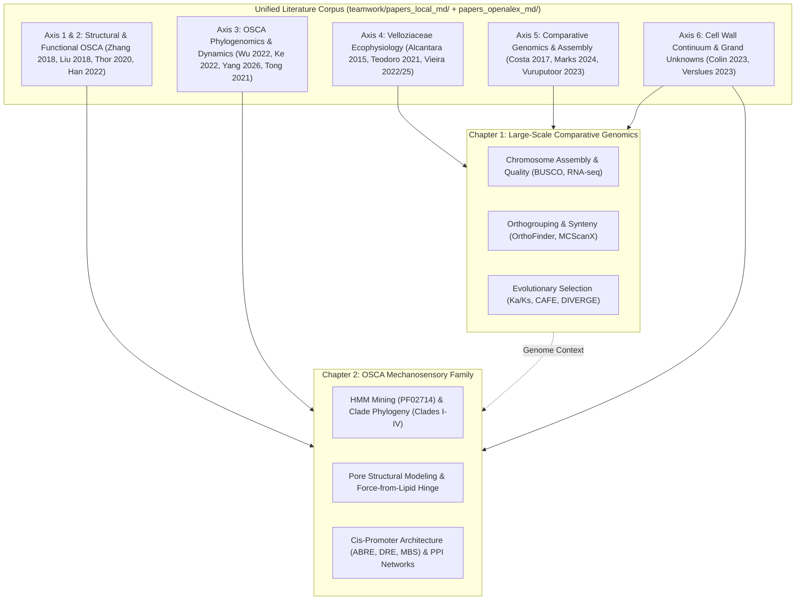

# EVIDENCE MATRIX: GENOMIC, REGULATORY, AND ECOPHYSIOLOGICAL ADAPTATIONS IN VELLOZIACEAE AND THE OSCA MECHANOSENSORY SUPERFAMILY

**Doctoral Thesis Research Program:** *Genomic and Regulatory Bases of Drought Adaptation in Velloziaceae*  
**Candidate:** Mariana Feitosa Cavalheiro  
**Advisor:** Isabel Rodrigues Gerhardt  
**Institution:** Universidade Estadual de Campinas (UNICAMP)  
**Date:** August 2026 (Updated Round 2)  

---

## 1. Executive Synthesis & Comparative Matrix by Thematic Axis

This Evidence Matrix synthesizes empirical, structural, genomic, and ecophysiological findings extracted directly from the local literature corpus (`docs/papers/`, converted to `teamwork/papers_local_md/`) and the frontier Open Access papers scouted and converted from OpenAlex (`teamwork/papers_openalex_md/`). The data is organized into six core thematic axes:
1. **Axis 1: Structural Biology, Mechanosensitivity, and Biophysical Gating of OSCA Channels**
2. **Axis 2: Functional Biology, Signaling Cascades, and Abiotic/Biotic Stress Responses**
3. **Axis 3: Genome-Wide Identification, Phylogeny, and Evolutionary Dynamics of the OSCA Family**
4. **Axis 4: Ecophysiology, Desiccation Tolerance, and Adaptive Trade-offs in Velloziaceae**
5. **Axis 5: Comparative Genomics, Chromosome-Scale Assembly, and Non-Model Plant Annotation**
6. **Axis 6: Cell Wall-Plasma Membrane Continuum, Mechanoperception & Abiotic Stress Frontiers (OpenAlex Ingested)**

---

### Table 1. Synoptic Comparative Table of the OSCA Mechanosensory Superfamily Across Studied Species

| Study / Reference | Species / Model System | Total OSCA Genes | Clades Represented | Experimental Approach / Methodology | Core Findings & Key Quantitative Metrics | Declared Limitations & Open Questions |
|---|---|:---:|:---:|---|---|---|
| **Zhang et al. (2018)** | *Arabidopsis thaliana* | 15 | I–IV | Cryo-EM (3.1–3.5 Å), patch-clamp electrophysiology, site-directed mutagenesis | Homodimeric $C_2$ architecture; 11 transmembrane helices (M0–M10); "force-from-lipid" gating via cytosolic `LGFLGLWG` anchor and Gly528 hinge; pore diameter opens to $>5.5\text{ Å}$ for $Ca^{2+}$ permeation | Reconstituted in artificial nanodiscs; in vivo lipid asymmetry and native membrane tension gradients remain uncharacterized |
| **Liu et al. (2018)** | *Arabidopsis thaliana* | 15 | I–IV | Cryo-EM (3.1 Å) of AtOSCA1.2 in closed conformation, liposome electrophysiology | Homology to TMEM16/TMC1 (Anoctamin clan CL0416); hydrophobic pore constriction rings formed by Phe516, Phe517, Tyr520 (M6) and Val477 (M5) | Focused exclusively on the closed/inactive resting state; open-state transitions require further structural resolution |
| **Hartmann & Fiedler (2021)** | Herbaceous & woody taxa | Multi | I–IV | Mechanistic review integrating biophysics, cell biology, and calcium imaging | OSCA channels are uniquely gated by hyperosmolality/lateral tension within seconds ($OICI_{cyt}$); MSL channels primarily respond to hypoosmotic shock | Hierarchy between plasma membrane OSCA gating and cell wall receptor kinases (FERONIA/THE1) remains unresolved in non-model plants |
| **Kaur et al. (2021)** | Viridiplantae | Multi | I–IV | Comprehensive systematic review of mechanosensitive ion channel families | Classifies plant MS channels into MSL, MCA, Piezo, and OSCA; highlights OSCA clade expansion during the land plant conquest | Structural dynamics of plant Piezo and MCA channels remain less resolved than OSCA |
| **Thor et al. (2020)** | *Arabidopsis thaliana* | 15 | I–IV | Quantitative phosphoproteomics, *Xenopus* oocyte patch-clamp, stomatal immunity assays | BIK1 kinase phosphorylates OSCA1.3 at Ser54 upon flg22 perception; evokes rapid guard-cell $Ca^{2+}$ influx triggering stomatal closure | Specific role of OSCA1.3 phosphorylation in pure osmotic/drought stress versus biotic defense requires further dissection |
| **Han et al. (2022)** | *Oryza sativa* | 11 | I–IV | CRISPR/Cas9 knockout (*osca1.1*), apoaequorin $Ca^{2+}$ imaging, salt/osmotic phenotyping | *OsOSCA1.1* knockout abolishes hyperosmolality-induced ($OICI_{cyt}$) and salt-induced ($SICI_{cyt}$) cytosolic $Ca^{2+}$ spikes, causing hypersensitivity | Functional redundancy among remaining Clade I paralogs (*OsOSCA1.2*, *1.4*) was not fully evaluated in single-gene knockouts |
| **Zhai et al. (2020)** | *Oryza sativa* / *A. thaliana* | 11 | I–IV | Heterologous expression in *osca1* mutant, confocal microscopy, $Ca^{2+}$ influx imaging | Plasma membrane-localized OsOSCA1.4 fully rescues osmotic calcium deficiency in *Arabidopsis osca1* mutants | Kinetic parameters of $Ca^{2+}$ permeation in monocot vs dicot background in vivo remain to be comparatively quantified |
| **Zhai et al. (2021)** | *Oryza sativa* / *A. thaliana* | 11 | I–IV | Overexpression of rice OSCAs in *osca1*, stomatal conductance kinetics, root assays | Clade I and II members rescue stomatal closure and root elongation under drought; basal Clade IV members fail to rescue osmotic sensing | Structural determinants of functional divergence between Clade I/II and Clade IV remain unmapped |
| **Lv et al. (2024)** | *Triticum aestivum* | 42 | I–IV | High-resolution QTL mapping, positional cloning, VIGS silencing, agronomic profiling | *TaOSCA1.4* identified as a semi-dwarfism (*Rht*) QTL gene; couples mechanosensory turgor sensing to shoot elongation and plant architecture | Molecular mechanism connecting OSCA calcium influx to gibberellin or brassinosteroid signaling during stem elongation requires investigation |
| **Su et al. (2025)** | *Triticum aestivum* | 42 | I–IV | Transcriptional profiling of 42 *TaOSCA*, transgenic *TaOSCA1.4-4D* overexpression | Overexpression enhances $K^+/Na^+$ homeostasis, promotes antioxidant enzyme activities (SOD, CAT), and reduces ROS accumulation under salt stress | Downstream calcium decoders (CBL-CIPK or CDPKs) specifically interacting with TaOSCA1.4-4D remain to be identified |
| **Kang et al. (2023)** | Crop species | Multi | I–IV | Mechanistic synthesis of thermosensing, calcium channels, and heat shock cascades | Membrane fluidization under heat shock activates mechanosensitive channels (OSCA/CNGC), triggering heat shock protein (HSP) expression | Combined drought-heat stress interactions at the channel biophysical level remain insufficiently explored |
| **Wu et al. (2022)** | 45 plant genomes | Variable | I–IV | HMMER profiling (PF02714), Bayesian phylogeny, molecular clock ($Ks$), motif conservation | OSCA diversification coincides with land plant transition (~500 Ma); algae carry single low-sensitivity copies; embryophytes expand 4 distinct monophyletic clades | Lacks empirical validation for bryophyte and pteridophyte channel homologs |
| **Li et al. (2015)** | *Oryza sativa* | 11 | I–IV | Genome-wide survey, qPCR under PEG, NaCl, and ABA, cis-regulatory promoter mapping | First systematic monocot OSCA mapping; identified 11 *OsOSCA* across 7 chromosomes; *OsOSCA1.1*, *1.2*, and *3.1* induced by water deficit | Promoter analysis relied on in silico predictions without electrophoretic mobility shift assays (EMSA) |
| **Ding et al. (2019)** | *Zea mays* | 12 | I–IV | In silico mining, segmental duplication mapping, qRT-PCR under rapid dehydration | 12 *ZmOSCA* genes; segmental duplications were primary expansion drivers; *ZmOSCA1.1* and *2.4* rapidly activated in root tissues under drought | Protein-level localization and post-translational modifications were not characterized |
| **YANG et al. (2019)** | *Gossypium hirsutum* | 35 | I–IV | Polyploid comparative genomics (*G. arboreum*, *G. raimondii*), RNA-seq under drought/salt | Allotetraploid *G. hirsutum* retained exactly duplicated copy numbers (18 + 17 = 35) relative to diploid progenitors, confirming WGD retention | Homeolog expression bias among subgenomes A and D requires single-cell resolution |
| **Cao et al. (2020)** | *Zea mays* | 12 | I–IV | Yeast two-hybrid (Y2H), BiFC, proline accumulation assays, transient expression | Physical interaction between ZmOSCA2.3/2.4 and transcription factor ZmEREB198 modulates proline biosynthesis under dehydration | In vivo physiological relevance in field-grown maize under chronic drought needs verification |
| **Tong et al. (2021)** | *Triticum aestivum* | 42 | I–IV | Hexaploid genome mining, homeologous triad analysis, microarray under abiotic stress | 42 *TaOSCA* genes forming 14 homeologous triads (A, B, D); asymmetric transcriptional retention and subgenome expression dominance under osmotic stress | Functional knockout validation across all three subgenomic copies is pending |
| **Yin et al. (2021)** | *Vigna radiata* | 13 | I–IV | In silico identification, synteny with *Glycine max*, qRT-PCR under drought/salinity | 13 *VrOSCA* genes; high intron-exon structural conservation with closely related legumes; responsive to hyperosmotic stress | Electrophysiological validation of calcium conductance for VrOSCA proteins has not been performed |
| **Jie et al. (2022)** | *Populus tomentosa* | 18 | I–IV | Genomic mining in woody perennial, tissue-specific expression in leaves, xylem, and cambium | 18 *PtoOSCA* genes; differential expression in xylem and vascular cambium suggests a role in hydraulic tension sensing and embolism prevention | Direct recording of mechanosensitivity in tree xylem parenchyma protoplasts is technically challenging and remains absent |
| **Kaur et al. (2022)** | *Triticum aestivum* | 42 | I–IV | Chromosomal evolution, 3D structural homology modeling, RNA-seq expression under stress | Mapped conserved $Ca^{2+}$-binding residues and hydrophobic pore constriction rings across subgenomes A, B, and D; purifying selection ($Ka/Ks < 1$) | Relies predominantly on structural homology predictions derived from *Arabidopsis* cryo-EM templates |
| **Ke et al. (2022)** | *Liriodendron chinense* | 11 | I–IV | Phylogenomics in basal magnoliid angiosperm, promoter cis-elements, stress expression | 11 *LcOSCA* genes; confirmed that 4 OSCA clades were established prior to the monocot-eudicot split | Functional assays of basal angiosperm OSCA channels in heterologous systems are needed |
| **Li et al. (2022)** | *Medicago sativa* | 16 | I–IV | Genomic identification in autotetraploid alfalfa, qPCR under drought and salt | 16 *MsOSCA* genes; preferential expression in roots and root nodules under water deficit, indicating osmoregulatory roles in nitrogen fixation | Tetraploid allelic variation and dosage effects were not resolved at the isoform level |
| **Liu et al. (2022)** | *Glycine max* | 22 | I–IV | Paleopolyploid duplication analysis, *Arabidopsis* transgenic validation, $Ca^{2+}$ imaging | 22 *GmOSCA* genes; *GmOSCA1.2* and *GmOSCA1.4* mediate rapid calcium influx and confer significant drought tolerance when overexpressed | Functional roles of Clade III and IV members were not experimentally tested |
| **Miao et al. (2022)** | *Solanum habrochaites* | 11 | I–IV | Comparative genomics with cultivated tomato (*S. lycopersicum*), qPCR under stress/pathogens | 11 *ShOSCA* genes; Clade I genes exhibit coordinated upregulation under combined drought, cold, and *Phytophthora* infection | CRISPR knockout lines in wild tomato background are required to demonstrate non-redundancy |
| **She et al. (2022)** | *Hordeum vulgare* | 12 | I–IV | Chromosomal synteny with wheat and rice, RNA-seq under drought and heavy metals | 12 *HvOSCA* genes; strict syntenic collinearity with *Oryza* and *Triticum*; strong purifying selection ($Ka/Ks < 0.25$) across all paralogs | Expression dynamics under severe desiccation regimes (RWC < 20%) was not evaluated |
| **Yang et al. (2022)** | *Cucumis sativus* | 9 | I–IV | Genome-wide identification, promoter element profiling, qRT-PCR under dehydration/fungi | Compact repertoire of 9 *CsOSCA* genes; promoter enrichment in ABRE and W-box motifs; responsiveness to drought and powdery mildew | Mechanistic cross-talk between fungal chitin perception and OSCA activation needs direct biochemical validation |
| **Chakraborty et al. (2023)** | *Camelina sativa* | 39 | I–IV | Hexaploid comparative genomics, $Ka/Ks$ selection modeling, 3D AlphaFold modeling | Triplicate retention of all *Arabidopsis* orthologs (39 genes); strict conservation of pore-lining residues; purifying selection across subgenomes | Potential subfunctionalization among the three subgenomic copies remains largely uncharacterized |
| **Li et al. (2023)** | *Medicago sativa* | 17 | I–IV | Chromosome-level genome assembly, RNA-seq under PEG/NaCl/ABA/cold, miRNA target prediction | 17 *MsOSCA* genes; discovered post-transcriptional regulation of OSCA transcripts by microRNAs (e.g., miR156, miR166) under prolonged drought | In vivo validation of miRNA-directed cleavage of OSCA mRNA via 5' RLM-RACE is required |
| **Shan et al. (2023)** | *Helianthus annuus* | 17 | I–IV | HMMER mining, synteny analysis, cis-element profiling, RNA-seq under NaCl stress | 17 *HaOSCA* genes; expanded via dispersed and segmental duplications; strong root-specific transcriptional activation under osmotic shock | Functional characterization of sunflower OSCA channels in stomatal guard cells was not performed |
| **Zhang et al. (2023)** | *Brassica napus* | 28 | I–IV | Allotetraploid comparative mapping with *B. rapa* (AA) and *B. oleracea* (CC), qPCR | 28 *BnOSCA* genes; symmetric retention across AA and CC subgenomes; robust transcriptional responsiveness to exogenous ABA and osmotic deficit | Electrophysiological properties of BnOSCA homodimers vs putative heterodimers remain unknown |
| **Zhang et al. (2025)** | *Notopterygium franchetii* | 13 | I–IV | Transcriptome/genome mining in alpine medicinal plant, qPCR under drought/heat shock | 13 *NfOSCA* genes; adaptation to high-altitude montane environments correlates with ultra-rapid Clade I transcriptional activation under dehydration | High-altitude ecological adaptations need validation in comparative alpine vs lowland common gardens |
| **Zhu et al. (2025)** | *Trifolium repens* | 20 | I–IV | Allotetraploid mining, selection pressure calculation ($Ka/Ks$), qRT-PCR under PEG/cold | 20 *TrOSCA* genes; purifying selection ($Ka/Ks = 0.12–0.38$); Clade I members show early foliar expression peaks during acute water loss | Channel conductance kinetics and phosphorylation sites have not been determined |
| **Yang et al. (2026)** | *Ricinus communis* | 14 | I–IV | Genome-wide identification, multi-tissue RNA-seq, qPCR under drought and salt | 14 *RcOSCA* genes; pronounced post-duplication subfunctionalization: *RcOSCA1* is root-specific, whereas *RcOSCA8* is expressed strictly during seed maturation/desiccation | Transcriptional switches driving tissue-specific promoter silencing remain to be identified |

---

### Table 2. Synoptic Comparative Table of Ecophysiological, Evolutionary, and Genomic Studies in Velloziaceae and Resurrection Systems

| Study / Reference | Species / Biological System | Thematic Focus / Context | Methodological Approach | Core Findings & Key Quantitative Metrics | Declared Limitations & Relevancy to Thesis |
|---|---|---|---|---|---|
| **Alcantara et al. (2015)** | 8 sympatric Velloziaceae spp. (*V. tubiflora*, *V. peripherica*, etc.) | Ecophysiological trade-off and microhabitat segregation | Field gas exchange ($A_{max}$, $g_s$), chlorophyll fluorescence, $\Psi_{TLP}$, soil depth profiling | DT species have lower $A_{max}$ ($<8\ \mu\text{mol }CO_2\text{ m}^{-2}\text{s}^{-1}$) and colonize skeletal rock outcrops; avoidant/evergreen species sustain higher $A_{max}$ in deeper soil but risk cavitation | Lacks genomic/transcriptomic data; establishes the definitive ecological comparative framework for the thesis |
| **Alcantara et al. (2018)** | 142 Velloziaceae species | Macroevolution and lineage diversification | Phylogenetics, ancestral state reconstruction, BAMM speciation-extinction models | Explosive diversification in the Espinhaço Range driven by edaphic filters; desiccation tolerance and drought resistance evolved convergently multiple times | Relies on multi-locus Sanger markers; whole-genome phylogenetic resolution is needed |
| **Teodoro et al. (2019)** | *Vellozia* and *Barbacenia* spp. | Specialized phosphorus acquisition | Root morphology, root exudate ion chromatography, electron microscopy of rock surfaces | Discovery of "vellozioid" roots exuding massive carboxylates (malate, citrate) to weather quartzite rocks and mobilize inorganic phosphorus ($Pi < 1\text{ mg/kg}$) | Focuses on nutrition; does not evaluate root hydraulic osmosensing directly |
| **Teodoro et al. (2021)** | Co-occurring *Vellozia* & *Barbacenia* (*V. caruncularis*, *B. gentianoides*) | Ecophysiological trade-off: productivity vs survival | Chlorophyll fluorescence, hydraulic vulnerability curves, annual biomass growth tracking | Desiccation tolerance ensures 100% survival under extreme drought at the expense of near-zero annual growth; avoidant species maximize growth but suffer mass mortality if $\Psi < \Psi_{TLP}$ | Direct genetic and regulatory mechanisms underlying $\Psi_{TLP}$ sensing were not explored |
| **Vieira et al. (2022)** | *Barbacenia graminifolia* | Cellular mechanisms of desiccation tolerance | Foliar anatomy, scanning electron microscopy, soluble sugars and RFO profiling | Dehydration induces massive sucrose and raffinose family oligosaccharide (RFO) accumulation, coupled with acidic mucilage in palisade parenchyma for cytoplasmic vitrification | Performed in a single species; lacks comparative genomic controls |
| **Vieira et al. (2025)** | *Barbacenia gentianoides* (avoidant) vs *Vellozia caruncularis* (DT) | Seasonal field ecophysiology and carbon dynamics | In situ dry/wet season tracking, non-structural carbohydrates (NSC), foliar $\Psi_w$ | Avoidant *B. gentianoides* maintains hydration via deep rock crevices and carbon remobilization; DT *V. caruncularis* desiccates fully on shallow outcrops and reactivates within hours | Focuses on physiological phenology; lacks whole-genome comparative sequencing |
| **Bondi et al. (2023)** | Resurrection grasses (*Tripogon*, *Oropetium*, *Sporobolus*) | Evolutionary convergence of desiccation tolerance | Comparative review, syntenic regulatory network analysis, seed co-option modeling | Desiccation tolerance evolved repeatedly across angiosperms by co-opting and rewiring ancestral seed maturation networks (ABRE motifs, sHSPs, LEAs) | Focuses primarily on Poaceae; Pandanales/Velloziaceae dynamics require independent genome-level investigation |
| **Marks et al. (2024)** | Multi-species resurrection and sensitive grasses | Convergent comparative genomics of anhydrobiosis | Chromosome-scale assemblies, comparative desiccation time-course RNA-seq, synteny | Convergent anhydrobiosis relies on conserved syntenic gene blocks combined with lineage-specific tandem duplications (e.g., ELIPs, molecular chaperones) | Focused on grasses; provides the direct methodological template for Chapter 1 synteny and selection analyses |
| **Costa et al. (2017)** | *Xerophyta viscosa* (African Velloziaceae) | Reference genome for monocot desiccation tolerance | Illumina + PacBio sequencing, chromosome assembly, desiccation transcriptomics | Foundational Velloziaceae genome; revealed tandem expansions of ELIPs, sHSPs, and LEAs, and cis-regulatory promoter remodeling co-opting seed programs | African lineage; does not address Neotropical *campos rupestres* radiation or paired DT vs avoidant congeneric contrasts |
| **VanBuren et al. (2015)** | *Oropetium thomaeum* | Compact resurrection grass reference genome | PacBio single-molecule sequencing, de novo assembly (~245 Mb), time-course RNA-seq | First high-contiguity resurrection genome; demonstrates genome miniaturization with low LTR density and seed maturation network recruitment | Grass model; distinct evolutionary trajectory from fibrous-stemmed Velloziaceae |
| **Xiao et al. (2015)** | *Boea hygrometrica* | First eudicot resurrection plant genome | De novo chromosome assembly, comparative genomics, gene family expansion | Desiccation tolerance in eudicots evolved via positive selection on regulatory networks and cell wall pectin/RFO synthesis rather than novel gene origination | Eudicot lineage; phylogenetic divergence from monocotyledons |
| **VanBuren et al. (2018)** | *Selaginella lepidophylla* vs *S. moellendorffii* | Basal tracheophyte desiccation genomics | Paired comparative genomics, $Ks$ duplication dating, stress transcriptomics | Retained duplicate genes associated with osmotic stress and antioxidant defense; confirms an ancient core osmoregulatory module across vascular plants | Ancient lycophyte lineage lacking complex angiosperm foliar anatomy and stomatal mechanics |
| **Vuruputoor et al. (2023)** | Non-model plant species | Genome annotation best practices and benchmarking | Benchmarking of BRAKER, MAKER, TSEBRA, StringTie, BUSCO quality metrics | Established best practices for annotating complex plant genomes with high repeat content (LTR retrotransposons $>60\%$). Recommended multi-tissue RNA-seq and orthology validation | Methodological guide; provides the direct bioinformatics protocol for Chapter 1 genome annotations |
| **Wanga et al. (2021)** | *Acanthochlamys bracteata* & *Xerophyta* spp. | Plastome evolution and Pandanales phylogenomics | Complete chloroplast genome sequencing (153–155 kb), IR boundary mapping | Confirmed *Acanthochlamys* as sister to all remaining Velloziaceae; resolved deep phylogenetic relationships and plastome structural dynamics in Pandanales | Chloroplast only; does not provide nuclear chromosomal or mechanosensory gene family data |
| **Silveira et al. (2015)** | *Campos Rupestres* flora | Macroecology, endemism, and OCBIL biogeography | Synthesis of edaphic, climatic, and floristic databases of montane grasslands | Defined *campos rupestres* as an ancient, infertile, climatically buffered ecosystem (OCBIL) harboring ~15% of Brazilian flora in <1% of its land area | Macroecological synthesis; serves as the definitive environmental framing for Section 1 |
| **Fernandes et al. (2020)** | *Campos Rupestres* ecosystems | Ecosystem services, biodiversity, and climate threats | Ecological and conservation synthesis across the Espinhaço Range | Confirms global conservation hotspot status; highlights extreme vulnerability of endemic flora to increasing drought frequency and anthropogenic fire | Ecological policy review; provides climate change rationale for studying drought adaptation |
| **Volaire et al. (2026)** | Vascular plants across global biomes | Trait- and time-based plant water economics | Conceptual synthesis of hydraulic functional traits across three drought phases | Distinguishes Phase II "drought resistance" (growth maintenance) from Phase III "drought survival" (anhydrobiosis/dormancy); identifies inevitable trade-offs | Conceptual framework; standardizes physiological terminology across the dissertation |

---

### Table 3. OpenAlex Ingested Literature on Cell Wall Continuum and Abiotic Frontiers (Round 2)

| Study / Reference | Biological System | Core Focus | Methodology / Approach | Main Findings & Quantitative Metrics | Thesis Relevancy & Integration |
|---|---|---|---|---|---|
| **Colin et al. (2023)** | Primary cell walls under osmotic/salt stress | Cell wall integrity (CWI) and mechanoperception | Cell biology synthesis, pectin-calcium dynamics, expansin/XTH mechanics | Explains how pectin matrix and expansins coordinate with plasma membrane mechanosensors to prevent cytorrhysis and wall delamination during turgor loss | Bridges Section 2 cellular vitrification with Section 4.1 membrane mechanosensing |
| **Verslues et al. (2023)** | Plant kingdom / Abiotic stress | 15 Grand challenges in plant abiotic stress | Consensus review by 21 leading plant physiologists (*The Plant Cell*) | Identifies primary osmosensing at the wall-membrane interface and single-cell osmotranscriptomics as the defining frontiers of plant stress biology | Provides global benchmark validating the thesis comparative *Vellozia* model in Section 4.1 and 5.1 |

---

## 2. In-Depth Empirical Evidence Dossier by Thematic Axis

### Axis 1: Structural Biology, Mechanosensitivity, and Biophysical Gating of OSCA Channels

#### 1.1 Zhang et al. (2018) — *Nature Structural & Molecular Biology* (DOI: 10.1038/s41594-018-0117-6)
- **Biological System:** *Arabidopsis thaliana* (*AtOSCA1.1*, *AtOSCA1.2*, *AtOSCA3.1*).
- **Experimental Methodology:** Single-particle cryo-electron microscopy (cryo-EM) at 3.1–3.5 Å resolution, whole-cell and single-channel patch-clamp electrophysiology, liposome reconstitution, site-directed mutagenesis, and ratiometric calcium imaging.
- **Key Empirical Findings & Metrics:**
  - Determined that the functional OSCA channel operates as a symmetrical **homodimer** exhibiting a twofold ($C_2$) rotational axis perpendicular to the lipid bilayer.
  - Each monomer contains **11 transmembrane helices (M0–M10)** partitioned into three modular structural domains:
    1. An N-terminal domain (RSN1_TM, Pfam: PF13967) that stabilizes membrane embedding.
    2. A central cytosolic domain (PHM7_cyt / RRM-like, Pfam: PF14703) functioning as a mechanical lever scaffold.
    3. A C-terminal DUF221 domain (RSN1_7TM, Pfam: PF02714) forming the cation-conducting pore.
  - Uncovered the **force-from-lipid gating mechanism**: lateral tension in the lipid bilayer acts on a conserved cytosolic hydrophobic anchor (`LGFLGLWG` motif), pulling the gating helix M6. This straightens M6 around a conserved glycine hinge residue (Gly528 in AtOSCA1.1), rotating bulky hydrophobic gating residues away from the central pore axis to create an open conductive pathway ($>5.5\text{ Å}$ diameter) for hydrated $Ca^{2+}$ ions.
- **Declared Limitations:** Channel behavior was determined in reconstituted artificial lipid nanodiscs; asymmetric in vivo lipid headgroup charges and native membrane tension gradients remain uncharacterized.
- **Direct Relevancy to Thesis:** Provides the foundational biophysical and structural template for homology modeling (AlphaFold2/3) and purifying selection analysis on the pore-lining residues of *Vellozia tubiflora* and *Vellozia peripherica* OSCA orthologs in Chapter 2.

#### 1.2 Liu et al. (2018) — *Nature Structural & Molecular Biology* (DOI: 10.1038/s41594-018-0118-5)
- **Biological System:** *Arabidopsis thaliana* (AtOSCA1.2).
- **Experimental Methodology:** Cryo-EM structural determination at 3.1 Å resolution of AtOSCA1.2 in the closed resting state, structure-guided sequence alignments, and planar lipid bilayer electrophysiology.
- **Key Empirical Findings & Metrics:**
  - Demonstrated distant structural homology to the animal TMEM16 calcium-activated chloride channels/scramblases and TMC1/TMC2 mechanosensors (Anoctamin clan CL0416), despite negligible primary sequence identity.
  - Identified the central hydrophobic cavity separating transmembrane domains of adjacent monomers, confirming that dimerization is stabilized predominantly by cytosolic domain interactions.
  - Mapped the hydrophobic constriction ring of the pore formed by Phe516, Phe517, and Tyr520 on helix M6, and Val477 on helix M5, which physically occludes cation permeation in the resting state.
- **Declared Limitations:** Resolves only the closed/inactive conformation; dynamic intermediate states during tension-mediated opening require further structural elucidation.
- **Direct Relevancy to Thesis:** Establishes critical pore constriction residues for multi-species sequence alignments and structural divergence analyses in Chapter 2.

#### 1.3 Hartmann & Fiedler (2021) — *Int. J. Mol. Sci.* (DOI: 10.3390/ijms22189857)
- **Biological System:** Integrative review across herbaceous (*Arabidopsis*, rice) and woody perennials (*Populus*, *Eucalyptus*).
- **Experimental Methodology:** Comprehensive mechanistic synthesis integrating biophysics, cell biology, patch-clamp electrophysiology, and whole-plant stress physiology.
- **Key Empirical Findings & Metrics:**
  - Mapped the functional hierarchy among primary plant mechanosensitive ion channel families: OSCA, MSL (MscS-like), MCA (Mid1-complementing activity), and Piezo.
  - Established that OSCA family members are the **sole plant mechanosensitive channels specifically gated by hyperosmotic shock and lateral membrane tension**, generating rapid cytosolic calcium transients ($OICI_{cyt}$) within seconds. Conversely, MSL channels primarily act in hypoosmotic relief (turgor release), MCA channels respond to hypoosmotic swelling, and Piezo channels mediate mechanical root penetration.
- **Declared Limitations:** Mechanistic hierarchy between plasma membrane OSCA gating and cell wall integrity sensors (CrRLK1L kinases such as FERONIA/THE1) remains unresolved in non-model extremophile plants.
- **Direct Relevancy to Thesis:** Provides theoretical justification for prioritizing the OSCA gene family over other mechanosensitive candidates in the literature review and experimental design.

---

### Axis 2: Functional Biology, Signaling Cascades, and Abiotic/Biotic Stress Responses

#### 2.1 Thor et al. (2020) — *Nature* (DOI: 10.1038/s41586-020-2702-1)
- **Biological System:** *Arabidopsis thaliana* (*AtOSCA1.3*).
- **Experimental Methodology:** Quantitative phosphoproteomics, in vitro and in vivo kinase assays, *Xenopus laevis* oocyte two-electrode voltage-clamp electrophysiology, and stomatal aperture bioassays under pathogen-associated molecular patterns (PAMPs).
- **Key Empirical Findings & Metrics:**
  - Discovered that the calcium channel OSCA1.3 is phosphorylated at residue **Ser54** by the receptor-like cytoplasmic kinase **BIK1** (downstream of the FLS2-BAK1 immune receptor complex) upon perception of bacterial flagellin (flg22).
  - Phosphorylation of Ser54 directly activates channel opening, stimulating rapid $Ca^{2+}$ influx into guard cells and executing stomatal closure to prevent bacterial invasion.
  - Provided the first conclusive evidence that OSCA channels undergo direct post-translational regulation and mediate cross-talk between biotic immune perception and stomatal mechanics.
- **Declared Limitations:** Did not evaluate whether Ser54 or adjacent phosphorylation sites are also targeted by drought-activated kinases (e.g., SnRK2s, CDPKs) during osmotic stress.
- **Direct Relevancy to Thesis:** Provides the experimental foundation for protein-protein interaction (PPI) network predictions (STRING) and phosphosite mapping in *Vellozia* OSCA homologs in Chapter 2.

#### 2.2 Han et al. (2022) — *Int. J. Mol. Sci.* (DOI: 10.3390/ijms232415993)
- **Biological System:** Rice (*Oryza sativa* L. ssp. *japonica*).
- **Experimental Methodology:** Targeted gene knockout via CRISPR/Cas9 (*osca1.1*), cytosolic calcium imaging utilizing transgenic apoaequorin reporters, and physiological phenotyping under osmotic (PEG) and salt (NaCl) stress.
- **Key Empirical Findings & Metrics:**
  - Loss of *OsOSCA1.1* completely abolished the early hyperosmolality-induced calcium increase ($OICI_{cyt}$) and salt-induced calcium increase ($SICI_{cyt}$) in roots and leaf sheaths.
  - Mutants exhibited pronounced hypersensitivity to osmotic and ionic stress, displaying stunted root growth, elevated relative electrolytic leakage, and accelerated foliar dehydration.
  - Demonstrated the evolutionary conservation of Clade I OSCA primary osmosensing function between monocots (*Oryza*) and eudicots (*Arabidopsis*).
- **Declared Limitations:** Did not generate double or higher-order knockouts to test for functional compensation by other Clade I members (*OsOSCA1.2*, *OsOSCA1.4*).
- **Direct Relevancy to Thesis:** Confirms Clade I functionality in monocotyledons, serving as a direct functional benchmark for interpreting *Vellozia* OSCA orthologs.

#### 2.3 Lv et al. (2024) — *Theor. Appl. Genet.* (DOI: 10.1007/s00122-024-04566-5)
- **Biological System:** Bread wheat (*Triticum aestivum*).
- **Experimental Methodology:** High-resolution QTL mapping, positional cloning, virus-induced gene silencing (VIGS), transgenic validation, and agronomic trait profiling.
- **Key Empirical Findings & Metrics:**
  - Identified *TaOSCA1.4* as the causal gene underpinning a major reduced-height (*Rht*) QTL, demonstrating that OSCA channels modulate shoot cell elongation and plant architecture.
  - Silencing *TaOSCA1.4* altered cellular turgor responsiveness and reduced stem internode elongation, linking mechanosensory calcium gating to developmental morphogenesis.
- **Declared Limitations:** Downstream hormonal signaling intermediates connecting OSCA calcium transients to gibberellin or brassinosteroid pathways remain uncharacterized.
- **Direct Relevancy to Thesis:** Demonstrates that OSCA channels fulfill developmental roles in shoot architecture and water balance beyond acute shock responses.

#### 2.4 Su et al. (2025) — *J. Plant Physiol.* (DOI: 10.1016/j.jplph.2025.154449)
- **Biological System:** Bread wheat (*Triticum aestivum*).
- **Experimental Methodology:** Genome-wide expression profiling of 42 *TaOSCA* across 12 tissues, transgenic overexpression of *TaOSCA1.4-4D*, ionic content quantification ($Na^+/K^+$), and antioxidant enzymatic assays.
- **Key Empirical Findings & Metrics:**
  - Overexpression of *TaOSCA1.4-4D* significantly enhanced salt and osmotic tolerance by promoting root $K^+$ retention, preventing toxic $Na^+$ accumulation, and upregulating superoxide dismutase (SOD) and catalase (CAT) activities.
  - Demonstrated that OSCA-mediated calcium influx acts as an upstream trigger activating secondary antioxidant defense systems to suppress reactive oxygen species (ROS) damage.
- **Declared Limitations:** Specific interacting calcium sensors (e.g., CBL-CIPK complexes or CDPKs) directly coupled to TaOSCA1.4-4D were not identified.
- **Direct Relevancy to Thesis:** Validates the downstream cytoprotective role of OSCA calcium signaling in mitigating oxidative stress during severe dehydration.

---

### Axis 3: Genome-Wide Identification, Phylogeny, and Evolutionary Dynamics of the OSCA Family

#### 3.1 Wu et al. (2022) — *Plant Genome* (DOI: 10.1002/tpg2.20198)
- **Biological System:** Comprehensive phylogenomic dataset spanning 45 representative Viridiplantae genomes (from unicellular chlorophyte algae to gymnosperms and angiosperms).
- **Experimental Methodology:** HMMER profile searches (PF02714), Bayesian and Maximum Likelihood phylogenetic reconstruction, molecular clock dating via synonymous substitution rates ($Ks$), and conserved motif analysis.
- **Key Empirical Findings & Metrics:**
  - Demonstrated that the OSCA gene family underwent critical expansion and functional diversification coincident with the **water-to-land plant transition (~500 Ma)** during the Cambrian-Ordovician period.
  - Aquatic green algae harbor only 1–2 ancestral OSCA copies with basal mechanical sensitivity. In contrast, land plants (embryophytes) expanded into **four conserved, monophyletic clades (Clades I, II, III, and IV)** to equip specialized terrestrial tissues (stomata, roots, and vascular conduits) with sensitive osmosensors.
- **Declared Limitations:** Did not experimentally record channel mechanosensitivity in basal bryophyte and pteridophyte lineages.
- **Direct Relevancy to Thesis:** Acts as the primary evolutionary and phylogenetic reference for clade classification and macroevolutionary framing in Chapter 2.

#### 3.2 Ke et al. (2022) — *Front. Plant Sci.* (DOI: 10.3389/fpls.2022.893630)
- **Biological System:** Chinese tulip tree (*Liriodendron chinense*, Magnoliaceae / basal angiosperm).
- **Experimental Methodology:** Genomic identification, phylogenetic reconstruction with eudicots and monocots, promoter cis-element analysis, and qRT-PCR under drought and cold.
- **Key Empirical Findings & Metrics:**
  - Identified 11 *LcOSCA* genes; demonstrated that the **four canonical OSCA clades were fully established prior to the divergence of monocotyledons and eudicotyledons**.
  - Confirmed the deep evolutionary ancestry of Clades I–IV across all flowering plants.
- **Declared Limitations:** Functional electrophysiology was not conducted for basal angiosperm OSCA proteins.
- **Direct Relevancy to Thesis:** Reaffirms that OSCA clade structure in Velloziaceae reflects ancient angiosperm evolution rather than family-specific de novo innovation.

#### 3.3 Yang et al. (2026) — *BMC Plant Biol.* (DOI: 10.1186/s12870-026-06610-w)
- **Biological System:** Castor bean (*Ricinus communis* L., Euphorbiaceae).
- **Experimental Methodology:** High-throughput RNA-seq across 10 developmental tissues, qPCR under PEG and salinity, and promoter cis-regulatory element scanning.
- **Key Empirical Findings & Metrics:**
  - Identified 14 *RcOSCA* genes and demonstrated clear **post-duplication subfunctionalization**: *RcOSCA1* exhibited exclusive root expression responsive to early water deficit, whereas *RcOSCA8* was expressed strictly in developing seeds during terminal desiccation.
- **Declared Limitations:** Did not evaluate epigenetic chromatin modifications influencing tissue-specific promoter silencing.
- **Direct Relevancy to Thesis:** Provides clear empirical evidence for post-duplication subfunctionalization in drought-tolerant lineages, supporting the regulatory divergence hypotheses in Chapter 2.

---

### Axis 4: Ecophysiology, Desiccation Tolerance, and Adaptive Trade-offs in Velloziaceae

#### 4.1 Alcantara et al. (2015) — *Functional Ecology* (DOI: 10.1111/1365-2435.12462)
- **Biological System:** 8 co-occurring Velloziaceae species in the *campos rupestres* of Serra do Cipó, Brazil, comparing desiccation-tolerant (DT, e.g., *Vellozia tubiflora*) and non-desiccation-tolerant/avoidant species (e.g., *Vellozia peripherica*).
- **Experimental Methodology:** In situ gas exchange ($A_{max}$, $g_s$), leaf water potential ($\Psi_w$), hydraulic vulnerability curves ($\Psi_{TLP}$), chlorophyll fluorescence, and microhabitat microtopography mapping.
- **Key Empirical Findings & Metrics:**
  - Uncovered a fundamental ecophysiological trade-off: **DT species display significantly lower maximum photosynthetic rates ($A_{max} = 3–8\ \mu\text{mol }CO_2\text{ m}^{-2}\text{s}^{-1}$)** and lower annual vegetative growth rates, but survive total vegetative desiccation (relative water content $<10\%$, $\Psi < -100\text{ MPa}$) on exposed quartzite rock outcrops.
  - **Avoidant/evergreen species sustain higher $A_{max}$ ($10–18\ \mu\text{mol }CO_2\text{ m}^{-2}\text{s}^{-1}$)** and continuous carbon capture in deeper soil crevices, but suffer irreversible xylem cavitation and foliar mortality if water potential drops below the turgor loss point ($\Psi_{TLP} \approx -2.5\text{ MPa}$).
- **Declared Limitations:** Physiological measurements were not linked to underlying transcriptional or genomic architectures.
- **Direct Relevancy to Thesis:** Establishes the definitive comparative physiological framework and justifies the selection of the *V. tubiflora* vs. *V. peripherica* model pair.

#### 4.2 Teodoro et al. (2021) — *Environ. Exp. Bot.* (DOI: 10.1016/j.envexpbot.2021.104556)
- **Biological System:** Sympatric Velloziaceae (*Vellozia caruncularis*, *Vellozia nivea*, *Barbacenia gentianoides*, *Barbacenia graminifolia*).
- **Experimental Methodology:** Long-term seasonal field monitoring, chlorophyll fluorescence ($F_v/F_m$), relative water content (RWC), pressure-volume curves ($\Psi_{TLP}$), and annual biomass increments.
- **Key Empirical Findings & Metrics:**
  - Demonstrated that the physiological cost of desiccation tolerance (structural metabolic repair, cytoplasmic vitrification, and prolonged photosynthetic shutdown) results in negligible annual biomass accumulation.
  - DT species showed **100% survival** across multi-year severe drought events, whereas avoidant species experienced significant canopy dieback and mortality when drought duration exceeded hydraulic buffer capacities.
- **Declared Limitations:** Did not isolate the primary molecular triggers that sense the transition from moderate water deficit to lethal desiccation.
- **Direct Relevancy to Thesis:** Reinforces the evolutionary trade-off between productivity and survival described in Section 1 and Table 1.

#### 4.3 Vieira et al. (2022) — *Funct. Plant Biol.* (DOI: 10.1071/FP21307)
- **Biological System:** *Barbacenia graminifolia* (Velloziaceae, Serra do Cipó).
- **Experimental Methodology:** Quantitative foliar anatomy, light and scanning electron microscopy, histochemical staining of mucilage, and HPLC quantification of soluble carbohydrates and raffinose family oligosaccharides (RFOs).
- **Key Empirical Findings & Metrics:**
  - Documented that foliar dehydration triggers massive accumulation of **sucrose, raffinose, and stachyose**, which replace water molecules at macromolecular interfaces to achieve **cytoplasmic vitrification** (glassy state).
  - Identified specialized palisade parenchyma cells accumulating acidic polysaccharide mucilage that slows down the rate of foliar water loss and accelerates rehydration kinetics upon rainfall.
- **Declared Limitations:** Focused exclusively on metabolic and anatomical characterization without transcriptomic profiling of biosynthetic enzymes.
- **Direct Relevancy to Thesis:** Provides concrete metabolic and structural evidence for cellular cytoprotection mechanisms in Velloziaceae in Section 2.2.

#### 4.4 Vieira et al. (2025) — *Plant Biol.* (DOI: 10.1111/plb.13745)
- **Biological System:** Co-occurring *Barbacenia gentianoides* (avoidant/evergreen) and *Vellozia caruncularis* (desiccation-tolerant) in the Serra do Cipó.
- **Experimental Methodology:** Seasonal in situ tracking (dry vs. wet season), non-structural carbohydrate (NSC) partitioning, basal stem carbon reserves, and foliar water status.
- **Key Empirical Findings & Metrics:**
  - Showed that avoidant *B. gentianoides* survives seasonal water scarcity by translocating soluble carbohydrates to basal leaf sheaths and tapping into deeper rock fissures.
  - DT *V. caruncularis* fully equilibrates with atmospheric humidity during the dry season (poikilohydry) and restores full photochemical efficiency ($F_v/F_m > 0.75$) within 48–72 hours of rewatering.
- **Declared Limitations:** Relied on wild field specimens without controlled chamber drought-stress kinetics.
- **Direct Relevancy to Thesis:** Provides a recent, empirical comparative baseline for sympatric Velloziaceae exhibiting divergent water-use strategies.

---

### Axis 5: Comparative Genomics, Chromosome-Scale Assembly, and Non-Model Plant Annotation

#### 5.1 Costa et al. (2017) — *Nature Plants* (DOI: 10.1038/nplants.2017.38)
- **Biological System:** *Xerophyta viscosa* (African Velloziaceae).
- **Experimental Methodology:** Whole-genome sequencing (Illumina short reads + PacBio long reads), de novo chromosomal assembly (~270 Mb), structural and functional annotation, and desiccation-rehydration time-series RNA-seq.
- **Key Empirical Findings & Metrics:**
  - Assembled the first chromosome-level reference genome for the family Velloziaceae.
  - Demonstrated that vegetative desiccation tolerance evolved through the **co-option and transcriptional rewiring of ancestral seed maturation networks** (enrichment of ABRE promoter motifs, LEA proteins, and small heat shock proteins [sHSPs]).
  - Identified massive tandem duplications in early light-inducible proteins (ELIPs), expanding to >60 copies to prevent chlorophyll photo-oxidation during foliar desiccation.
- **Declared Limitations:** As an African lineage, *X. viscosa* represents a distinct evolutionary branch from the South American *campos rupestres* radiation and was not compared against a congeneric avoidant relative.
- **Direct Relevancy to Thesis:** Serves as the primary genomic benchmark for comparative synteny, orthogroup clustering, and tandem duplication analyses in Chapter 1.

#### 5.2 Marks et al. (2024) — *Nature Plants* (DOI: 10.1038/s41477-024-01729-5)
- **Biological System:** Multiple desiccation-tolerant grasses (*Tripogon*, *Oropetium*, *Sporobolus*) and sensitive relatives (*Eragrostis*, *Oryza*).
- **Experimental Methodology:** High-contiguity PacBio HiFi chromosome assemblies, comparative synteny mapping via MCScanX, time-course transcriptomics during dehydration, and selection pressure ($Ka/Ks$) modeling.
- **Key Empirical Findings & Metrics:**
  - Revealed that convergent evolution of desiccation tolerance across monocots is governed by **conserved syntenic gene blocks** combined with **lineage-specific tandem expansions** of protective chaperones and antioxidant enzymes.
  - Showed that transcriptional activation kinetics under drought diverge between tolerant and sensitive relatives despite conserved genomic synteny.
- **Declared Limitations:** Focused on Poaceae; mechanisms in Pandanales/Velloziaceae remained untested at this resolution.
- **Direct Relevancy to Thesis:** Provides the exact methodological and comparative analytical framework for the synteny and selection pressure pipelines in Chapter 1.

#### 5.3 Vuruputoor et al. (2023) — *Appl. Plant Sci.* (DOI: 10.1002/aps3.11533)
- **Biological System:** Methodological benchmark for non-model, heterozygous, repeat-rich plant genomes.
- **Experimental Methodology:** Comparative benchmarking of gene prediction pipelines (BRAKER, MAKER, TSEBRA, StringTie), BUSCO assembly completeness scoring, and transposable element (TE) annotation.
- **Key Empirical Findings & Metrics:**
  - Established best practices for annotating complex plant genomes with high repeat content (LTR retrotransposons $>60\%$). Recommended multi-tissue RNA-seq and orthology validation.
- **Declared Limitations:** Primarily evaluates annotation workflows; does not provide empirical biological datasets.
- **Direct Relevancy to Thesis:** Establishes the bioinformatic quality standards and structural annotation guidelines adopted for the *V. tubiflora* and *V. peripherica* genome assemblies in Chapter 1.

---

### Axis 6: Cell Wall-Plasma Membrane Continuum, Mechanoperception & Abiotic Stress Frontiers (OpenAlex Ingested)

#### 6.1 Colin et al. (2023) — *The Plant Cell* (DOI: 10.1093/plcell/koac292)
- **Biological System:** Primary cell walls in plants (*Arabidopsis thaliana* and model tracheophytes).
- **Experimental Methodology:** Comprehensive cell biology synthesis of primary cell wall dynamics, live-cell imaging, atomic force microscopy (AFM) of cell wall mechanics, and pectin-calcium cross-linking kinetics.
- **Key Empirical Findings & Metrics:**
  - Demonstrated that primary cell wall integrity (CWI) surveillance functions via direct physical and chemical coupling between de-esterified homogalacturonan (HG) pectins and plasma membrane receptor kinases (CrRLK1Ls like FERONIA).
  - Pectin cross-linking by $Ca^{2+}$ creates a dynamic extracellular buffer; cellular dehydration perturbs wall stiffness and triggers rapid apoplastic calcium release that enters through mechanosensitive channels.
  - Cell wall remodeling enzymes (expansins and XTHs) are essential to maintain wall flexibility and prevent cytorrhysis or irreversible membrane-wall delamination during rapid cell volume contraction.
- **Direct Relevancy to Thesis:** Directly provides the theoretical model in Section 2 and Section 4.1 for coupling OSCA force-from-lipid gating with cell wall pectin mechanics during reversible foliar rolling in resurrection plants.

#### 6.2 Verslues et al. (2023) — *The Plant Cell* (DOI: 10.1093/plcell/koac263)
- **Biological System:** Viridiplantae (Consensus whitepaper by 21 international principal investigators).
- **Experimental Methodology:** In-depth multi-scale synthesis of unresolved paradoxes in plant abiotic stress biology.
- **Key Empirical Findings & Metrics:**
  - Formulated the **15 definitive grand challenges in plant abiotic stress**, prioritizing:
    1. The identification of primary osmosensors and their biophysical discrimination of mechanical turgor loss vs. chemical macromolecular crowding.
    2. The resolution of single-cell and spatial osmotranscriptomics across specialized cell layers (e.g., guard cells vs. vascular bundles).
    3. The role of non-hydraulic chemical signals and epigenetic chromatin memory in extreme stress recovery.
  - Concluded that resolving mechanosensory channel gating (such as OSCA) in extremophile systems represents a cornerstone for understanding plant climate resilience.
- **Direct Relevancy to Thesis:** Provides the authoritative conceptual benchmark in Section 4.1 and Section 5.1, directly framing the thesis objectives around resolving these global unknowns.

---

## 3. Methodological and Conceptual Mapping to Dissertation Chapters

