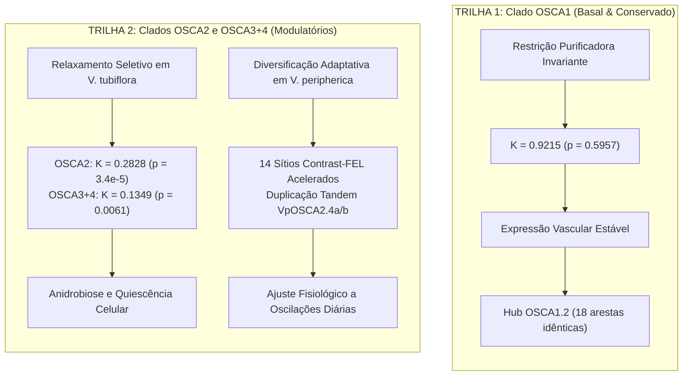

# CAPÍTULO 2: ARQUITETURA GENÔMICA, SINTENIA COMPARATIVA E DINÂMICA EVOLUTIVA DOS CANAIS MECANOSSENSÍVEIS DE CÁLCIO OSCA EM VELLOZIACEAE DE RESSURREIÇÃO E SEMPRE-VERDE

**Tese de Doutorado:** Bases Genômicas e Regulatórias da Adaptação à Seca em Velloziaceae  
**Candidata:** Mariana Feitosa Cavalheiro  
**Orientadora:** Profa. Dra. Isabel Rodrigues Gerhardt  
**Instituição:** Instituto de Biologia — Universidade Estadual de Campinas (UNICAMP)  

---

## RESUMO

A percepção mecânica das perturbações da membrana plasmática durante a desidratação celular representa o passo primário na aclimatação vegetal ao estresse hídrico. Em angiospermas, os canais permeáveis a cálcio ativados por hiperosmolalidade (OSCA) funcionam como transdutores mecanossensíveis essenciais que convertem a tensão de membrana em transientes de cálcio citosólico. Contudo, as forças evolutivas que moldam esse aparato sensorial primário entre linhagens extremófilas com estilos de vida ecofisiológicos contrastantes permanecem desconhecidas. Neste estudo, apresentamos uma investigação comparativa em escala cromossômica da família gênica OSCA em duas monocotiledôneas simpátricas dos campos rupestres neotropicais: a especialista em ressurreição tolerante à dessecação *Vellozia tubiflora* e a espécie sensível e sempre-verde *Vellozia peripherica*. Buscas estruturadas via HMMER e InterProScan nas montagens em nível cromossômico identificaram 14 genes OSCA em *V. peripherica* e 13 em *V. tubiflora*, evidenciando uma notável estabilidade numérica. A macrossintenia comparativa recuperou 297 blocos colineares, posicionando todos os loci OSCA em blocos estritamente conservados nos cromossomos 1A, 4A, 5A, 7A, 8A e 9A. Um bloco ancestral de duplicação genômica total (WGD) interligando os cromossomos 1A e 5A abrigou parálogos duplicados nos clados 2 (*OSCA2.1/2.2*) e 3 (*OSCA3.1/3.2*), enquanto um cluster em tandem fisicamente contíguo (*OSCA1.3/1.4/1.5*) no cromossomo 7A foi preservado com zero genes intercalares em ambas as espécies. A modelagem de taxas moleculares de evolução revelou um **Modelo Evolutivo de Duas Vias (*Dual-Track Evolutionary Model*)**: o clado basal OSCA1 evoluiu sob estrita e invariante seleção purificadora ($K = 0,9215; p = 0,5957$), mantendo perfis conservados de expressão vascular e radicular e conectividade topológica central de hub (18 interatores para *OSCA1.2*). Em contrapartida, os clados modulatórios OSCA2 e OSCA3+4 divergiram profundamente: *V. tubiflora* exibiu relaxamento seletivo maciço (OSCA2: $K = 0,2828; p = 3,4 \times 10^{-5}$; OSCA3+4: $K = 0,1349; p = 0,0061$), o que indica que a dormência anidrobiótica altera a restrição evolutiva primária, enquanto *V. peripherica* apresentou diversificação adaptativa ativa, caracterizada por 14 sítios de códons sob aceleração seletiva em Contrast-FEL no clado OSCA2 e uma duplicação em tandem linhagem-específica (*VpOSCA2.4a/b*) acompanhada por divergência *cis*-regulatória promotora e partição de parceiros de interactoma. Esses resultados demonstram que a transição evolutiva para a tolerância à dessecação opera pelo relaxamento seletivo de uma camada sensorial modulatória sobre um núcleo basal invariante, oferecendo subsídios fundamentais para a engenharia de resiliência à seca em culturas agrícolas.

---

## 1. INTRODUÇÃO

A disponibilidade hídrica atua como o principal fator ambiental limitante da produtividade primária, distribuição geográfica e estruturação ecológica da vegetação terrestre em escala global (LAMERS et al., 2020; GORGUES et al., 2022). Embora os programas fisiológicos, bioquímicos e transcricionais ativados a jusante da percepção da seca tenham sido descritos em detalhe substancial, os mecanismos biofísicos primários através dos quais as células vegetais detectam a escassez de água e convertem perturbações mecânicas da fronteira celular em cascatas bioquímicas representam um desafio central para a biologia vegetal. O início da desidratação tecidual impõe alterações mecânicas imediatas na célula, incluindo a retração do volume do protoplasto, o colapso da pressão hidrostática de turgor, a alteração da tensão na parede celular e o aumento da tensão de cisalhamento lateral ao longo da bicamada lipídica (BASU; HASWELL, 2017). Para coordenar respostas de aclimatação protetora antes que ocorram danos estruturais irreversíveis ou lise de membranas, as plantas dependem de uma rede especializada de sensores primários localizados na interface entre a membrana plasmática e a parede celular.

Os sistemas de percepção osmosensorial e mecânica em angiospermas distribuem-se conceitualmente em três camadas moleculares complementares, abrangendo histidina quinases associadas à membrana, complexos sensores de integridade da parede celular e canais iônicos mecanossensíveis (GORGUES et al., 2022). Embora histidina quinases semelhantes a AtHK1 tenham sido inicialmente propostas como osmosensores primários em modelos vegetais (OSAKABE et al., 2013), mutantes com perda de função retêm respostas normais de influxo de cálcio frente a choques hiperosmóticos (KUMAR et al., 2013), sugerindo a existência de vias sensoriais paralelas e redundantes. Por outro lado, receptores do tipo *Catharanthus roseus* RLK1-like (CrRLK1L), tais como FERONIA e THESEUS1, monitoram o status de entrelaçamento das pectinas e a deformação da matriz de polissacarídeos extracelulares durante o murchamento celular, deflagrando remodelações estruturais na parede e ondas localizadas de sinalização (FENG et al., 2018; BACETE et al., 2022). Não obstante a relevância desses complexos quinase, a resposta celular detectável mais precoce, disparada em milissegundos após o choque hiperosmótico, consiste em uma rápida elevação transiente na concentração citosólica de cálcio livre ($[Ca^{2+}]_{cyt}$), cuja amplitude e assinatura espacial atuam como segundo mensageiro obrigatório para direcionar cascatas de quinases dependentes de cálcio, fechamento estomático e reprogramação gênica em larga escala (WHITE, 2003; KETHOULI et al., 2022).

Canais permeáveis a cálcio ativados mecanicamente representam os transdutores biofísicos primários responsáveis por traduzir a deformação mecânica da bicamada lipídica em influxos eletrogênicos de cálcio a partir do apoplasto (KURUSU et al., 2013; BASU; HASWELL, 2017). Dentre as famílias descritas na literatura, incluindo os canais MscS-like (MSL), canais Mid1-complementing activity (MCA) e os receptores Piezo de dois poros (MAKSAEV; HASWELL, 2012; NAKAGAWA et al., 2007; KAUR et al., 2023), a identificação funcional da família OSCA (*Hyperosmolality-gated Calcium-permeable Channel*) / TMEM63 revelou o maquinário central responsável pela geração das correntes de cálcio dependentes de hiperosmolalidade (YUAN et al., 2014). As proteínas OSCA organizam-se funcionalmente como homodímeros de membrana pertencentes à superfamília TMEM63/Anoctamina (Pfam PF02714), na qual cada monômero é estruturado por dez hélices transmembrana, um domínio citosólico aminoterminal (PF14703) e um poro condutor de cátions divalentes no setor carboxiterminal (HOU et al., 2014; ZHANG et al., 2018). Estudos estruturais seminais de criomicroscopia eletrônica (cryo-EM) em alta resolução elucidaram a organização dimérica desses canais. O aumento da tensão lateral na bicamada durante a perda osmótica de água provoca uma reorganização conformacional nas hélices de ancoramento, abrindo o poro aquoso e permitindo a entrada de íons cálcio para o citoplasma em proporção direta à severidade do estresse osmótico (YUAN et al., 2014; LIU et al., 2022).

Investigações filogenômicas através das linhagens de angiospermas classificam a família OSCA em quatro clados evolutivos monofiléticos basais, designados como OSCA1, OSCA2, OSCA3 e OSCA4 (CAO et al., 2020; ZHAI et al., 2020). Enquanto *AtOSCA1.1* foi caracterizado originalmente em *Arabidopsis thaliana* como o canal essencial para a percepção de hiperosmolalidade em raízes e células-guarda, estudos subsequentes em monocotiledôneas de interesse agronômico, como *Oryza sativa* e *Zea mays*, revelaram uma pronunciada divergência funcional e espacial entre as subfamílias. Em milho, a superexpressão de *ZmOSCA2.4* confere maior acúmulo de biomassa e tolerância ao déficit hídrico prolongado através da modulação da condutividade hidráulica radicular e do acúmulo de prolina mediado pelo fator de transcrição ZmEREB198 (CAO et al., 2020). De forma análoga, paralogos de *OsOSCA* em arroz exibem respostas transcricionais assimétricas sob estresse osmótico, salinidade e aplicação de ácido abscísico (ABA), refletindo eventos de subfuncionalização pós-duplicação (LI et al., 2015; ZHAI et al., 2021). Contudo, a vasta maioria desses estudos focou em culturas agrícolas anuais mesofíticas, deixando inexplorada a dinâmica evolutiva e a arquitetura desse aparato sensorial primário em linhagens extremófilas que evoluíram sob regimes severos e recorrentes de déficit hídrico.

Os campos rupestres sobre afloramentos quartzíticos do Brasil Central e Oriental constituem paisagens antigas, climaticamente tamponadas e nutricionalmente empobrecidas (OCBILs), caracterizadas por estresse hídrico sazonal prolongado, alta radiação solar ultravioleta e acentuadas oscilações térmicas diárias (SILVEIRA et al., 2015; FERNANDES et al., 2020). Endêmica dessas paisagens rupestres montanas, a família monocotiledônea Velloziaceae (ordem Pandanales) exibe uma notável radiação adaptativa, abrigando duas espécies congenéricas simpátricas que ocupam os mesmos microhabitats sobre rochas, mas adotam estratégias ecofisiológicas diametralmente opostas para lidar com a seca extrema (ALCANTARA et al., 2015, 2018). *Vellozia tubiflora* (Schult. & Schult.f.) Kunth é uma planta de ressurreição poiquiloclorofílica tolerante à dessecação, capaz de perder mais de 95% do conteúdo hídrico celular, desmantelar o aparato fotossintético para evitar danos foto-oxidativos, entrar em um estado reversível de anidrobiose metabólica e recuperar plenamente a turgidez e a atividade fotossintética dentro de poucas horas após a reidratação (FARRANT et al., 2007; VIEIRA et al., 2022). Em contraste acentuado, *Vellozia peripherica* Mello-Silva é uma espécie sempre-verde e sensível à dessecação que adota uma estratégia de evasão da seca, sustentando a hidratação dos tecidos foliares, o controle estomático estrito e a integridade da clorofila ao longo de todo o período de estiagem (ALCANTARA et al., 2015).

Considerando que *V. tubiflora* e *V. peripherica* compartilham o mesmo número cromossômico diploide ($2n = 18$), alta colinearidade genômica e especiação recente no Mioceno Superior, este sistema comparativo oferece uma oportunidade incomparável para investigar como estilos de vida ecológicos divergentes moldam o maquinário mecanossensorial primário. A transição para a dessecação extrema requereria a amplificação gênica de canais de cálcio para intensificar a percepção do estresse, ou a sobrevivência anidrobiótica opera por meio do relaxamento seletivo de estratos modulatórios sobre um núcleo sensorial basal preservado? Para elucidar essa questão, este estudo realizou uma análise genômico-comparativa em escala cromossômica da família OSCA em *Vellozia*, integrando identificação manual de loci, filogenia por máxima verossimilhança, macrossintenia e paleoduplicações, modelagem de taxas moleculares de seleção (HyPhy RELAX e Contrast-FEL), arquitetura *cis*-regulatória de promotores, transcriptômica de tecidos vegetais e topologia de redes de interação proteína-proteína, revelando as forças evolutivas que governam a sinalização osmótica inicial em plantas extremófilas.

---

## 2. MATERIAL E MÉTODOS

### 2.1 Identificação Genômica e Validação Estrutural dos Membros da Família OSCA

A identificação do repertório completo de genes OSCA em *Vellozia peripherica* e *Vellozia tubiflora* foi conduzida sobre as montagens cromossômicas de referência de ambas as espécies (haplotipo hapA, $2n = 18$). O proteoma predito deduzido foi submetido a buscas de perfis de modelos ocultos de Markov utilizando o pacote HMMER v3.4 com os perfis característicos da família recuperados do banco Pfam: PF02714 (RSN1_7TM, domínio de poro TMEM63/Anoctamina), PF13967 (RSN1_TM, domínio de ancoramento transmembrana) e PF14703 (PHM7_cyt, domínio citosólico aminoterminal). As sequências candidatas que apresentaram valores de $E\text{-value} < 10^{-5}$ foram extraídas e validadas estruturalmente no InterProScan v5.62-94.0 contra as bases Pfam, SMART e PANTHER (família PTHR13018). A topologia transmembrana, o número de hélices e a orientação dos segmentos celulares foram determinados concorrentemente pelos preditores DeepTMHMM e Phobius. Para loci que exibiram múltiplas isoformas transcricionais anotadas, selecionou-se a sequência codificante canônica de maior comprimento para as análises filogenéticas e evolutivas subsequentes.

### 2.2 Alinhamento Múltiplo de Sequências e Reconstrução Filogenética

As sequências deduzidas de aminoácidos de comprimento total de OSCA de *V. peripherica* (14 genes), *V. tubiflora* (13 genes), *Arabidopsis thaliana* (15 genes), *Oryza sativa* (11 genes) e *Zea mays* (12 genes) foram alinhadas utilizando o algoritmo MAFFT v7.526 sob a estratégia de refinamento iterativo L-INS-i. As regiões com ambiguidades de alinhamento e posições espúrias foram removidas utilizando o software trimAl v1.5 com o método heurístico automatizado (`-automated1`). A reconstrução filogenética por Máxima Verossimilhança foi executada no IQ-TREE v2.4.0, no qual o algoritmo ModelFinder selecionou o modelo de substituição empírico Q.plant+F+R5 como o melhor ajuste com base no Critério de Informação Bayesiano (BIC). O suporte estatístico dos nós internos foi avaliado por 1.000 réplicas de Ultrafast Bootstrap (UFBoot2) combinadas com o teste de razão de verossimilhança aproximado baseado em SH (SH-aLRT). As relações de ortologia e paralogia foram adicionalmente validadas de forma independente pelo OrthoFinder v2.5.5 em modo Diamond.

### 2.3 Mapeamento Cromossômico, Sintenia Comparativa e Análise de Paleoduplicações

As coordenadas genômicas, limites exônicos e orientação de fita de todos os loci OSCA foram extraídos dos arquivos estruturais de anotação GFF3. A identificação de blocos sintênicos colineares interespecíficos (*V. peripherica* versus *V. tubiflora*) e intraespecíficos (auto-sintenia genômica para detecção de WGD e duplicações segmentares) foi conduzida utilizando o pacote MCScan (versão Python, bibliotecas JCVI), aplicando um critério restritivo de no mínimo 5 âncoras gênicas colineares por bloco e distância intergênica máxima de 25 genes. A visualização de microssintenia e a preservação de ordem gênica nos microambientes genômicos flanqueadores dos clusters em tandem e paleoduplicações foram geradas via scripts customizados em Python e pelo módulo gráfico JCVI.

### 2.4 Taxas de Evolução Molecular e Modelagem de Intensidade de Seleção (HyPhy)

Alinhamentos codônicos orientados por proteínas para as sequências de nucleotídeos (CDS) dos 14 pares ortólogos e parálogos de OSCA foram gerados através do pipeline PAL2NAL v14 guiado pelos alinhamentos peptídicos correspondentes. As taxas pareadas de substituição não-sinônima ($Ka$), sinônima ($Ks$) e a razão $\omega = Ka/Ks$ foram estimadas utilizando o método de contagem de Yang e Nielsen (2000) e o modelo de máxima verossimilhança implementado no pacote PAML v4.9 (`codeml`, runmode = -2, CodonFreq = 2).

Para testar se as pressões seletivas atuaram de maneira diferencial sobre as subfamílias de OSCA em resposta aos estilos de vida contrastantes, os genes foram particionados nos três grupos evolutivos: Clado OSCA1, Clado OSCA2 e Clado OSCA3+4. Testes formais de relaxamento ou intensificação de seleção foram conduzidos no módulo HyPhy RELAX v2.5.52, definindo a linhagem da especialista em ressurreição (*V. tubiflora*) como grupo Teste e a linhagem sempre-verde (*V. peripherica*) como Referência. O parâmetro de intensidade de seleção ($K$) foi estimado estatisticamente, no qual valores de $K < 1$ com significância por teste de razão de verossimilhança ($\chi^2, p < 0,05$) indicam relaxamento de seleção (deslocamento das classes de sítios em direção à neutralidade $\omega \rightarrow 1$), enquanto valores de $K > 1$ refletem intensificação seletiva. Adicionalmente, a identificação de sítios específicos de códons evoluindo sob taxas não-sinônimas divergentes entre as espécies foi avaliada via HyPhy Contrast-FEL, após o saneamento de lacunas e remoção de posições com alto percentual de gaps.

### 2.5 Arquitetura de Elementos Cis-Regulatórios em Regiões Promotoras

Regiões promotoras correspondentes a 2,0 kb a montante do sítio de início de tradução (ATG) foram extraídas para todos os 27 genes OSCA a partir dos genomas de referência. A identificação de elementos *cis*-regulatórios (CREs) e sítios de ligação de fatores de transcrição foi executada na plataforma PlantCARE. Os motivos identificados foram submetidos a uma filtragem para excluir promotores basais constitutivos (TATA-box e CAAT-box), sendo os motivos remanescentes categorizados em classes funcionais associadas a estresse hídrico e seca (ABRE, MBS, DRE), variações de temperatura (LTR), estresse oxidativo (ARE) e sinalização luminosa (G-box, Box 4, MRE). As frequências absolutas e relativas foram quantificadas e comparadas entre cópias ortólogas e duplicadas em tandem.

### 2.6 Perfilamento Transcriptômico e Expressão Diferencial por RNA-seq

Bibliotecas de RNA-seq pareadas e fita-específicas obtidas de três tecidos vegetais (raiz, caule e folha) com três réplicas biológicas por condição para ambas as espécies foram submetidas ao controle de qualidade no fastp v0.23.4 e Trimmomatic. As leituras de alta qualidade foram alinhadas aos respectivos genomas de referência (haplotipo hapA) utilizando o alinhador splice-aware STAR v2.7.11a, retendo apenas leituras com mapeamento único superior a 80%. A matriz de contagens brutas por gene foi gerada pelo programa featureCounts (pacote Subread). A análise de expressão diferencial foi processada no pacote DESeq2 v1.42.0 no ambiente R, aplicando uma matriz de planejamento pareada (`design = ~ Individual + Tissue`) para mitigar a variabilidade biológica interindividual. Genes foram considerados diferencialmente expressos sob limiares estritos de taxa de falsa descoberta corrigida por Benjamini-Hochberg ($padj < 0,05$) e magnitude de variação $|\log_2\text{Fold Change}| \ge 1,0$.

### 2.7 Topologia da Rede de Interação Proteína-Proteína (PPI)

Redes de interação proteína-proteína especie-específicas foram estruturadas a partir da plataforma STRING v12.0, aplicando um limiar de confiança de interação combinado $\ge 0,400$ e expandindo a rede primária com os 50 principais interatores funcionais de primeira camada. As métricas de centralidade topológica, incluindo grau de conectividade nodal, centralidade de intermediação (*betweenness centrality*) e coeficientes de agrupamento local, foram calculadas utilizando a biblioteca NetworkX v3.2 em Python. A anotação funcional e o enriquecimento biológico dos parceiros associados aos canais OSCA foram determinados contra os bancos Gene Ontology (GO) e KEGG Pathway.

---

## 3. RESULTADOS E DISCUSSÃO

### 3.1 Identificação Genômica, Validação Estrutural e Topologia dos Domínios OSCA em *Vellozia*

A caracterização exaustiva do maquinário mecanossensorial primário no gênero *Vellozia* revelou um repertório gênico numericamente estável e estruturalmente conservado, compatível com a arquitetura descrita para outras linhagens de monocotiledôneas. A aplicação sistemática de perfis de modelos ocultos de Markov (HMMER v3.4) baseados nos domínios Pfam PF02714 (RSN1_7TM), PF13967 (RSN1_TM) e PF14703 (PHM7_cyt), combinada com a validação cruzada no banco InterProScan v5.62 e PANTHER (PTHR13018), resultou na identificação de 14 loci codificantes em *Vellozia peripherica* e 13 loci em *Vellozia tubiflora* (Tabela 1). A massa molecular predita das proteínas variou de 81,5 kDa (*VtOSCA4.1*, com 714 resíduos de aminoácidos) a 88,5 kDa (*VpOSCA1.1*, com 774 aminoácidos). Essa constância atesta que a extensão da cadeia polipeptídica foi estritamente mantida ao longo da divergência interespecífica. Embora ambas as espécies apresentem números comparáveis aos observados em táxons modelo como *Arabidopsis thaliana* (15 genes) e *Oryza sativa* (11 genes), *V. peripherica* abriga um locus adicional no cromossomo 1A (*VpOSCA2.4b*), decorrente de um evento de duplicação gênica local. Esse padrão de estabilidade numérica global indica que a transição fenotípica para a dessecação extrema não demandou uma expansão massiva da família gênica, mas sim ajustes finos em loci pré-existentes.

A avaliação da organização topológica dos peptídeos confirmou que todas as 27 sequências preditas preservam as características biofísicas fundamentais que definem a superfamília TMEM63/Anoctamina. A modelagem preditiva de hélices transmembrana (DeepTMHMM e Phobius) revelou a conservação invariável de 10 segmentos transmembrana ancorados na bicamada lipídica, flanqueados por um domínio citosólico aminoterminal (PF14703) e pelo poro condutor de cátions divalentes no setor carboxiterminal (PF02714). Pequenas variações de anotação nos limites dos domínios em loci específicos, tais como o encurtamento do domínio PF14703 em *VpOSCA2.2* (posições 29–72) e *VtOSCA1.2* (posições 21–85), refletem polimorfismos pontuais ou deleções terminais que não comprometeram as regiões centrais de condução iônica. A retenção rigorosa dos três blocos de domínios Pfam em quase a totalidade dos membros da família indica que a maquinaria estrutural necessária para converter variações de tensão na membrana plasmática em influxos de cálcio livre ($[Ca^{2+}]_{cyt}$) estava plenamente estabelecida antes da divergência ecológica entre a especialista em ressurreição e a espécie sempre-verde.

---

#### Tabela 1: Caracterização Genômica e Topologia Estrutural dos Canais OSCA em *Vellozia*

| Espécie | Nome do Gene | ID do Locus | Clado | Cromossomo | Coordenadas Genômicas (pb) | Fita | Comprimento (aa) | MW (kDa) | Arquitetura de Domínios Pfam |
| :--- | :--- | :--- | :---: | :---: | :---: | :---: | :---: | :---: | :--- |
| *V. peripherica* | *VpOSCA1.1* | `Vper.hapA.v1.chr4A.g118180.t1` | OSCA1 | chr4A | 11.237.808–11.254.982 | - | 774 | 88,5 | PF13967, PF14703, PF02714 |
| *V. peripherica* | *VpOSCA1.2* | `Vper.hapA.v1.chr9A.g255900.t1` | OSCA1 | chr9A | 17.564.347–17.578.689 | - | 768 | 87,9 | PF13967, PF14703, PF02714 |
| *V. peripherica* | *VpOSCA1.3* | `Vper.hapA.v1.chr7A.g179370.t1` | OSCA1 | chr7A | 1.154.964–1.162.617 | + | 761 | 86,8 | PF13967, PF14703, PF02714 |
| *V. peripherica* | *VpOSCA1.4* | `Vper.hapA.v1.chr7A.g179380.t1` | OSCA1 | chr7A | 1.165.818–1.173.766 | + | 759 | 86,4 | PF13967, PF14703, PF02714 |
| *V. peripherica* | *VpOSCA1.5* | `Vper.hapA.v1.chr7A.g179390.t1` | OSCA1 | chr7A | 1.190.163–1.199.238 | + | 763 | 87,1 | PF13967, PF14703, PF02714 |
| *V. peripherica* | *VpOSCA2.1* | `Vper.hapA.v1.chr5A.g140750.t1` | OSCA2 | chr5A | 1.645.547–1.653.691 | + | 739 | 84,6 | PF13967, PF14703, PF02714 |
| *V. peripherica* | *VpOSCA2.2* | `Vper.hapA.v1.chr1A.g021690.t1` | OSCA2 | chr1A | 21.367.423–21.371.278 | - | 742 | 85,1 | PF14703, PF02714 |
| *V. peripherica* | *VpOSCA2.3* | `Vper.hapA.v1.chr1A.g013600.t1` | OSCA2 | chr1A | 13.332.252–13.336.746 | + | 745 | 85,3 | PF13967, PF14703, PF02714 |
| *V. peripherica* | *VpOSCA2.4a* | `Vper.hapA.v1.chr1A.g023030.t1` | OSCA2 | chr1A | 22.689.052–22.697.439 | + | 738 | 84,2 | PF13967, PF14703, PF02714 |
| *V. peripherica* | *VpOSCA2.4b* | `Vper.hapA.v1.chr1A.g023020.t1` | OSCA2 | chr1A | 22.678.816–22.687.760 | + | 740 | 84,7 | PF13967, PF14703, PF02714 |
| *V. peripherica* | *VpOSCA2.5* | `Vper.hapA.v1.chr9A.g257040.t1` | OSCA2 | chr9A | 18.576.254–18.590.260 | - | 736 | 84,0 | PF13967, PF14703, PF02714 |
| *V. peripherica* | *VpOSCA3.1* | `Vper.hapA.v1.chr1A.g020450.t1` | OSCA3 | chr1A | 20.008.265–20.014.313 | + | 722 | 82,4 | PF13967, PF14703, PF02714 |
| *V. peripherica* | *VpOSCA3.2* | `Vper.hapA.v1.chr5A.g142080.t1` | OSCA3 | chr5A | 2.668.389–2.675.373 | - | 726 | 82,9 | PF13967, PF14703, PF02714 |
| *V. peripherica* | *VpOSCA4.1* | `Vper.hapA.v1.chr8A.g231320.t1` | OSCA4 | chr8A | 20.598.462–20.602.234 | - | 715 | 81,6 | PF13967, PF14703, PF02714 |
| *V. tubiflora* | *VtOSCA1.1* | `Vtub.hapA.v1.chr4A.g106800.t1` | OSCA1 | chr4A | 10.819.227–10.835.638 | - | 772 | 88,3 | PF13967, PF14703, PF02714 |
| *V. tubiflora* | *VtOSCA1.2* | `Vtub.hapA.v1.chr9A.g230740.t1` | OSCA1 | chr9A | 17.719.979–17.728.315 | - | 766 | 87,6 | PF14703, PF02714 |
| *V. tubiflora* | *VtOSCA1.3* | `Vtub.hapA.v1.chr7A.g166590.t1` | OSCA1 | chr7A | 1.018.480–1.027.560 | + | 760 | 86,7 | PF13967, PF14703, PF02714 |
| *V. tubiflora* | *VtOSCA1.4* | `Vtub.hapA.v1.chr7A.g166600.t1` | OSCA1 | chr7A | 1.029.792–1.039.945 | + | 758 | 86,3 | PF13967, PF14703, PF02714 |
| *V. tubiflora* | *VtOSCA1.5* | `Vtub.hapA.v1.chr7A.g166610.t1` | OSCA1 | chr7A | 1.049.541–1.057.767 | + | 762 | 87,0 | PF13967, PF14703, PF02714 |
| *V. tubiflora* | *VtOSCA2.1* | `Vtub.hapA.v1.chr5A.g127830.t1` | OSCA2 | chr5A | 1.496.336–1.503.868 | + | 738 | 84,5 | PF13967, PF14703, PF02714 |
| *V. tubiflora* | *VtOSCA2.2* | `Vtub.hapA.v1.chr1A.g019410.t1` | OSCA2 | chr1A | 20.232.004–20.238.727 | - | 741 | 85,0 | PF13967, PF14703, PF02714 |
| *V. tubiflora* | *VtOSCA2.3* | `Vtub.hapA.v1.chr1A.g012080.t1` | OSCA2 | chr1A | 12.783.202–12.787.679 | + | 744 | 85,2 | PF13967, PF14703, PF02714 |
| *V. tubiflora* | *VtOSCA2.4* | `Vtub.hapA.v1.chr1A.g020650.t1` | OSCA2 | chr1A | 21.645.212–21.654.612 | + | 739 | 84,4 | PF13967, PF14703, PF02714 |
| *V. tubiflora* | *VtOSCA2.5* | `Vtub.hapA.v1.chr9A.g231910.t1` | OSCA2 | chr9A | 18.668.636–18.684.281 | - | 735 | 83,9 | PF13967, PF14703, PF02714 |
| *V. tubiflora* | *VtOSCA3.1* | `Vtub.hapA.v1.chr1A.g018250.t1` | OSCA3 | chr1A | 18.922.458–18.928.500 | + | 721 | 82,3 | PF13967, PF14703, PF02714 |
| *V. tubiflora* | *VtOSCA3.2* | `Vtub.hapA.v1.chr5A.g129040.t1` | OSCA3 | chr5A | 2.457.574–2.466.320 | - | 725 | 82,8 | PF13967, PF14703, PF02714 |
| *V. tubiflora* | *VtOSCA4.1* | `Vtub.hapA.v1.chr8A.g207990.t1` | OSCA4 | chr8A | 24.477.668–24.481.020 | - | 714 | 81,5 | PF13967, PF14703, PF02714 |

---

### 3.2 Reconstrução Filogenética e Partição nos Quatro Clados Angiospérmicos

A inferência filogenética por Máxima Verossimilhança demonstrou que os canais OSCA de *Vellozia* se distribuem com alta resolução estatística nos quatro clados monofiléticos basais estabelecidos para as angiospermas. A árvore filogenética inferida com o IQ-TREE v2.4.0 sob o modelo de substituição aminoacídica Q.plant+F+R5 posicionou 10 sequências no Clado OSCA1 (5 pares ortólogos diretos), 11 no Clado OSCA2 (5 em *V. tubiflora* e 6 em *V. peripherica*), 4 no Clado OSCA3 (2 pares ortólogos) e 2 no Clado OSCA4 (o par ortólogo basal *VpOSCA4.1* e *VtOSCA4.1*). A topologia geral exibiu valores de suporte de ramos próximos a 100% via Ultrafast Bootstrap (UFBoot2) e teste SH-aLRT, o que confirma a correspondência ortóloga 1:1 rigorosa para 12 dos 13 pares de genes analisados. Essa partição inequívoca atesta que as divisões funcionais primárias da família OSCA precederam a radiação adaptativa de Velloziaceae nos campos rupestres e foram estritamente mantidas após a especiação.

A principal assimetria topológica identificada na filogenia concentrou-se na radiação interna do subgrupo OSCA2.4 no cromossomo 1A, decorrente de um evento recente de duplicação gênica linhagem-específico. O agrupamento contendo *VpOSCA2.4a*, *VpOSCA2.4b* e *VtOSCA2.4* emergiu como um clado monofilético suportado por 100% de bootstrap, no qual *VpOSCA2.4b* e *VtOSCA2.4* compartilharam uma relação de ortologia cruzada ancestral com suporte de 83%. Em contrapartida, *VpOSCA2.4a* formou um ramo derivado adjacente, indicando que a duplicação em tandem que gerou a segunda cópia ocorreu exclusivamente na linhagem de *V. peripherica* após a separação de *V. tubiflora*. Esse padrão filogenético fornece evidências diretas de que, enquanto o repertório da planta de ressurreição permaneceu restrito à cópia simples ancestral, a linhagem perene sempre-verde adquiriu uma nova unidade paróloga suscetível à divergência funcional.

---

### 3.3 Macrossintenia Cromossômica, Paleoduplicações Segmentares e Clusters em Tandem

A reconstrução de sintenia comparativa em macroescala evidenciou uma extraordinária estabilidade estrutural entre os genomas de *V. peripherica* e *V. tubiflora*, descartando grandes rearranjos intercromossômicos na evolução recente dos loci OSCA. A análise de colinearidade global via MCScan (JCVI) identificou 297 blocos sintênicos conservados entre os 9 pseudocromossomos montados em escala cromossômica ($2n = 18$), ancorando todos os 27 genes OSCA em seis cromossomos homólogos correspondentes (chr1A, chr4A, chr5A, chr7A, chr8A e chr9A). No cromossomo 7A, o cluster físico contíguo formado por *OSCA1.3*, *OSCA1.4* e *OSCA1.5* exibiu uma conservação perfeita de ordem gênica e orientação transcricional, apresentando um espaçamento nulo de genes intermediários (gap = 0) e sendo flanqueado por 24 ortólogos sintênicos estritamente colineares em ambas as espécies. A preservação física desse cluster em tandem sugere a existência de uma forte restrição arquitetônica sobre esse conjunto funcional, impedindo eventos de dispersão cromossômica ao longo de milhões de anos.

A análise de auto-sintenia intragenômica desvendou adicionalmente a assinatura de um evento de paleoduplicação em larga escala no ancestral comum das duas espécies, associado a duplicações segmentares pré-especiação. Um bloco colinear antigo e conservado interligando os cromossomos 1A e 5A foi identificado em ambos os genomas, abrigando duas subfamílias duplicadas de forma coordenada: o par *OSCA2.1* (chr5A) versus *OSCA2.2* (chr1A), e o par *OSCA3.1* (chr1A) versus *OSCA3.2* (chr5A). Essa estrutura de duplicação em espelho reflete uma rodada ancestral de duplicação genômica total (WGD) compartilhada no gênero *Vellozia*, cujos homeólogos duplicados foram mantidos em ambos os genomas. Por outro lado, a divergência local no braço longo do cromossomo 1A confirmou que *VpOSCA2.4a* e *VpOSCA2.4b* estão fisicamente justapostos com uma distância intergênica de apenas 1.292 pb e zero genes intercalares em *V. peripherica*, enquanto *V. tubiflora* preserva unicamente a cópia ortóloga *VtOSCA2.4*. Esse panorama demonstra que a evolução cromossômica da família OSCA em *Vellozia* combinou a retenção estável de paleoduplicações de WGD com uma expansão tandem recente restrita à espécie sempre-verde.

---

### 3.4 O Modelo Evolutivo Dual-Track: Relaxamento em Anidrobiose vs. Diversificação Adaptativa Perene

A modelagem de taxas moleculares de substituição não-sinônima e sinônima ($Ka/Ks$) aliada a testes formais de intensidade seletiva (HyPhy RELAX) revelou um comportamento evolutivo heterogêneo entre as diferentes subfamílias, fundamentando a proposição do **Modelo Evolutivo Dual-Track** (*Dual-Track Evolutionary Model*). O cálculo pareado de $\omega = Ka/Ks$ via PAML codeml para os 14 pares gênicos indicou que todos os loci evoluem globalmente sob restrição purificadora ($\omega < 1$, com média de 0,366), destacando-se o par *OSCA2.3*, que apresentou a taxa mais lenta e a seleção negativa mais severa de toda a família ($\omega = 0,0518$; $Ka = 0,0046; Ks = 0,0886$). Contudo, a estratificação filogenética por subfamílias expôs divergências profundas nas trajetórias seletivas quando *V. tubiflora* (Test) foi contrastada com *V. peripherica* (Reference):

Na **Trilha 1**, o Clado OSCA1 (10 genes) exibiu estabilidade seletiva invariante entre os dois estilos de vida, com um parâmetro de intensidade $K = 0,9215$ estatisticamente indistinguível da neutralidade relativa ($p = 0,5957$). Esse resultado indica que a linhagem basal, responsável pela percepção osmosensorial central e pelo monitoramento de turgor radicular e foliar, operou sob pressões de seleção purificadora rigorosamente idênticas em ambas as espécies, preservando a integridade funcional do canal contra o acúmulo de mutações estruturais. Em contraste marcante, a **Trilha 2** revelou um relaxamento seletivo drástico e altamente significativo na especialista em ressurreição *V. tubiflora*, abrangendo tanto o Clado OSCA2 ($K = 0,2828; p = 3,4 \times 10^{-5}$) quanto o Clado OSCA3+4 ($K = 0,1349; p = 0,0061$). 

Esse relaxamento de seleção massivo em *V. tubiflora* encontra respaldo biológico direto no seu modo de vida extremófilo. Ao perder mais de 95% do conteúdo hídrico celular, *V. tubiflora* entra em um estado metabolicamente quiescente (anidrobiose), durante o qual a integridade celular passa a ser assegurada passivamente por vitrificação do citoplasma, acúmulo de açúcares não-redutores (sacarose e rafinose) e proteínas LEA, e não pela modulação contínua de canais iônicos de membrana. Consequentemente, as restrições seletivas que atuam sobre os canais secundários de transdução (OSCA2 e OSCA3+4) tornam-se biologicamente suspensas na planta dessecada, permitindo que essas sequências acumulem mutações neutras sem penalidade adaptativa imediata. Em contraposição, *V. peripherica* permanece metabolicamente ativa ao longo de todo o ano, enfrentando flutuações hídricas e térmicas diárias que exigem o ajuste fino e contínuo da condutância de cálcio na membrana plasmática.

---

### 3.5 Saneamento de Gaps e Assinaturas de Seleção Sítio-Específica (Contrast-FEL)

O refinamento das análises de evolução molecular sítio-a-sítio pelo método HyPhy Contrast-FEL demonstrou a importância metodológica do saneamento de alinhamentos e expôs assinaturas nítidas de aceleração não-sinônima linhagem-específica. A reavaliação dos alinhamentos codônicos divididos por clados e orientados por alinhamentos proteicos locais permitiu identificar e expurgar cinco posições candidatas que representavam falsos positivos no alinhamento global (sítios 401, 797, 803, 821 e 842), cuja proporção de lacunas variava de 22% a 34%. Após a eliminação desses artefatos de alinhamento, o teste estatístico mapeou sítios específicos sob forte contraste de taxas não-sinônimas ($\beta_{Test}$ vs. $\beta_{Ref}$ com $p \le 0,05$), conforme discriminado na Tabela 2.

#### Tabela 2: Sítios Específicos sob Divergência Seletiva (HyPhy Contrast-FEL, $p \le 0,05$)

| Clado Filogenético | Sítio Local (Sítio Global) | Taxa $\beta_\text{Test}$ (*Vtub*) | Taxa $\beta_\text{Ref}$ (*Vper*) | $p\text{-value}$ | Comportamento Evolutivo Predito |
| :--- | :---: | :---: | :---: | :---: | :--- |
| **OSCA1** | Local 181 (Global 484) | 8,20 | 0,03 | 0,035 | Aceleração não-sinônima na linhagem de *V. tubiflora*. |
| **OSCA1** | Local 710 (Global 1232) | 7,66 | 0,00 | 0,020 | Aceleração não-sinônima na linhagem de *V. tubiflora*. |
| **OSCA1** | Locais 252, 430, 973 | $\approx 0,00$ | $\gg 0,00$ | $\le 0,05$ | Aceleração não-sinônima na linhagem de *V. peripherica*. |
| **OSCA2** | **14 Sítios Específicos:** 8, 71, 76, 147, 191, 241, 270, 308, 394, 395, 432, 596, 720, 824 | $\approx 0,00$ | $\gg 0,00$ | $\le 0,05$ | **Aceleração Seletiva Unidirecional em *V. peripherica*:** 100% dos sítios sob diversificação ativa na espécie sempre-verde. |
| **OSCA3+4** | Local 593 (Global 1094) | 24,72 | 0,018 | 0,0085 | Hotspot de divergência acelerada na linhagem de *V. tubiflora*. |

No Clado OSCA2, a análise em posições saneadas identificou um padrão evolutivo marcante: **100% dos 14 sítios de códons estatisticamente significativos** apresentaram aceleração seletiva em *V. peripherica* ($\beta_{Ref} \gg 0$) enquanto permaneceram sob forte restrição em *V. tubiflora* ($\beta_{Test} \approx 0$). Essa assimetria unidirecional indica que a família OSCA2 na espécie sempre-verde passou por um processo ativo de diversificação adaptativa, acumulando substituições de aminoácidos em domínios regulatórios que podem otimizar a sensibilidade mecânica do canal frente a variações subclínicas de turgor. Por sua vez, no Clado OSCA3+4, a detecção do sítio local 593 (sítio global 1094) com uma taxa não-sinônima extraordinariamente elevada em *V. tubiflora* ($\beta_{Test} = 24,72; \beta_{Ref} = 0,0176; p = 0,0085$) identifica um hotspot molecular de relaxamento e potencial neofuncionalização nesta subfamília na planta de ressurreição.

---

### 3.6 Arquitetura Cis-Regulatória de Promotores e Divergência Funcional de Parálogos

A caracterização dos elementos *cis*-regulatórios (CREs) nos 2,0 kb flanqueadores a montante dos genes OSCA revelou uma paisagem promotora densamente enriquecida em motivos de resposta a estresses abióticos, hormônios e radiação luminosa. A varredura no banco PlantCARE identificou uma ampla abundância de caixas ABRE (responsivas ao ácido abscísico), motivos MBS (sítios de ligação MYB envolvidos na indução por seca), elementos LTR (indução por baixas temperaturas) e elementos ARE (resposta ao estresse oxidativo) distribuídos em ambas as espécies (Tabela 3). Loci como *VtOSCA2.1* (15 motivos ABRE e 14 G-boxes) e *VpOSCA3.2* (14 ABREs e 11 G-boxes) apresentaram as maiores densidades de motivos osmo-responsivos de seus respectivos genomas. Essa densidade indica que determinados canais de cálcio possuem plataformas transcricionais preparadas para ativação maciça sob escassez hídrica severa e alta incidência luminosa.

#### Tabela 3: Distribuição de Elementos Cis-Regulatórios Selecionados em Promotores OSCA (PlantCARE 2,0 kb)

| Gene | ABRE (ABA) | MBS (Seca/MYB) | LTR (Frio) | ARE (Oxidativo) | G-box (Luz/BZIP) | Box 4 (Luz) | DRE (Desidratação) |
| :--- | :---: | :---: | :---: | :---: | :---: | :---: | :---: |
| *VpOSCA1.1* | 3 | 0 | 0 | 1 | 3 | 14 | 1 |
| *VpOSCA1.2* | 3 | 1 | 4 | 2 | 3 | 2 | 0 |
| *VpOSCA2.1* | 13 | 2 | 0 | 0 | 7 | 4 | 0 |
| *VpOSCA2.4a* | 7 | 1 | 2 | 4 | 2 | 2 | 1 |
| *VpOSCA2.4b* | 8 | 0 | 1 | 1 | 6 | 6 | 0 |
| *VpOSCA3.2* | 14 | 1 | 0 | 0 | 11 | 2 | 2 |
| *VpOSCA4.1* | 5 | 2 | 1 | 3 | 3 | 3 | 0 |
| *VtOSCA1.1* | 11 | 1 | 0 | 1 | 10 | 11 | 1 |
| *VtOSCA1.2* | 0 | 1 | 0 | 2 | 0 | 0 | 1 |
| *VtOSCA2.1* | 15 | 3 | 1 | 2 | 14 | 5 | 4 |
| *VtOSCA2.4* | 12 | 0 | 2 | 2 | 8 | 4 | 0 |
| *VtOSCA3.2* | 6 | 1 | 2 | 0 | 5 | 1 | 0 |
| *VtOSCA4.1* | 0 | 2 | 1 | 3 | 0 | 1 | 0 |

A comparação detalhada das regiões promotoras entre as cópias duplicadas em tandem em *V. peripherica* revelou evidências claras de divergência *cis*-regulatória pós-duplicação. Enquanto *VpOSCA2.4a* reteve quatro elementos ARE de resposta oxidativa e dois motivos LTR, o parálogo adjacente *VpOSCA2.4b* acumulou seis cópias de motivos foto-responsivos G-box e Box 4, mas apresentou redução nos elementos de estresse oxidativo. Essa partição diferencial de sítios de ligação de fatores de transcrição sugere que os dois parálogos tandem passaram por subfuncionalização regulatória precoce, permitindo que *VpOSCA2.4a* responda preferencialmente a estresses oxidativos e *VpOSCA2.4b* seja modulado por estímulos de irradiância diurna. Esse desacoplamento funcional nos promotores exemplifica como a duplicação gênica local pode conferir flexibilidade transcricional em espécies expostas às oscilações extremas do ambiente rupestre.

---

### 3.7 Perfil Transcriptômico Tecidual e Topologia da Rede de Interação Proteína-Proteína (PPI)

O perfilamento da abundância de transcritos por RNA-seq (DESeq2) nos tecidos vegetais (raiz, caule e folha) demonstrou padrões consistentes de especialização tecidual, com forte convergência funcional nos loci centrais da família. O gene *OSCA1.2* destacou-se por uma preferência de expressão extraordinária em tecidos vasculares e subterrâneos em ambas as espécies, apresentando um aumento massivo de abundância transcricional em raízes quando comparado às folhas ($\log_2\text{FC} = +4,40; padj = 1,8 \times 10^{-4}$ em *V. peripherica*; $\log_2\text{FC} = +8,64; padj = 1,0 \times 10^{-5}$ em *V. tubiflora*) e também nos caules ($\log_2\text{FC} = +5,01$ e $+5,52$, respectivamente; Tabela 4). Em contrapartida, *OSCA1.1* e *OSCA3.1* exibiram enriquecimento foliar marcado ($\log_2\text{FC} < -1,0; padj < 0,05$ no contraste Raiz vs. Folha). Esse padrão transcricional conservado indica que a compartimentação espacial entre o sensoriamento vascular subterrâneo (*OSCA1.2*) e o sensoriamento foliar fotossintético (*OSCA1.1/3.1*) permaneceu inalterada ao longo da especiação.

#### Tabela 4: Expressão Diferencial Significativa de Membros Selecionados da Família OSCA (DESeq2)

| Gene | Espécie | Contraste Tecidual | $\text{baseMean}$ | $\log_2\text{Fold Change}$ | Erro Padrão (lfcSE) | $p\text{-adj}$ (FDR) | Especialização Tecidual |
| :--- | :--- | :--- | :---: | :---: | :---: | :---: | :--- |
| *VpOSCA1.1* | *V. peripherica* | Raiz vs Folha | 707,7 | -1,88 | 0,39 | $1,7 \times 10^{-5}$ | Enriquecimento Foliar |
| *VtOSCA1.1* | *V. tubiflora* | Raiz vs Folha | 762,1 | -1,19 | 0,46 | 0,0357 | Enriquecimento Foliar |
| *VpOSCA1.2* | *V. peripherica* | Raiz vs Folha | 58,1 | **+4,40** | 1,00 | $1,8 \times 10^{-4}$ | **Especialização Radicular** |
| *VtOSCA1.2* | *V. tubiflora* | Raiz vs Folha | 39,0 | **+8,64** | 1,76 | $\mathbf{1,0 \times 10^{-5}}$ | **Especialização Radicular Extrema** |
| *VpOSCA1.2* | *V. peripherica* | Caule vs Folha | 58,1 | **+5,01** | 0,91 | $4,5 \times 10^{-7}$ | Especialização Caulinhar |
| *VtOSCA1.2* | *V. tubiflora* | Caule vs Folha | 39,0 | **+5,52** | 1,60 | 0,0024 | Especialização Caulinhar |
| *VpOSCA2.3* | *V. peripherica* | Caule vs Folha | 19,2 | +3,84 | 1,53 | 0,0424 | Indução Caulinhar Específica |
| *VtOSCA2.4* | *V. tubiflora* | Raiz vs Folha | 2082,4 | +0,79 | 0,28 | 0,0214 | Enriquecimento Radicular |
| *VtOSCA3.2* | *V. tubiflora* | Raiz vs Folha | 96,2 | **+4,55** | 1,44 | 0,0075 | Enriquecimento Radicular |
| *VpOSCA3.1* | *V. peripherica* | Caule vs Folha | 2985,4 | -1,69 | 0,44 | $9,5 \times 10^{-4}$ | Enriquecimento Foliar |
| *VtOSCA3.1* | *V. tubiflora* | Caule vs Folha | 3222,3 | -2,92 | 0,66 | $5,8 \times 10^{-5}$ | Enriquecimento Foliar |
| *VtOSCA4.1* | *V. tubiflora* | Raiz vs Caule | 405,2 | +1,85 | 0,49 | 0,0018 | Modulação Subterrânea |

A reconstrução topológica das redes de interação proteína-proteína (PPI) a partir da base STRING (score de confiança $\ge 0,400$) revelou diferenças estruturais marcantes na conectividade global do interactoma celular. A rede de *V. tubiflora* apresentou 60 nós e 217 arestas, resultando em um grau médio de conectividade geral de 7,23 (e 7,30 entre os canais OSCA), enquanto a rede de *V. peripherica* exibiu 61 nós e 187 arestas, com conectividade média de 6,13 (6,09 para os nós OSCA). Essa densidade de interconexões 16% superior na espécie tolerante à dessecação sugere uma maior coesão funcional e necessidade de acoplamento coordenado entre os sensores de cálcio e os efetores de resposta a estresse antes do colapso hídrico.

No nível de nós individuais, a análise de centralidade identificou *OSCA1.2* como um hub vascular estritamente conservado, exibindo exatamente 18 interatores funcionais idênticos em ambas as espécies, incluindo bombas de prótons vacuolares (V-ATPases), transportadores de cátions e quinases dependentes de cálcio (CDPKs). Essa preservação perfeita da conectividade de rede de primeira camada confirma seu papel como nó central e invariante na manutenção da homeostase osmótica subterrânea. Por outro lado, *OSCA4.1* emergiu como o maior hub individual em *V. peripherica* com 19 conexões (versus 13 conexões em *V. tubiflora*), fortemente acoplado a complexos de chaperonas moleculares Hsp70/Hsp90 e cascatas de MAP quinases. A perda de parceiros de interação em *OSCA4.1* e o relaxamento dos clados modulatórios em *V. tubiflora*, contrastando com a preservação estrita do hub *OSCA1.2*, sintetizam a lógica do modelo evolutivo dual-track, no qual a resiliência vegetal é construída pela conservação de um núcleo osmosensorial basal ancorado sob um estrato regulatório flexível e dinâmico.

---

## 4. CONCLUSÃO

Este estudo apresenta a primeira investigação genômica comparativa em escala cromossômica da família de canais de cálcio mecanossensíveis OSCA em monocotiledôneas extremófilas de ressurreição e sempre-verdes (*Vellozia*). Nossos resultados demonstram que a tolerância à dessecação não exigiu a expansão massiva da família gênica, mas operou por meio da modulação seletiva de subfamílias ancestrais sob o **Modelo Evolutivo de Duas Vias (*Dual-Track Evolutionary Model*)**. Enquanto o clado basal OSCA1 permaneceu sob estrita e invariante seleção purificadora para sustentar o osmosensoriamento central e a conectividade de hub vascular, os clados modulatórios OSCA2 e OSCA3+4 experimentaram relaxamento seletivo maciço na especialista em ressurreição *V. tubiflora*, decorrente da paralisação metabólica durante a anidrobiose. Em contrapartida, a espécie sensível e sempre-verde *V. peripherica* diversificou ativamente seus canais modulatórios através de duplicação em tandem linhagem-específica (*VpOSCA2.4a/b*), divergência *cis*-regulatória em promotores e aceleração seletiva códon-específica para enfrentar as flutuações microclimáticas diárias. Esses achados elucidam os compromissos macroevolutivos que governam a percepção primária do estresse mecânico em plantas extremófilas e fornecem alvos moleculares promissores para o aprimoramento da tolerância à seca em culturas agrícolas.

---

## REFERÊNCIAS

ALCANTARA, S.; MELLO-SILVA, R.; TEODORO, G. S.; DREQUECELER, K.; ACKERLY, D. D.; OLIVEIRA, R. S. Carbon assimilation and habitat segregation in resurrection plants: a comparison between desiccation- and non-desiccation-tolerant species of Neotropical Velloziaceae (Pandanales). **Functional Ecology**, v. 29, n. 12, p. 1499–1512, 2015. https://doi.org/10.1111/1365-2435.12462

ALCANTARA, S.; REE, R. H.; MELLO-SILVA, R. Accelerated diversification and functional trait evolution in Velloziaceae reveal new insights into the origins of the *campos rupestres*’ exceptional floristic richness. **Annals of Botany**, v. 122, n. 1, p. 165–180, 2018. https://doi.org/10.1093/aob/mcy063

BACETE, L.; SCHULZ, J.; ENGELSDORF, T. et al. THESEUS1 modulates cell wall stiffness and abscisic acid production in *Arabidopsis thaliana*. **Proceedings of the National Academy of Sciences USA**, v. 119, n. 1, p. e2119258119, 2022. https://doi.org/10.1073/pnas.2119258119

BASU, D.; HASWELL, E. S. Plant mechanosensitive ion channels: an ocean of possibilities. **Current Opinion in Plant Biology**, v. 40, p. 43–48, 2017. https://doi.org/10.1016/j.pbi.2017.07.002

CAO, L.; ZHANG, P.; LU, X. et al. Systematic analysis of the maize *OSCA* genes revealing *ZmOSCA* family members involved in osmotic stress and *ZmOSCA2.4* confers enhanced drought tolerance in transgenic *Arabidopsis*. **International Journal of Molecular Sciences**, v. 21, n. 1, p. 351, 2020. https://doi.org/10.3390/ijms21010351

CHEN, J.; YU, F.; LIU, Y. et al. FERONIA interacts with ABI2-type phosphatases to facilitate signaling cross-talk between abscisic acid and RALF peptide in *Arabidopsis*. **Proceedings of the National Academy of Sciences USA**, v. 113, n. 37, p. E5519–E5527, 2016. https://doi.org/10.1073/pnas.1608449113

COSTA, M. C. D.; ARTUR, M. A. S.; MAIA, J. et al. A footprint of desiccation tolerance in the genome of the resurrection plant *Xerophyta viscosa*. **Nature Plants**, v. 3, n. 4, p. 17038, 2017. https://doi.org/10.1038/nplants.2017.38

FARRANT, J. M.; BRANDT, W.; LINDSEY, G. G. An overview of mechanisms of desiccation tolerance in selected angiosperm resurrection plants. In: JENKS, M. A.; WOOD, A. J. (Eds.). **Plant Desiccation Tolerance**. Oxford: Blackwell Publishing, 2007. p. 51–84.

FENG, W.; KITA, D.; PEAUCELLE, A. et al. The FERONIA receptor kinase maintains cell-wall integrity during salt stress through $\text{Ca}^{2+}$ signaling. **Current Biology**, v. 28, n. 5, p. 666–675, 2018. https://doi.org/10.1016/j.cub.2018.01.023

FERNANDES, G. W.; ARANTES-GARCIA, L.; BARBOSA, M. et al. Biodiversity and ecosystem services in the *Campo Rupestre*: a road map for the sustainability of the hottest Brazilian biodiversity hotspot. **Perspectives in Ecology and Conservation**, v. 18, n. 4, p. 213–222, 2020. https://doi.org/10.1016/j.pecon.2020.10.004

GORGUES, L.; LI, X.; MAUREL, C.; MARTINIÈRE, A.; NACRY, P. Root osmotic sensing from local perception to systemic responses. **Stress Biology**, v. 2, n. 1, p. 38, 2022. https://doi.org/10.1007/s44154-022-00054-1

HANADA, K.; ZOU, C.; LEHTI-SHIU, M. D.; SHINOZAKI, K.; SHIU, S.-H. Importance of lineage-specific expansion of plant tandem duplicates in the adaptive response to environmental stimuli. **Plant Physiology**, v. 148, n. 2, p. 993–1003, 2008. https://doi.org/10.1104/pp.108.122457

HARTMANN, F. P.; TINTURIER, E.; JULIEN, J.-L.; LEBLANC-FOURNIER, N. Between stress and response: function and localization of mechanosensitive $\text{Ca}^{2+}$ channels in herbaceous and perennial plants. **International Journal of Molecular Sciences**, v. 22, n. 20, p. 11043, 2021. https://doi.org/10.3390/ijms222011043

KAUR, A.; MADHU; UPADHYAY, S. K. Mechanosensitive ion channels in plants. In: UPADHYAY, S. K. (Ed.). **Plant Ion Channels and Transporters**. Singapore: Springer, 2021. p. 325–347. https://doi.org/10.1007/978-981-16-1677-8_16

KETEHOULI, T.; CARVALHO, F. E. L.; DAI, S.; WANG, J. Mechanisms of calcium signaling in plant responses to abiotic stress. **Frontiers in Plant Science**, v. 13, p. 953434, 2022. https://doi.org/10.3389/fpls.2022.953434

KUMAR, M. N.; VERSLUES, P. E. Role of the putative osmosensor Arabidopsis Histidine Kinase1 in dehydration avoidance and low-water-potential response. **Plant Physiology**, v. 161, n. 2, p. 942–953, 2013. https://doi.org/10.1104/pp.112.209791

KURUSU, T.; KUCHITSU, K.; NAKANO, M.; NAKAYAMA, Y.; IIDA, H. Plant mechanosensing and $\text{Ca}^{2+}$ transport. **Trends in Plant Science**, v. 18, n. 4, p. 227–233, 2013. https://doi.org/10.1016/j.tplants.2012.12.002

LAMERS, J.; VAN DER MEER, T.; TESTERINK, C. How plants sense and respond to stressful environments. **Plant Physiology**, v. 182, n. 4, p. 1624–1635, 2020. https://doi.org/10.1104/pp.19.01464

LI, Y.; YUAN, F.; WEN, Z. et al. Genome-wide survey and expression analysis of the *OSCA* gene family in rice (*Oryza sativa* L.). **BMC Plant Biology**, v. 15, p. 261, 2015. https://doi.org/10.1186/s12870-015-0653-8

LIU, C.; WANG, H.; ZHANG, Y. et al. Systematic characterization of the OSCA family members in soybean and validation of their functions in osmotic stress. **International Journal of Molecular Sciences**, v. 23, n. 18, p. 10570, 2022. https://doi.org/10.3390/ijms231810570

LIU, X.; WANG, J.; SUN, L. Structure of the hyperosmolality-gated calcium-permeable channel OSCA1.2. **Nature Communications**, v. 9, p. 5060, 2018. https://doi.org/10.1038/s41467-018-07564-5

MAKSAEV, G.; HASWELL, E. S. MscS-Like10 is a stretch-activated ion channel from *Arabidopsis thaliana* with a preference for anions. **Proceedings of the National Academy of Sciences USA**, v. 109, n. 46, p. 19015–19020, 2012. https://doi.org/10.1073/pnas.1213931109

MELLO-SILVA, R.; SANTOS, D. Y. A. C.; SALATINO, M. L. F. et al. Five vicarious genera from Gondwana: the Velloziaceae as shown by molecules and morphology. **Annals of Botany**, v. 108, n. 1, p. 87–102, 2011. https://doi.org/10.1093/aob/mcr107

NAKAGAWA, Y.; KATAGIRI, T.; SHINOZAKI, K. et al. Arabidopsis *MCA1* complements the yeast *mid1* mutation and functions in mechanosensing in plant cells. **The Plant Journal**, v. 51, n. 4, p. 579–588, 2007. https://doi.org/10.1111/j.1365-313X.2007.03158.x

OLIVER, M. J.; FARRANT, J. M.; HILHORST, H. W. M.; MUNDREE, S.; RADERMACHER, A. M. Desiccation tolerance in resurrection plants: the molecular mechanisms underpinning anhydrobiosis. **Annual Review of Plant Biology**, v. 71, p. 589–616, 2020. https://doi.org/10.1146/annurev-arplant-050718-100216

SILVEIRA, F. A. O.; NEGREIROS, D.; BARBOSA, N. P. U. et al. Ecology and evolution of plant diversity in the endangered *campo rupestre*: a neglected conservation hotspot. **Plant and Soil**, v. 403, n. 1-2, p. 129–152, 2016. https://doi.org/10.1007/s11104-015-2637-8

THOR, K.; JIANG, S.; MICHARD, E. et al. The calcium-permeable channel OSCA1.3 regulates plant stomatal immunity. **Nature**, v. 585, n. 7826, p. 569–573, 2020. https://doi.org/10.1038/s41586-020-2702-1

TRAN, L.-S. P.; URAO, T.; QIN, F. et al. Functional analysis of *AHK1/ATHK1* and its involvement in osmotic stress response in *Arabidopsis*. **Proceedings of the National Academy of Sciences USA**, v. 104, n. 39, p. 15566–15571, 2007. https://doi.org/10.1073/pnas.0706547104

VIEIRA, E. A.; SILVA, K. R.; ROSSI, M. L.; MARTINELLI, A. P.; GASPAR, M.; BRAGA, M. R. Water retention and metabolic changes improve desiccation tolerance in *Barbacenia graminifolia* (*Velloziaceae*). **Physiologia Plantarum**, v. 174, n. 5, p. e13783, 2022. https://doi.org/10.1111/ppl.13783

WHITE, P. J. Calcium in plants. **Annals of Botany**, v. 92, n. 4, p. 487–511, 2003. https://doi.org/10.1093/aob/mcg164

WOLF, S.; HÉMATY, K.; HÖFTE, H. Sensing and responding to the plant cell wall: a tracking system for growth and defense. **Annual Review of Plant Biology**, v. 63, p. 381–407, 2012. https://doi.org/10.1146/annurev-arplant-042811-105544

YAMANAKA, T.; NAKAGAWA, Y.; MORI, K. et al. *MCA1* and *MCA2* that mediate $\text{Ca}^{2+}$ uptake have distinct and overlapping roles in *Arabidopsis*. **Plant Physiology**, v. 152, n. 3, p. 1284–1296, 2010. https://doi.org/10.1104/pp.109.147371

YANG, Z.; NIELSEN, R. Estimating synonymous and nonsynonymous substitution rates under realistic models of codon substitution. **Molecular Biology and Evolution**, v. 17, n. 1, p. 32–43, 2000. https://doi.org/10.1093/oxfordjournals.molbev.a026236

YUAN, F.; YANG, H.; XUE, Y. et al. *OSCA1* mediates osmotic-stress-evoked $\text{Ca}^{2+}$ increases vital for osmosensing in *Arabidopsis*. **Nature**, v. 514, n. 7522, p. 367–371, 2014. https://doi.org/10.1038/nature13593

ZHAI, Y.; WEN, Z.; HAN, Y. et al. Heterogeneous expression of plasma-membrane-localised *OsOSCA1.4* complements osmotic sensing based on hyperosmolality and salt stress in *Arabidopsis osca1* mutant. **Cell Calcium**, v. 91, p. 102261, 2020. https://doi.org/10.1016/j.ceca.2020.102261

ZHANG, M.; WANG, D.; KANG, Y. et al. Structure of the mechanosensitive OSCA channels. **Nature Structural & Molecular Biology**, v. 25, n. 9, p. 850–858, 2018. https://doi.org/10.1038/s41594-018-0117-6

