# MASTER EVIDENCE MATRIX: CHAPTER 1 COMPARATIVE GENOMICS

**Chapter Focus:** Large-Scale Comparative Genomics of *Vellozia tubiflora* and *Vellozia peripherica*  
**Date:** August 2026  

---

## 1. Thematic Axes of Evidence for Chapter 1

```mermaid
flowchart TD
    subgraph Axis1["Axis 1: Macroevolutionary & Ecological Setting"]
        A1["OCBIL Mountaintop Evolution (SILVEIRA et al., 2015; FERNANDES et al., 2020)"]
        A2["DT vs. Avoidance Trade-off (ALCANTARA et al., 2015; TEODORO et al., 2021; VOLAIRE et al., 2026)"]
    end

    subgraph Axis2["Axis 2: High-Contiguity Genomic Hand-Off"]
        B1["9 Pseudomolecules & BUSCO >95% (VURUPUTOOR et al., 2023; Reference to Appendix A)"]
        B2["Proteome Size (34,449 Vtub vs. 34,705 Vper; OrthoFinder Assignment: 93.6% vs. 88.0%)"]
    end

    subgraph Axis3["Axis 3: Orthology & Syntenic Architecture"]
        C1["24,013 Orthogroups & 7,061 1:1:1 Single-Copy Orthologs (EMMS; KELLY, 2019)"]
        C2["297 Collinear Chromosomal Blocks (WANG et al., 2012; JCVI/MCScanX)"]
        C3["Conserved Paleoduplication Block Chr1A-Chr5A & Chr7A OSCA Cluster"]
    end

    subgraph Axis4["Axis 4: Gene Family Dynamics (CAFE5)"]
        D1["Birth-Death Rate λ = 0.07456 (MENDES et al., 2020)"]
        D2["Vtub-Specific Expansions: TOC/TIC Plastid Translocon (+55) & Photosynthetic NDH Complex (+29)"]
        D3["Vper-Specific Expansions: LRR-Receptor Kinases (+57, +29, +25) & NB-LRR Immunity (+22, +17)"]
    end

    subgraph Axis5["Axis 5: Selection Constraints & Clade Divergence"]
        E1["Pairwise Ka/Ks Purifying Selection (Mean Ka/Ks = 0.354; YANG, 2007)"]
        E2["Subfamily Selection Relaxation in Vtub: OSCA2 (K=0.283) & OSCA3+4 (K=0.135) (WERTHEIM et al., 2015)"]
        E3["Site Acceleration in Vper (14 Sites in OSCA2; KOSAKOVSKY POND et al., 2020)"]
    end

    Axis1 --> Axis2 --> Axis3 --> Axis4 --> Axis5
```

---

## 2. Key Methodological Literature Citations (ABNT Compliant)

1. **OrthoFinder Algorithm & Statistics:**
   - EMMS, David M.; KELLY, Steven. OrthoFinder: phylogenetic orthology inference for comparative genomics. **Genome Biology**, v. 20, n. 1, p. 238, 2019. DOI: https://doi.org/10.1186/s13059-019-1832-y.
2. **MCScanX & Synteny Analysis:**
   - WANG, Yupeng; et al. MCScanX: a toolkit for detection and evolutionary analysis of gene synteny and collinearity. **Nucleic Acids Research**, v. 40, n. 7, p. e49, 2012. DOI: https://doi.org/10.1093/nar/gkr1293.
3. **CAFE5 Gene Family Dynamics:**
   - MENDES, Fabio K.; et al. CAFE 5 models variation in evolutionary rates among gene families. **Bioinformatics**, v. 36, n. 22-23, p. 5516–5518, 2020. DOI: https://doi.org/10.1093/bioinformatics/btaa1022.
4. **HyPhy RELAX Framework:**
   - WERTHEIM, Joel O.; et al. RELAX: detecting relaxed selection in a phylogenetic framework. **Molecular Biology and Evolution**, v. 32, n. 3, p. 820–832, 2015. DOI: https://doi.org/10.1093/molbev/msu400.
5. **HyPhy Contrast-FEL:**
   - KOSAKOVSKY POND, Sergei L.; et al. Contrast-FEL: a test for differences in selective pressures at individual sites among clades and phenotypes. **Molecular Biology and Evolution**, v. 38, n. 3, p. 1184–1198, 2020. DOI: https://doi.org/10.1093/molbev/msaa263.
6. **PAML / codeml Pairwise Selection:**
   - YANG, Ziheng. PAML 4: phylogenetic analysis by maximum likelihood. **Molecular Biology and Evolution**, v. 24, n. 8, p. 1586–1591, 2007. DOI: https://doi.org/10.1093/molbev/msm088.

